# KiCad GitHub View

[](https://github.com/wayri/KiCad-Github-View/actions/workflows/ci.yml)
[](https://github.com/wayri/KiCad-Github-View/releases)
[](https://github.com/wayri/KiCad-Github-View/releases)
[](#what-you-can-do)
[](docs/INSTALL.md)
[](docs/INSTALL.md)
[](docs/GIT-HOSTS.md)
[](#what-you-can-do)

**Interactive KiCad review inside GitHub and GitLab file pages.** Open schematics and PCB layouts as drawings, inspect saved parts and nets, compare revisions, and anchor review notes to the design. The viewer runs in the browser with our own schematic/PCB engine and the owner-authorized SPIKE 3D adapter. No KiCad installation, local companion process or rendering server is needed for the browser extension.

[Download v0.12.28](https://github.com/wayri/KiCad-Github-View/releases/tag/v0.12.28) · [Install](docs/INSTALL.md) · [Comment integration](docs/COMMENTS.md) · [Git services](docs/GIT-HOSTS.md) · [Release notes](docs/releases/v0.12.28.md)

The workspace has **Project · Schematic · Layout** tabs, with **Split view** and **Compare commits** on the same row. Schematics automatically open their saved root; navigate with the hierarchy tree, double-click sheet symbols, or use the top Back / Forward / Up / Root icons. Parent discovery follows saved links across repository folders, with diagnostics for incomplete or ambiguous hierarchies.

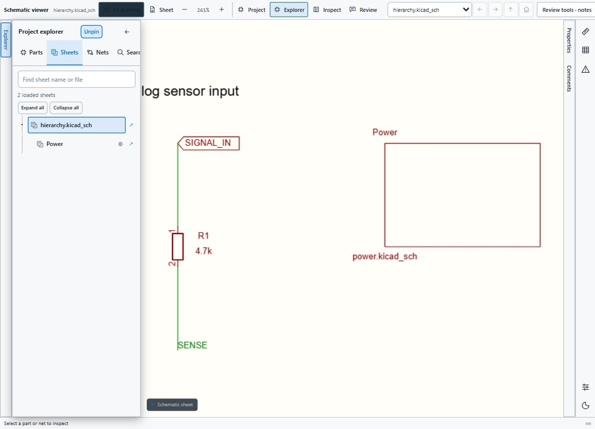

This screenshot uses a synthetic drawing and local mock transport.


Illustrated walkthroughs: [Using GitHub integration](docs/using-github-integration/README.md) · [Using GitLab integration](docs/using-gitlab-integration/README.md). Browser packages: [Firefox](docs/FIREFOX.md) · [Safari](docs/SAFARI.md).

**Status: preview release.** Source designs are read-only: no routing, schematic editing or automatic design changes. This project is not affiliated with KiCad, GitHub or GitLab. Browser-store and VS Code Marketplace listings are not published. Public previews work without login. Private GitHub and GitLab projects require an authorized extension account; GitLab credentials and previews are isolated by server. See the limitations below before relying on a view for engineering review.

Large-project loading now uses background preparation, avoids duplicate parsing, and shows a prominent staged loading indicator. See [measured performance and limits](docs/PERFORMANCE.md).

Store deployment: [Chrome Web Store and VS Code Marketplace guide](docs/STORE-PUBLISHING.md).

## Screenshots

Actual browser captures of the shared viewer, including light and dark interfaces. These were captured in a local preview harness with mocked Git transport, not on an installed extension inside GitHub. The small sensor, hierarchy, settings and model examples are synthetic fixtures; Marble uses the public board source. Click an image to inspect it at full size. [Capture details and attribution](docs/images/README.md).

| PCB layout · real Marble board | Schematic page and sheet navigator · fixture |
| --- | --- |
| [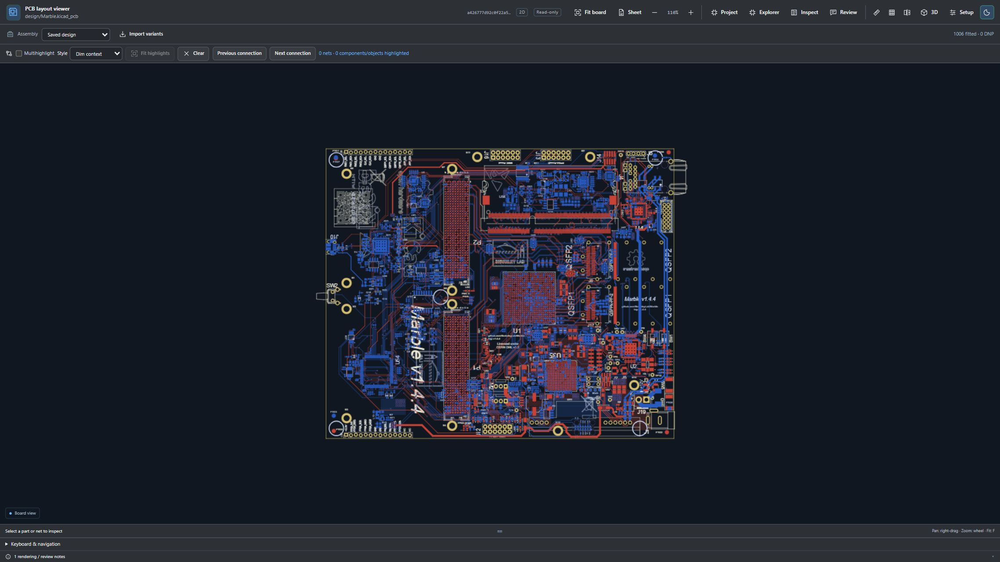](docs/images/marble-layout.jpg) | [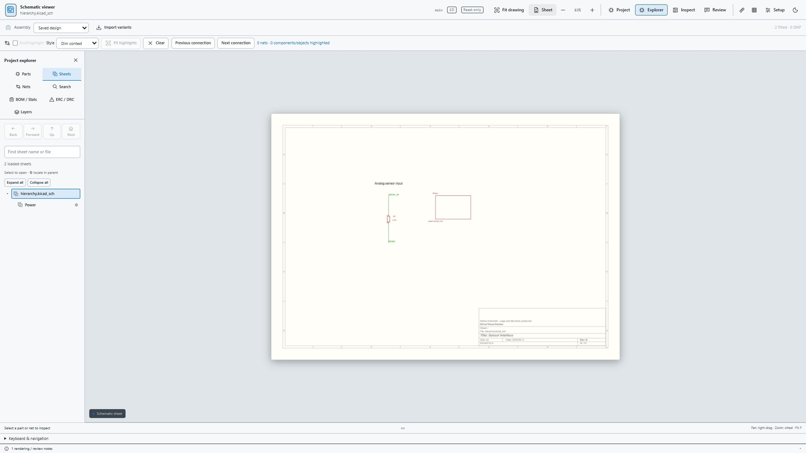](docs/images/schematic-sheets.jpg) |

| Net highlighting and connection properties | BOM and saved board analytics |
| --- | --- |
| [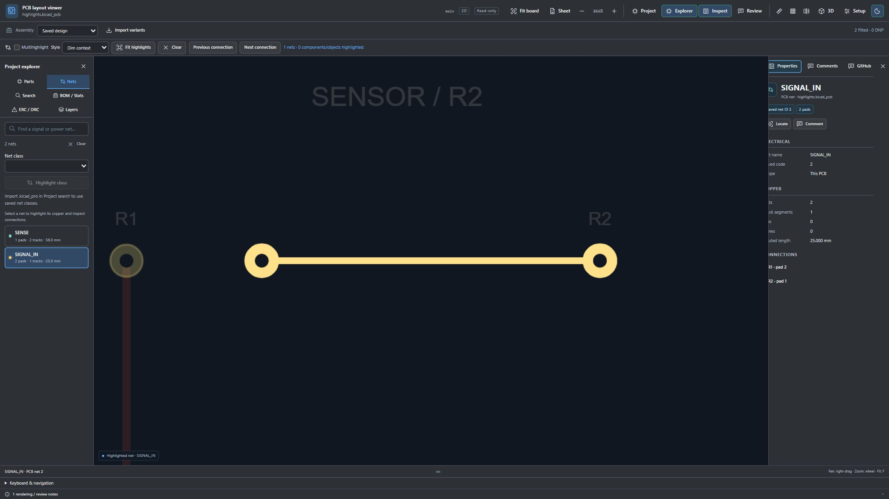](docs/images/net-highlighting.jpg) | [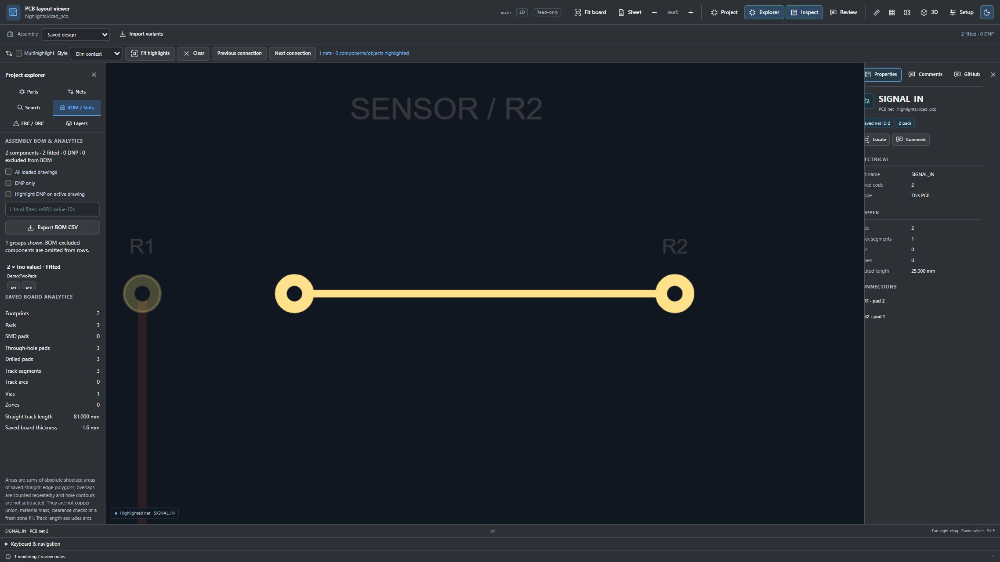](docs/images/bom-analytics.jpg) |

| Linked repository WRL model · fixture | Marble 3D · procedural component proxies |
| --- | --- |
| [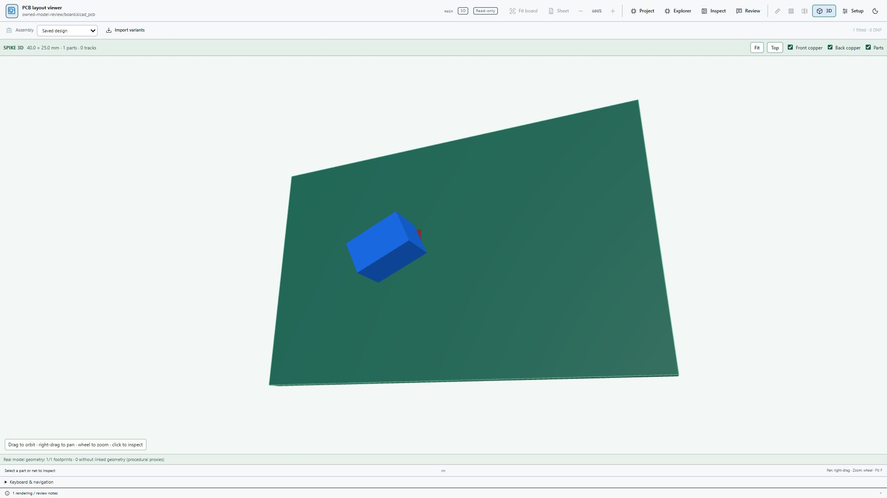](docs/images/repository-model-3d.jpg) | [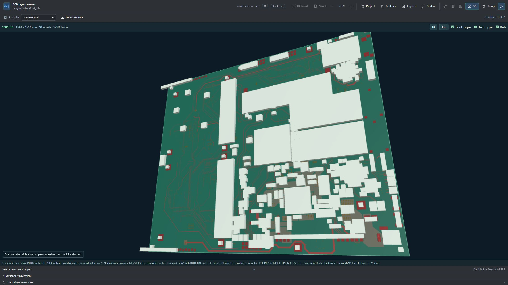](docs/images/marble-3d-proxies.jpg) |

The WRL example verifies one real linked model. Marble's STEP/CERN-library references do not resolve to supported repository assets: its pictured component bodies are **proxies**, not real component models.

| Project settings with labeled fields | Saved physical stackup |
| --- | --- |
| [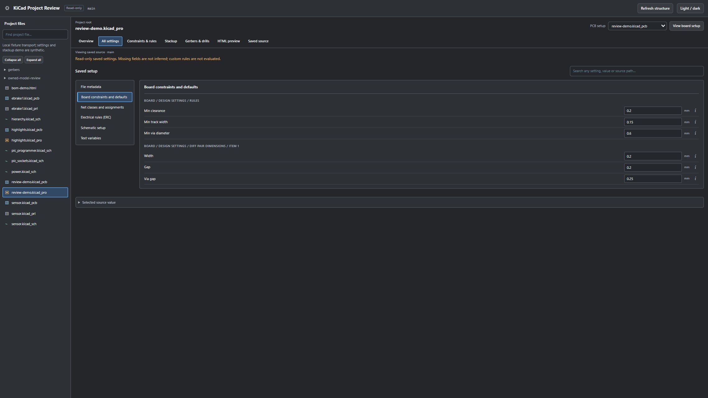](docs/images/project-settings.jpg) | [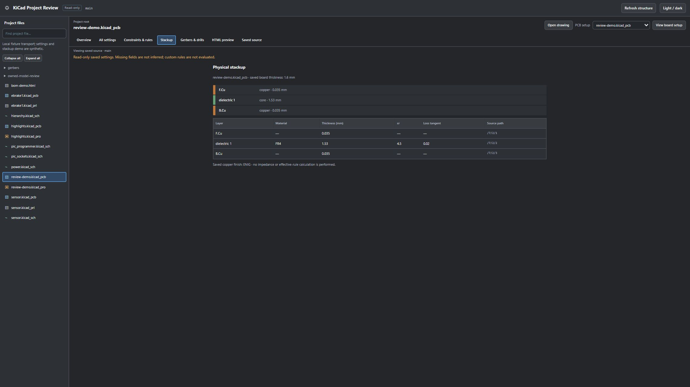](docs/images/project-stackup.jpg) |

| GitHub Issues and Discussions integration | Comment editor with severity and tags |
| --- | --- |
| [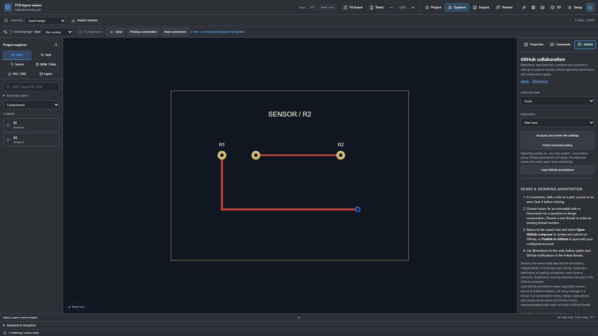](docs/images/github-collaboration.jpg) | [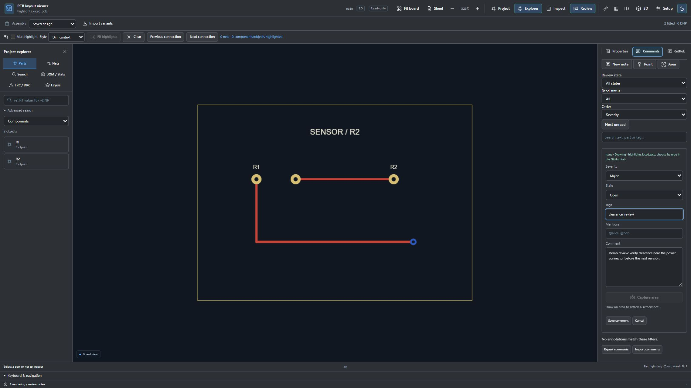](docs/images/comment-editor.jpg) |

These collaboration captures show the local UI and a mocked policy response. No GitHub issue, discussion or comment was posted for the screenshots.

**Revision comparison:** linked base/head drawings and the saved-object Changes panel, using synthetic revisions.

[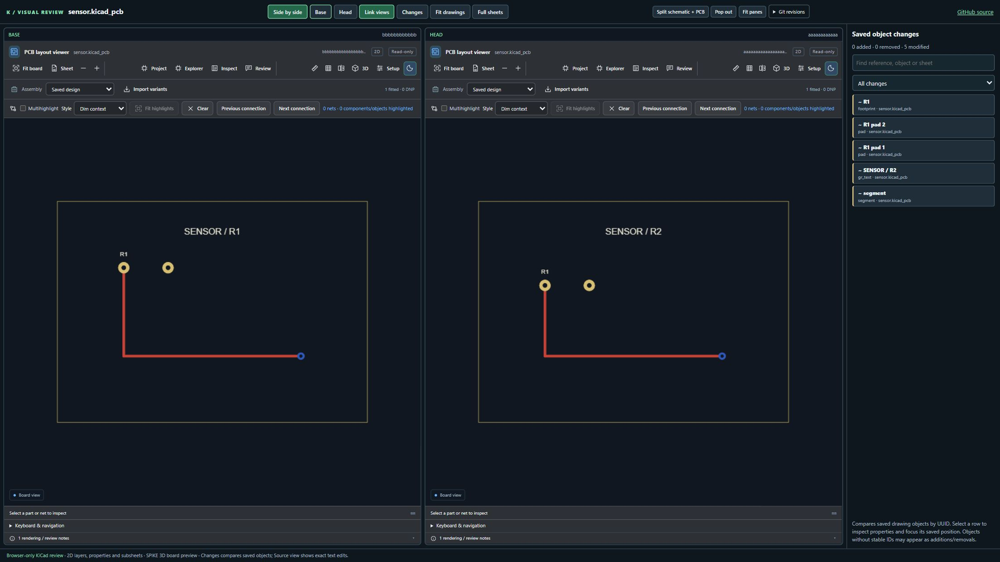](docs/images/revision-comparison.jpg)

## What you can do

| Workspace | Review capabilities |
| --- | --- |
| Schematics | Dedicated drawing viewer, paper/border/title block, parts and saved properties, loaded sheet hierarchy, Back/Forward/Up/Root navigation, sheet selection and double-click navigation |
| PCB layouts | Copper, pads, tracks, vias and saved filled zones; layer visibility and focus; board flip; independent light/dark UI and drawing themes; part and net inspection |
| Search and highlighting | Project search with field filters, wildcard and bounded regex queries; single or multiple component/net/net-class highlights; connection navigation and fit highlights |
| Measurement | Live distance, X/Y and angle display; mm/mil units; geometry/grid snapping; pinned measurements; saved Edge.Cuts bounding dimensions |
| Comparison | Select branches or commits; inspect added, removed and modified saved objects and before/after properties; linked base/head camera views; GitHub pull-request file previews including public fork heads |
| Review notes | Part, point and rectangular area anchors; severity, tags, mentions, timestamps, read/unread state, Open/Skipped/Resolved/Won't fix triage; optional visible 2D area captures |
| Project inspection | Compact project tree; saved project settings, constraints, net classes, layer details and physical stackup where present; read-only forms and tables |
| Fabrication | Browser Gerber/drill viewer with disclosed unsupported constructs; file selection and layer review |
| Assembly and analytics | BOM/Stats, JSON/CSV assembly variants, fitted/DNP counts and highlights, component navigation, saved board/zone/copper statistics |
| 3D | SPIKE board preview, source footprint/model transforms and repository-linked WRL/VRML or self-contained GLB assets; missing models have procedural proxies |
| HTML/iBOM | Isolated preview for self-contained HTML; interactive browser preview has no network or extension bridge; VS Code uses a static preview |

Properties and analytics come from the saved source revision. Missing settings are not fabricated. Imported ERC/DRC JSON reports provide visual markers and navigation; the browser does not run KiCad's ERC or DRC engine.

## Install in Chrome or Edge

1. Download **`kicad-visual-review-chrome-edge-brave-opera-vivaldi-chromium-0.12.28.zip`** from [Releases](https://github.com/wayri/KiCad-Github-View/releases/tag/v0.12.28). The GitHub **Source code** archives are not the prepared extension package.
2. Extract the ZIP into a permanent folder. Select the folder containing `manifest.json`, not the ZIP itself.
3. Open `chrome://extensions` in Chrome/Chromium or `edge://extensions` in Edge.
4. Enable **Developer mode**, select **Load unpacked**, and choose that folder.
5. Allow the extension on `github.com` and `gitlab.com`. Open a KiCad file page and refresh it. Connect an authorized account in Options for private projects. The drawing appears in the repository's file preview.

Keep the extracted folder in place. To update, extract the new package there, click **Reload** on the extension card, and refresh repository tabs. Pin the toolbar icon for quick access; the toolbar button or `Alt+Shift+K` focuses the inline viewer. **Show source** returns to the text view; **Open full viewer** and **Pop out** provide larger views.

The drawing toolbar contains the active sheet selector, Back/Forward/Up/Root navigation and **View layout / View schematic**. **Review tools** holds assembly variants, highlight controls, shortcuts and rendering notes. Properties, Comments and Explorer are independent flyouts: collapse them from their headers, drag their edges to resize, or focus an edge and use the arrow keys. Comments has **Add comment** and **View comments** tabs; switching tabs preserves an unsaved draft.

Project drawing previews now open in focused mode by default, hiding the outer project tree and setup headers. **Show project controls** brings them back without reloading the drawing or losing a draft; **Close preview** returns to the project. A local 1707 × 960 check measured 80.3% unobscured drawing across the complete project viewer with a Comments panel open; at that height, the toolbar switches between Properties and Comments to keep the active panel usable. This used the actual renderer with mocked transport.

Explorer, Properties and Comments use side tabs with **Pin / Unpin** and collapse arrows. Hover or click a side tab to reveal its full-height pane. Unpinned panes auto-hide after leaving or when interacting with the drawing; focused inputs and resizing remain accessible. Pin one or several panes to keep them beside the drawing. Properties and Comments share the right dock vertically when both are pinned. Width resizing and unsaved drafts are retained; pin choices last for the mounted viewer session.


Auto-hidden panes leave the drawing area available apart from narrow side tabs and tools. Pinning reserves readable side space, with at least 35% of available dock width retained for the drawing when several panes are pinned. **Focus view** hides the docks. This replaces the former small-panel area budget and Expand/Tall modes.

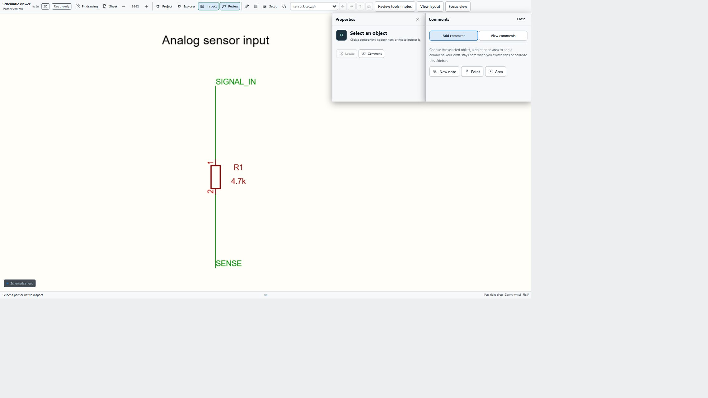

Chrome's unpacked workflow is documented in [Chrome's developer guide](https://developer.chrome.com/docs/extensions/get-started/tutorial/hello-world#load-unpacked); Edge provides [its sideloading guide](https://learn.microsoft.com/en-us/microsoft-edge/extensions/getting-started/extension-sideloading). Managed browsers may prohibit developer installations. There is no signed CRX or automatic browser-store update channel in this release.

See [the full installation guide](docs/INSTALL.md) for Brave, other Chromium browsers, updates, troubleshooting, checksums and VS Code.

## Browser compatibility

| Browser/platform | Current status |
| --- | --- |
| Desktop Chrome / Chromium | Primary Manifest V3 target; unpacked release package |
| Desktop Microsoft Edge | Same Chromium package and Load unpacked workflow; separate installed-browser acceptance remains necessary |
| Desktop Brave | Chromium candidate using the same package; not independently verified |
| Other desktop Chromium browsers, including Opera/Vivaldi | May load the same package if their extension manager supports Manifest V3 and required APIs; browser-specific smoke testing is pending |
| Firefox 128+ | Unsigned development ZIP with event-page runtime; temporary installation, installed-browser acceptance pending |
| Safari 16.4+ on macOS | Development payload and Apple conversion helper; Mac build, signing and installed-browser acceptance pending |
| Mobile browsers | Not supported by this release |
| VS Code Desktop | Separate VSIX using the shared read-only viewer |
| github.dev / VS Code web hosts | Web entry point exists; actual hosted installation and filesystem behavior need separate validation |

Use each browser's dedicated package: [Firefox installation](docs/FIREFOX.md) and [Safari conversion and installation](docs/SAFARI.md). Firefox offers static repository HTML; Safari disables that preview. Interactive iBOM remains a Chromium feature. Firefox and Safari use review JSON import/export instead of automatic selected-file writes. These development packages are not signed store releases; packaging tests do not establish installed-browser acceptance.

## Git service compatibility

| Service | Inline file drawings | Revision comparison | Remote review integration |
| --- | --- | --- | --- |
| GitHub.com, public and authorized private repositories | Schematic/PCB and project file previews; pull-request file cards | Branch/commit picker and PR merge-base comparisons | Explicit issue/discussion/PR publication with configured authentication; Issue/PR and selected Discussion marker readback |
| GitLab.com, public and private projects | File pages, including subgroup namespaces; private access needs account connection | Branch/commit picker | Explicit new issues, issue notes and issue discussions; marker readback on a selected issue |
| Self-hosted GitLab, explicitly granted HTTPS origins | Same GitLab adapter; server must be hosted at its origin root | Branch/commit picker | Per-server credentials and Issue/issue-discussion publication |
| GitHub Enterprise | Not implemented | Not implemented in browser | Not implemented |
| Bitbucket / Azure DevOps / Gitea / Forgejo | Not implemented | Not implemented in browser | Not implemented |
| Any service checked out locally in VS Code | Saved workspace files are host-independent | No native VS Code revision comparison yet | Local Git-trackable review sidecar; no direct publication |

GitLab account connection, private project reads and issue publication are supported. Self-hosted GitLab requires an explicit browser permission grant in Options. v0.12.10 adds an inline changed-drawing selector on current merge-request Changes pages, including fork comparisons. Historical merge-request diff versions and GitLab served beneath a URL subpath remain unsupported. The extension grants permissions only to its supported hosts; it does not send GitHub credentials to GitLab. See [host compatibility and adapter boundaries](docs/GIT-HOSTS.md).

## Using the viewer

Open a `.kicad_sch` or `.kicad_pcb` **file page**, rather than its raw download URL. Use **Explorer** to choose Parts, Sheets, Nets, Search, BOM/Stats, ERC/DRC or Layers. Click a part to inspect saved properties; inspect connected nets or choose several highlights using **Multihighlight**. **Project** opens the file structure and setup views. **Split schematic + PCB** displays a paired view with shared part/net selection where saved identities resolve uniquely.

The project manager and **Explorer → Sheets** show the same loaded schematic hierarchy, sheet names, nesting and active sheet. Other repository files stay under **Other project files**. Select a net to mark matching sheets with a gold dot; click a marked sheet or the **Matching sheets** buttons in Properties to follow that net. Opening a child sheet discovers its root and siblings within the bounded 128-candidate search. [Sheet navigation guide](docs/SHEET-NAVIGATION.md).

Useful shortcuts with the drawing focused:

| Action | Shortcut/control |
| --- | --- |
| Zoom / pan | Pointer-anchored mouse wheel / right or middle drag |
| Fit drawing / fit sheet | `F` / `Home` |
| Properties / net highlight | `E` / `H`, backtick or tilde |
| Maximize drawing area | **Focus view** / `Ctrl+Shift+F`; `Escape` restores controls |
| Search / comments | `/` / `C` |
| Measure / drawing theme | `M` / `D` |
| Enter a subsheet | Double-click the sheet symbol or select it and press `Enter` |
| Sheet history / parent / root | `Alt+Left`, `Alt+Right` / `Alt+Up` / `Alt+Home` |
| Layer focus | `[` and `]`; `Shift+F` fits focused layer; `Escape` restores visibility |

Project drawing previews fill the available space. **Hide project files**, **Focus drawing** and **Close preview** control the outer workspace; Explorer and Inspect have close buttons. The larger Sheets tree supports older `Sheet file`/`Sheet name` fields and up to 128 bounded drawing files; source links open the matching revision on its Git host. Marble's 25 unique schematics were checked using its public source and a local browser fixture.

The PCB **Ratsnest** button shows candidate connections from saved copper islands; zones and unsupported geometry can cause extra lines, so this is not native KiCad unrouted or DRC evidence. SPIKE uses WebGL for 3D; 2D uses Canvas2D with frame-coalesced pan/zoom and offscreen culling. v0.12.10 adds a bounded spatial index for large-board redraws and picking. The index preserves source draw order; text and large geometry retain conservative fallbacks. The browser build also uses WebGL to reproject an overscanned raster snapshot during pan/zoom on drawings with at least 4,096 primitives. It redraws source geometry on pointer release or after 120 ms of wheel idle; screenshots force a source redraw. This is GPU gesture compositing, not a GPU vector renderer. Snapshots are limited to 16 million pixels and the device texture size; missing/lost WebGL falls back to Canvas2D. **View and page setup → 2D acceleration** can disable it. Gerber custom rendering uses Canvas2D. Installed-browser and native-webview GPU acceptance remain pending. Linked WRL/VRML/GLB models support up to 2,048 instances within a 24 MiB asset budget, sharing downloads for repeated paths. The browser build also tessellates repository-linked STEP/STP in an interruptible WebAssembly worker (8 MiB input, 30 seconds per conversion, 500,000 vertices/triangles). Output uses millimetres. Local/global KiCad libraries still need explicit repository mappings. The pinned-source importer was rebuilt with dynamic JavaScript generation disabled and passes conversion under inherited worker CSP. The native VS Code host smoke verifies editor opening, hierarchy, review persistence and STEP asset reading; native webview 3D visual inspection and installed-browser STEP acceptance remain pending.

Text fields retain normal typing behavior. Reused hierarchy instances currently share file views; complete instance-specific connectivity is not resolved. Page setup overrides are for viewing and do not modify the source or implement arbitrary custom worksheet templates.

For detailed workflows see [search/highlights](extension/docs/search-and-highlights.md), [project/Gerbers](extension/docs/project-workspace.md), [BOM/analytics](extension/docs/bom-analytics.md), [variants](docs/variants.md), [HTML preview](extension/docs/html-preview.md) and [revision comparison](extension/docs/git-revisions.md).

## How comments integrate with Git and GitHub

Write a review in the drawing and post it directly to a **GitHub Issue or Discussion**, selected in the comment editor. A successful post creates the selected thread or adds a reply to its thread number, then saves the GitHub link with the annotation.

1. Open **Review → Comments** and create a part, point or area note. Enter your comment, severity, tags, mentions and state.
2. Choose **Issue/Discussion**, **Severity** and **State** in the three colored dropdowns. The first line of the comment is its title. Type `@` for account suggestions, and paste a screenshot directly into the text box.
3. Use **Preview GitHub Markdown** to inspect the formatted review section: comment text followed by a design-context table, exact revision/file link, object or area, severity, state, tags, mentions and timestamps.
4. The destination beside **Comment** defaults to **New issue**. Choose **Existing issue/discussion** and enter its number to reply; load a category for a new Discussion. Click **Comment**. This sends the review through GitHub's API using your connected account. Confirmed posts show a linked conversation; denied or ambiguous requests report an error and retain your draft. **Save draft** is available when you want to keep a note without posting.

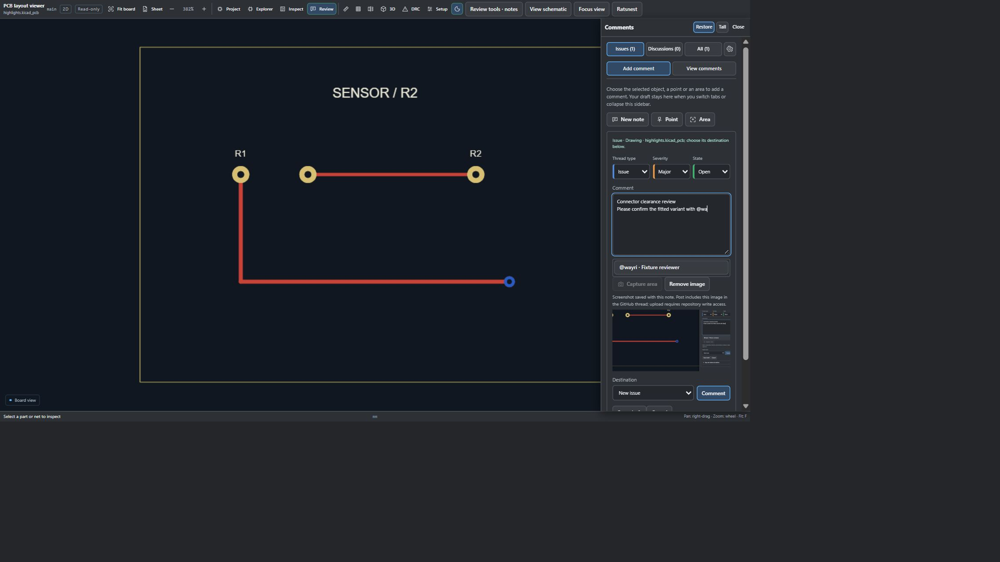

This is the actual editor with mocked transport; no remote post was made for the screenshot. In **View comments**, load an Issue or Discussion by number, or choose **View thread** on a linked note, to read ordinary messages and replies. The gear button exposes creation-date filters in UTC. Connect your account through **GitHub account**. The primary sign-in button uses the registered publisher OAuth App; [sign-in setup](docs/GITHUB-SIGNIN.md) also explains the advanced token fallback. Public and authorized private repository publication are supported, with GitHub permissions and repository policy checked. Authorized private annotation readback is supported; authorized private PR comparison is supported.

The Git-tracked `.kicad-review.json` file is an optional review record, not a prerequisite for posting. Without a connected file, confirmed links and drafts stay in browser storage. Connect/create a sidecar in a checkout to track them with Git; commit/push it with normal Git tools. Opening a drawing or choosing a destination does not post, commit or edit the design. Existing saved notes also retain **Publish to GitHub** and **Open GitHub composer** actions.

Review notes retain repository/ref/file, saved object identity or millimetre position/area, variant, creation/update times and lifecycle metadata. Changing a note to Resolved or Skipped changes review metadata; it does not close a GitHub issue or edit an earlier post. **Post to GitHub** uploads captured PNGs as repository attachments and embeds them in the selected Issue or Discussion. Upload requires repository write access with OAuth or a personal token; a failed upload keeps the draft without posting. Confirmed image URLs are retained for readback, while PNG bytes remain in the local/exported review record. GitLab publication also uploads captured PNGs and embeds the confirmed image URL. Private/internal GitLab projects must enable **Require authentication to view media files** before image publication; otherwise remove the image to post text only. Remote private image previews may additionally require signing into the GitLab website. The manual GitHub composer still requires attaching downloaded captures yourself. Mentions saved locally do not notify anyone until text is posted remotely, subject to GitHub behavior. Live image publication remains unverified.

Repository owners can provide `.kicad-review-policy.json` to restrict the extension's authenticated publication workflow. The policy is a viewer-side publishing check, not a replacement for GitHub repository permissions and not a way to prevent people posting directly on GitHub. GitLab notes remain provider- and server-isolated local/exportable records and can be explicitly published to issues or discussions within existing issues. VS Code writes a local sidecar without token publication. GitLab contributor policy fails closed when account authorship cannot be verified; use collaborators or an allowlist.

Read [the complete comment guide](docs/COMMENTS.md) for authentication, permissions, the exact policy schema, file access, conflicts, retry handling and limitations.

## VS Code installation

Download **`kicad-visual-review-vscode-0.12.32.vsix`** from Releases. In VS Code run **Extensions: Install from VSIX**, select the file and run **Developer: Reload Window**. Open a KiCad project folder and use **KiCad: Open Visual Viewer** or **Reopen Editor With → KiCad Visual Review**. The **KiCad Review** explorer lists saved drawings and review sidecars.

```sh
code --install-extension kicad-visual-review-vscode-0.12.32.vsix --force
```

Local notes use `.kicad-review.json` in the workspace root (or drawing directory outside a workspace). Filesystem-provider permissions still apply. The VSIX is not currently published in Visual Studio Marketplace. See [the VS Code guide](vscode-extension/README.md).

## Browser extension, GitHub App and local reports

| Delivery | Purpose | Requirements |
| --- | --- | --- |
| Browser extension ZIP | Embeds interactive previews directly in supported Git websites | Installed separately in each user's desktop browser |
| VS Code VSIX | Opens saved workspace files in visual custom editors | VS Code and a workspace filesystem provider |
| Optional GitHub App / hosted viewer ZIPs | Adds PR checks linking to a standalone browser viewer | App registration, HTTPS hosting and service configuration |
| Optional Python tool / GitHub Action | Produces KiCad-authored SVG and pixel-comparison HTML reports | Python 3.10+, Git and installed KiCad CLI 9+ |

A GitHub App cannot replace the built-in file preview or install the browser extension. The optional service processes signed webhook metadata; browser rendering stays client-side. No production App deployment or Marketplace billing integration is supplied. Browser GitHub sign-in has a registered public client ID; GitLab OAuth requires separate per-server/browser registration. See [the App guide](docs/github-app.md).

For local native reports:

```sh
python -m pip install -e .
kicad-vizdiff doctor
kicad-vizdiff view hardware/controller.kicad_sch --open
kicad-vizdiff diff hardware/controller.kicad_pcb --base main --head HEAD --open
kicad-vizdiff review --base main --head feature --merge-base --output kicad-review
```

Pass the root schematic to include child sheets. The native report supports side-by-side, overlay, swipe and changed-pixel views; these should not be confused with the browser extension's saved-object comparison. [`action.yml`](action.yml) and [the example PR workflow](.github/workflows/visual-review.yml) provide optional runner-based reports.

See [the Actions review guide](docs/actions-review.md) for merge-base comparisons, renamed/deleted drawings, revision evidence and downloading reports. [Original sample designs](examples/sensor/README.md) provide a schematic hierarchy and PCB for trying the viewers.

## Rendering and engineering limits

Recognized KiCad 9/10 saved constructs use the shared parser; native reference fixtures were exported with KiCad 10. Future generator versions, including KiCad 11 headers, are accepted as **forward previews** with warnings; this is not full KiCad 11 certification. See [version handling](extension/docs/version-compatibility.md).

The browser viewer is not pixel-identical to KiCad. Browser font metrics, custom worksheets, bitmap images and specialized constructs remain incomplete or approximate and should be checked against native KiCad. Nets are inferred from saved geometry; buses, implicit pins and complete cross-sheet/instance connectivity are not fully resolved. Saved-object comparison is not an electrical equivalence check.

3D loads repository-linked supported assets, not installed KiCad model libraries. Browser STEP support is a development preview; native VS Code STEP remains unverified. Missing models have proxies; GLB coordinates currently use millimetres. Gerber macros, curved regions, step-repeat and drill slots have documented limits. Copper/zone analytics are saved polygon sums, not a validated physical union or manufacturing sign-off. Retrieval, search, reports and annotation storage are bounded; API rate limits and omitted data are disclosed.

## Build, verify and release

Python 3.10+, Node 22+ and Git are required for packaging/tests. KiCad is optional except for native-reference checks.

```sh
python -m pip install '.[github]'
python scripts/release.py --output dist/release
```

The release gate prepares shared VS Code assets, runs Python and JavaScript tests, audits ZIP/VSIX inventories and writes `release-manifest.json` plus `SHA256SUMS.txt`. Each release identifies its source commit. Automated tests and local browser fixtures do not substitute for live browser-store acceptance or testing every browser/service combination.

To publish a new version, update both manifests and release documentation, commit, create the matching version tag and push it. The tag workflow builds verified assets and publishes a prerelease. See [release instructions](docs/RELEASING.md) and [CI details](docs/release-ci.md). Ordinary code pushes run CI without publishing.

## Licensing and support

Owner: Yawar ([wayri](https://github.com/wayri)). **No blanket open-source license is granted.** The owner plans a commercial integration and a separately licensed open-source GUI engine later. Public source availability does not assign that future license. See [LICENSING.md](LICENSING.md) and [THIRD-PARTY-NOTICES.md](THIRD-PARTY-NOTICES.md).

Report reproducible problems through [repository Issues](https://github.com/wayri/KiCad-Github-View/issues), including browser/version, public file URL or a shareable minimal fixture, expected behavior and the visible diagnostic. Exclude tokens, private files and credentials. Design/rendering limitations, Git host ports and browser ports can also be discussed there.

## Engineering limits

This is an experimental, read-only engineering review tool supplied without a claim of complete KiCad fidelity, electrical correctness, manufacturability or fitness for a particular purpose. Check the saved design in native KiCad and perform appropriate engineering verification before fabrication or safety-critical use. Visual differences, inferred nets, measurements, imported rule reports and 3D proxies are review aids, not design sign-off. Unsupported constructs and missing assets can affect what is visible.


Authentication, repository permissions and service availability remain subject to GitHub/GitLab and the user's configuration. Local review state does not automatically synchronize with remote threads. Public source availability does not grant a blanket open-source license. No affiliation, endorsement, certification or warranty from KiCad, CERN, Berkeley Lab, GitHub, GitLab or OpenAI is implied.

## Acknowledgements

- The KiCad project and contributors provide the file-format documentation and native tools used for reference checks; this extension implements its own browser renderer.
- Yawar's SPIKE engine supplies owner-authorized browser PCB geometry/3D integration; its provenance is recorded in [the engine notice](extension/vendor/SPIKE-ENGINE-NOTICE.md).
- Three.js and its contributors provide WebGL rendering and model loaders under the MIT license, preserved in [THREE-LICENSE](extension/vendor/THREE-LICENSE).
- GitHub and GitLab provide the repository and collaboration APIs used by the extension's host adapters.
- Berkeley Lab's Marble and the White Rabbit collaboration's Switch V4 repositories provide public real-design inspection cases. Their authors retain their respective design rights; these designs are not bundled with the extension and test results do not imply endorsement.

See [third-party notices](THIRD-PARTY-NOTICES.md) for distributed dependencies and [licensing status](LICENSING.md) for owner code.

Authentication protection, encryption limits and verification status are documented in [SECURITY.md](SECURITY.md). Supported Chrome sessions retain encrypted credentials through background idle; browser restart or extension reload requires sign-in again. Other browsers also lose sessions on background restart. Uninstall does not revoke GitHub authorization.

Comment actions reveal a usable composer even in a short split pane or Focus view. The full-height pane can auto-hide or remain pinned; collapse it to return to the drawing. Type `@` directly in the comment box to suggest repository accounts, or type at least two characters to search users; select a suggestion with the mouse or arrow keys and Enter. Suggestions do not grant repository access. Paired views cross-highlight saved parts and nets, including unambiguous sheet-qualified net names; reused or ambiguous sheet instances require explicit selection.

3D stand-ins use saved fabrication outlines, then courtyard or pad bounds. They are centred on that geometry and follow front/back rotation without model offsets or guessed size padding. Closed body outlines constrain boxes internally; missing or ambiguous bounds omit the stand-in. These boxes remain approximate visual aids, not mechanical models.

Measurement labels have opaque theme-aware backplates. For a three-point angle, press **M**, choose **Angle (3 points)**, then click the first arm endpoint, vertex and second arm endpoint. The third click pins the smaller angle (0–180°); **New measurement** restarts it and **Esc** exits. Available in schematic and PCB 2D views.

## Android phone and tablet app

The [Android hybrid app](android-app/README.md) packages the same viewer
with native file and folder pickers, touch pan/pinch zoom, shared project tabs,
and local review notes. One APK adapts to phones and tablets. Build its assets
with `python scripts/package_android.py`, then build the Android project with
Gradle. Development APKs require device testing and release signing before store
publication. Android supports native GitHub and GitLab accounts, public/private project imports, self-hosted GitLab, commit comparison and explicit review publication with screenshots. Drafts stay local until published.
