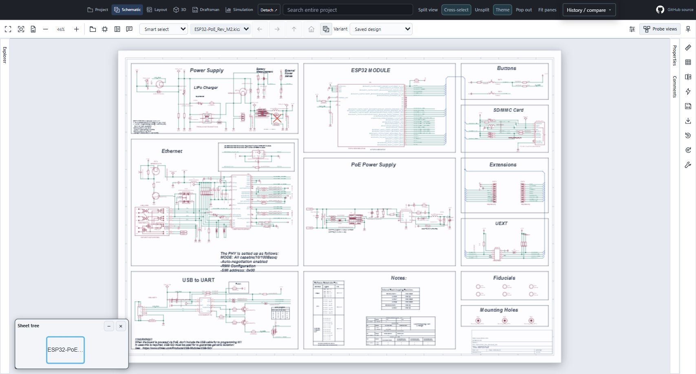
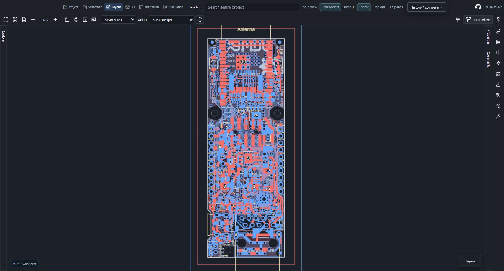
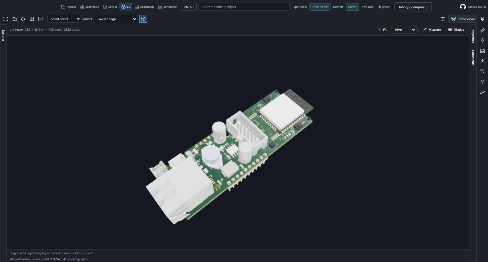
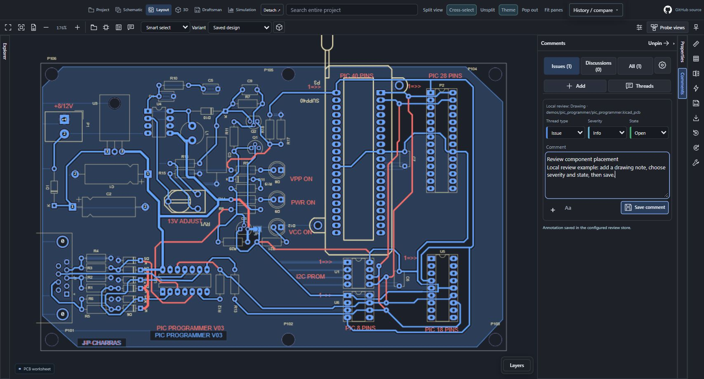
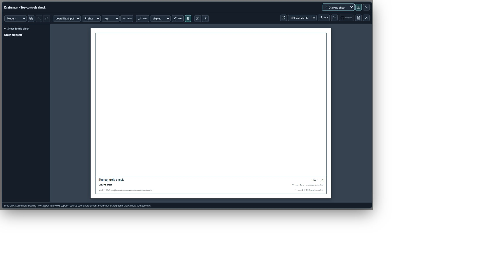

  

# KiCad Online

View schematics, PCB layouts and 3D models, follow connections across a project, and record review findings in your browser, VS Code or Android device. Ordinary viewing needs no KiCad installation or rendering server. Local projects can be used offline.

KiCad Online is an independent viewer and review tool, formerly Pocket KiView / KiCad Visual Review. It is not affiliated with or endorsed by the KiCad project.

[User guide](USER-GUIDE.md) · [Documentation](docs/README.md) · [Install](docs/INSTALL.md) · [Release notes](https://github.com/wayri/KiCad-Online/releases) · [Report an issue](https://github.com/wayri/KiCad-Online/issues)

## Downloads

| Platform | Install | Requirements |
| --- | --- | --- |
| Chrome / Chromium | [Chrome Web Store](https://chromewebstore.google.com/detail/klfdjlbngpoopegjmbajaidgodpmjaoc) | Desktop browser; [manual ZIP installation](docs/INSTALL.md#chrome--chromium--windows-linux-and-macos) is also available. Edge, Brave, Opera and Vivaldi compatibility varies. |
| VS Code | [Visual Studio Marketplace](https://marketplace.visualstudio.com/items?itemName=wayri.kicad-visual-review) | VS Code 1.95+ on Windows, Linux or macOS |
| Firefox | [Mozilla Add-ons](https://addons.mozilla.org/en-US/firefox/addon/pocket-kiview-kicad-review/) | Desktop Firefox 140+ / Android 142+ declared for 0.12.90; [Firefox installation and mobile limits](docs/FIREFOX.md) |
| Android app | [Download APK 1.92](https://github.com/wayri/KiCad-Online/releases/download/v0.12.90/pocket-kivi-android-phone-tablet-1.92-development.apk) | Android 8+; development-signed preview, manually installed and updated |
| Safari development package | [Download 0.12.85](https://github.com/wayri/KiCad-Online/releases/download/v0.12.85/kicad-visual-review-safari-0.12.85.zip) | macOS, Xcode conversion and signing; [setup and limits](docs/SAFARI.md) |

The [0.12.90 GitHub preview](https://github.com/wayri/KiCad-Online/releases/tag/v0.12.90) includes the Chromium ZIP, Firefox development ZIP, offline VSIX and matching Android 1.92 APK. [Verify downloads](docs/INSTALL.md#verify-downloads) with the release checksums. GitHub's automatic source archives are not installable packages.

Stores approve updates separately. The [dated channel status](docs/RELEASE-STATUS.md) distinguishes available downloads from pending submissions. There is no Google Play or Apple App Store release. The experimental Altium viewer is distributed separately.

## Open your first project

1. Install an edition and open a complete project folder or ZIP, including subsheets and model files.
2. Choose **Schematic**, **Layout** or **3D**. Select a part or net to inspect its fields and connections.
3. Open **Comments** to save a local finding, or explicitly send it to a supported GitHub/GitLab thread.

In the browser extension, open a repository and click the toolbar icon. One detected project opens directly; multiple projects offer a chooser. Optional in-page viewing is available. Private projects use the authorized browser session for supported reads; organization SSO and download policies still apply. A separate review account is optional for viewing. See [repository access](docs/GIT-HOSTS.md).

Local notes and assembly progress are stored separately from the design. Ordinary viewing does not edit KiCad source. Export review data to carry it between devices.

## Explore, inspect and review

| Work with | What you can do |
| --- | --- |
| Schematics | Navigate sheet hierarchy and all-sheets views, search parts and pins, and follow nets across loaded sheets. |
| PCB layouts | Inspect copper layers, highlight nets in layer colors, keep other layers visible with **Highlight layer**, and measure saved geometry. |
| 3D | Inspect supported linked models, switch to orthographic projection, select parts and nets, and open independent cross-probe windows. Missing models are identified. |
| BoM and assembly | Group and filter fields, cross-select parts, track local assembly progress, inspect variants and comment on properties or BoM fields. |
| Review comments | Save point or area notes, attach source locations, browse supported provider threads, and explicitly post replies. Supported synchronized notes can restore drawing markers. |
| Draftsman | Create drawing sheets with mechanical views, dimensions, notes and BoM tables; export PDF, SVG and editable documents, or save to an authorized repository branch. |
| Fabrication files | Inspect supported Gerber, Excellon/drill and fabrication-job data, layers and geometry summaries. |
| Reports and results | Display saved ERC/DRC findings and supported analysis exports; use circuit calculators and experimental Fast PI DC screening. |
| Revisions | Compare saved revisions and review highlighted changes. VS Code also offers explicit visual Git conflict resolution. |

[Browse the illustrated guide](USER-GUIDE.md) for controls, shortcuts and platform differences.

## See it in use

The public OLIMEX ESP32-PoE M2 example below shows the shared browser viewer. Its captured 3D view loaded 126 of 143 linked models; unresolved assets are reported. [Capture details](docs/BRAND-SCREENSHOTS-0.12.85.md).

| Schematic | Layout | 3D |
| :---: | :---: | :---: |
|  |  |  |

| Review comments | Draftsman |
| :---: | :---: |
|  |  |

These are browser captures; the comment example is a local note and the Draftsman image uses a small fixture. They do not demonstrate live posting or physical-device behavior. Explore the [screenshot gallery](docs/SCREENSHOT-GALLERY-0.12.83.md), [Marble layer-color examples](docs/QA-LAYER-HIGHLIGHTS-0.12.89.md), and [0.12.90 controls and projection examples](docs/QA-TOP-CONTROLS-0.12.90.md) for more views and their source details.

## Compatibility and limits

Recognized KiCad 8–10 constructs use the shared renderer. KiCad 4–7 and legacy schematics have restricted coverage; newer formats can produce incomplete previews. See the [format matrix](docs/KICAD-COMPATIBILITY.md).

3D realism depends on accessible, supported model assets. Missing geometry may use labelled stand-ins. Imported ERC/DRC reports and analysis files are saved results; the viewer does not run native KiCad rule checks or simulation engines. Experimental Fast PI provides fixed-temperature, single-net DC screening, not engineering sign-off. Verify important design and manufacturing decisions in the appropriate native tools.

## Documentation and support

- [Installation](docs/INSTALL.md) and [illustrated user guide](USER-GUIDE.md)
- [Comments](docs/COMMENTS.md), [Draftsman](docs/DRAFTSMAN.md) and [Fast PI](docs/FAST-PI.md)
- [Private and managed repositories](docs/GIT-HOSTS.md) and [troubleshooting](docs/VIEWER-RELIABILITY.md)
- [VS Code guide](vscode-extension/GUIDE.md) and [offline local workspace](docs/LOCAL-VIEWER.md)
- [Development](docs/DEVELOPMENT.md), [security](SECURITY.md) and [third-party notices](THIRD-PARTY-NOTICES.md)

For help, [open an issue](https://github.com/wayri/KiCad-Online/issues) or email [support.kivi@sigharmonic.com](mailto:support.kivi@sigharmonic.com). Include your version, platform, steps and a non-confidential example. Keep credentials and private designs out of public reports.

## Acknowledgements

Thanks to the KiCad developers and community, and to the maintainers and contributors of **Three.js, PDF.js, fzstd, Open CASCADE Technology, occt-import-js and Emscripten**, whose work supports this viewer.

Our public board demos use **[OLIMEX ESP32-PoE](https://github.com/OLIMEX/ESP32-POE)**, **[Berkeley Lab Marble](https://github.com/BerkeleyLab/Marble)**, **[Ttl/FMCW3](https://github.com/Ttl/fmcw3)** and the **[KiCad PIC Programmer demo](https://github.com/KiCad/kicad-source-mirror/tree/29798a640054e91411a44d230bd3a3425b3166e4/demos/pic_programmer)**. Thank you to their authors and contributors, and everyone who tests KiCad Online, reports issues or suggests improvements. See [demo board credits and recorded source revisions](docs/DEMO-BOARD-CREDITS.md); upstream design and model licenses remain applicable.

Dependency licenses, copyright notices and source information are retained in [Third-party notices](THIRD-PARTY-NOTICES.md) and the accompanying packages. These acknowledgements do not imply affiliation, sponsorship or endorsement.

## License and support

Copyright (c) 2026 **Yawar B (wayri)**. Licensed under the [KiCad Online Source-Available License 1.0](LICENSE), **not an OSI-approved open-source license**. Personal and internal professional use are permitted. Paid distribution, paid bundles and monetized hosted access require written permission. Your designs and outputs remain yours under the license. [Licensing details](LICENSING.md) | [Third-party notices](THIRD-PARTY-NOTICES.md).

Support and commercial licensing: **[support.kivi@sigharmonic.com](mailto:support.kivi@sigharmonic.com)**. Optional sponsorship does not unlock app features. This independent project is not affiliated with or endorsed by KiCad, GitHub, GitLab, Google, Apple or Microsoft.
