# Pocket KiView illustrated user guide

Firefox and Firefox derivatives have a separate [installation, signing and Mozilla deployment guide](docs/FIREFOX.md), including Zen, LibreWolf and Waterfox compatibility limits. The current unsigned Firefox ZIP is temporary; Firefox Android extension acceptance is pending.

Open saved KiCad projects, inspect schematics and layouts, and record review or assembly findings without a KiCad installation. Design sources are read-only during ordinary viewing. Review notes, assembly progress and variants are separate data; the VS Code conflict resolver is an explicit exception that can write a resolved drawing after confirmation.

This guide covers browser extension **0.12.72**, VS Code **0.12.70+**, and Android **1.72**. Draftsman refinements marked **0.12.70** require that build (Android 1.72); a store may still offer an earlier version. This guide distinguishes shared drawing tools from host-specific pages and account features.

Start with the [installation guide](docs/INSTALL.md) for Android, Windows, Linux and macOS. Check the [KiCad compatibility matrix](docs/KICAD-COMPATIBILITY.md) before reviewing a new file format. Recognized KiCad 8, 9 and 10 constructs use the shared viewer; coverage is narrower for 8/9, and newer constructs may display warnings or incomplete previews.


[Download packages](README.md#downloads) | [Published releases](https://github.com/wayri/KiCad-Github-View/releases) | [Support](mailto:support.kivi@sigharmonic.com)

## Your first five minutes

1. **Open the complete project:** import a folder/ZIP on Android or in the browser, or open its folder in VS Code. Include subsheets and model files.
2. **Choose Schematic or Layout:** use the sheet tree and search to find a part or net. Select it to inspect or highlight matching saved objects.
3. **Open 3D if needed:** accessible linked models improve realism; inspect missing-model warnings before relying on the preview.
4. **Record a review:** open Comments, write the finding, attach a drawing location and review its Issue/Discussion destination before sending. A local draft does not post to a provider.
5. **Keep the result:** save an offline copy on Android, export review metadata, or create a [Draftsman sheet](#9-create-draftsman-documentation). Ordinary viewing does not save changes to the KiCad source.

On a phone, collapse panels to recover drawing space. Use the panel's close/back control when finished; long-press drawing objects for context actions and controls for available tooltips. See [platform-specific installation](docs/INSTALL.md) before your first run.

## Find your workflow

- [Install and open a project](#1-open-a-project): Android, Chrome or VS Code.
- [Navigate, select and inspect](#2-navigate-and-inspect-drawings): sheets, PCB layers, nets and 3D.
- [Measure and find testpoints](#3-measure-probe-and-review-board-data): analytics and imported ERC/DRC.
- [Work through a BoM](#4-use-the-bom-field-table): grouping, variants, assembly and resets.
- [Open Gerber, PDF and simulation results](#5-open-fabrication-files-documents-and-results): calculators and WayriCAD exports.
- [Comment, inspect photos and transfer reviews](#6-record-share-and-transfer-a-review).
- [Resolve a local Git conflict](#7-resolve-a-git-conflict-in-vs-code).
- [Use Git history, focus controls and loader cancellation](#8-workspace-git-and-conversation-controls).
- [Create and export Draftsman sheets](#9-create-draftsman-documentation).
- [Troubleshoot a problem](#10-troubleshooting-and-support).

## Which edition does what?

| Capability | Android | Chrome / Chromium extension | VS Code extension |
| --- | --- | --- | --- |
| Saved KiCad schematic and PCB inspection | Yes | Yes | Yes |
| Sheet hierarchy, all-sheets overview, parts/nets/layers | Yes | Yes | Yes |
| Supported project-linked 3D models | Yes | Yes | Yes, workspace assets |
| Paired schematic / PCB cross-probing | Project views | Parallel views | Paired editors |
| 2D measurement, testpoints, saved board analytics | Yes | Yes | Yes |
| Imported ERC/DRC markers and saved settings | Yes | Yes | Yes; does not run native checks |
| Drawing BoM field grid, grouping, variants, DNP and assembly | Yes | Yes | Yes |
| Standalone BoM / iBOM / BoM Studio import page | Yes | Yes | Not included |
| Gerber and Excellon inspection | Standalone viewer/analyzer | Standalone viewer/analyzer | Inline inspection; no standalone analyzer |
| Standalone PDF viewer | Yes | Yes | Not included |
| Saved simulation plots and spatial result overlays | Yes | Yes | Standalone results page not included |
| Interactive circuit calculator page | Yes | Yes | Standalone page not included |
| Photo alignment and population-review workflow | Yes; camera support depends on device | Photo import/capture where available | Dedicated workflow not advertised |
| Local review notes and portable review transfer | Yes | Yes | Yes; notes also use a workspace sidecar |
| GitHub / GitLab conversations and explicit publication | Connected app account | Connected extension account | Trusted matching local Git checkout and account |
| Repository tree and commit graph | Connected repository | Repository viewer | Local Git provider; native Git for pinned saved files |
| Resolve marker-based Git conflicts visually | Not included | Revision comparison; no source conflict resolver | Yes; local files, whole-side selection |
| Project walkthroughs and captured-slide HTML export | Yes | Not advertised | Not included |
| Offline local viewing | Imported/saved project copy | Installed extension and local import | Local workspace |
| Inline GitHub / GitLab website previews | Use repository import | Yes | Use local checkout instead |

**Screenshots:** retained captures from several development versions, not a promise of identical current button placement. Installed Chrome/VS Code and physical Android captures are identified below. Other tool examples use local fixtures or preview harnesses; they do not prove live account posting, physical-photo accuracy or complete CAD fidelity. [Capture provenance](docs/images/README.md) and [VS Code capture sources](vscode-extension/images/SCREENSHOT-SOURCES.md).

## 1. Open a project

### Android

1. Download the **Android APK** using the [README download button](README.md#downloads).
2. Open it on your phone, permit installation from your chosen download app if Android asks, then install. This is a development-signed preview with manual updates, not a Google Play install. Keep the same signing channel; do not uninstall just to bypass a signature mismatch.
3. Launch **Pocket KiView** and open your project using the steps below.

<table>
<tr><th>PCB layout on a physical Samsung phone</th><th>Schematic on a physical phone</th></tr>
<tr><td align="center"><a href="docs/images/android/marble-phone-layout.png">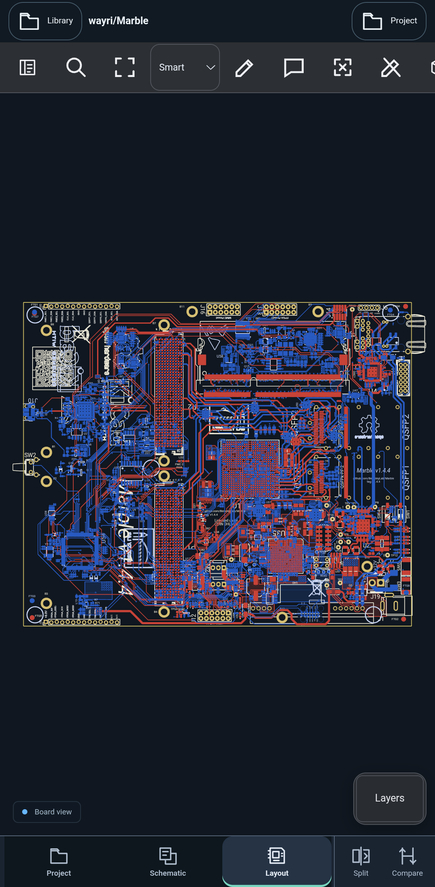</a></td><td align="center"><a href="docs/images/android/phone-schematic.png">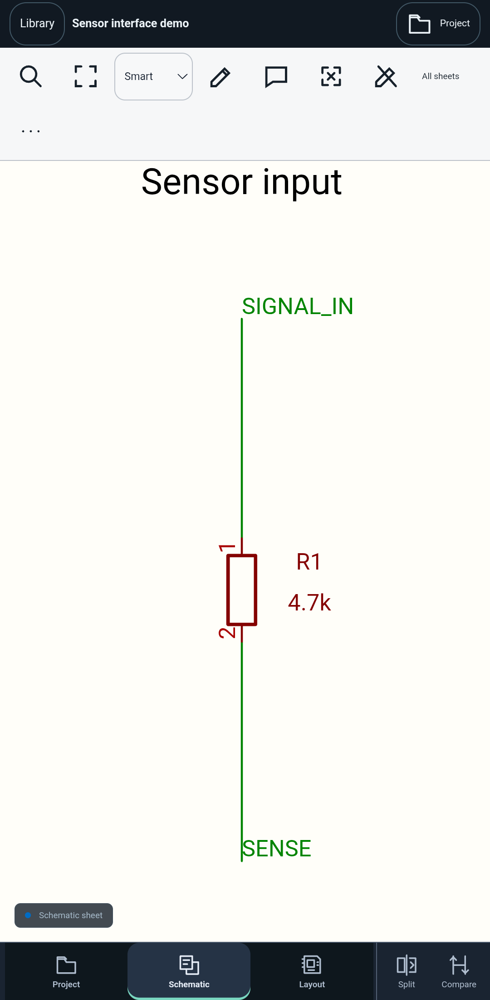</a></td></tr>
</table>

**Load your files:**

1. Choose **Open a file** for a drawing or project ZIP, or use the Android document picker for an available storage provider.
2. Prefer a complete project ZIP when the design includes subsheets, libraries or component models. Selecting one drawing does not grant access to its sibling files.
3. For a repository, use the GitHub or GitLab import controls. Public projects can be read without a connected account; private projects need authorized access through the app's account connection.
4. Use **Menu → Your projects → Save offline** to retain the loaded revision. Reopen it from **Offline** without a network connection. Save offline again after importing a newer revision; stored copies do not refresh automatically.

Offline copies belong to the app and disappear when app data is cleared or the app is uninstalled. **Export project ZIP** creates a separate, unencrypted file containing supported source/model files, without review metadata or credentials. Back up review state separately. See the [Android guide](android-app/README.md).

### Chromium browser extension

1. Download the **Chromium ZIP** from the [README downloads](README.md#downloads) and extract it to a permanent folder.
2. Open `chrome://extensions` (or `edge://extensions`), enable **Developer mode**, choose **Load unpacked**, and select the folder containing `manifest.json`.
3. Pin the extension if desired. Reload existing repository pages after installing or updating it. For future manual updates, replace the unpacked folder contents and select **Reload** on the extension card.

This desktop route works on Windows, Linux and macOS. Other Chromium browsers have differing validation coverage. Android Chrome does not support this installation route; use the Android app there.

| Schematic in the installed Chrome extension | PCB in the installed Chrome extension |
| --- | --- |
| 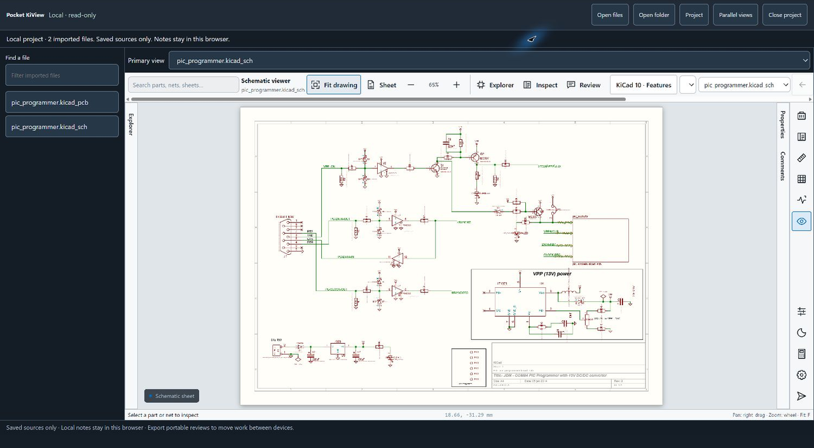 | 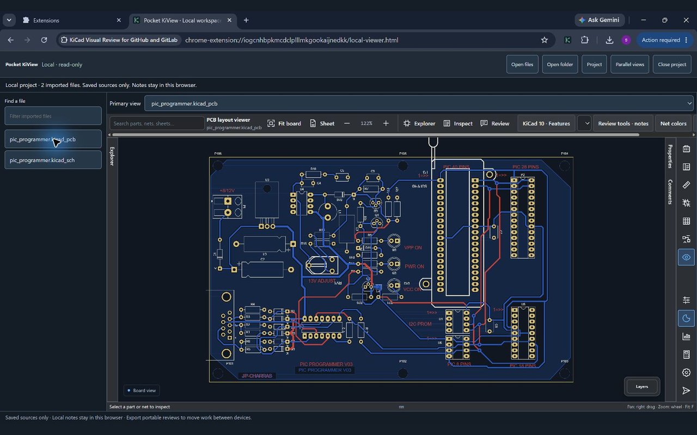 |

These installed-extension captures use the public KiCad PIC Programmer demo opened locally.

Open extension Options and choose **Open local KiCad workspace**. Use **Open files**, **Open folder**, or drag files/a folder into the workspace. Folder import preserves relative paths so subsheets and models can be found. If directory dragging is unsupported, use **Open folder**. Local imports stay on your computer and can be viewed offline after installing the extension.

Enable **Parallel views** and choose a drawing for each pane to inspect schematic and PCB together. Matching saved part/net identities support cross-probing. Reimport browser-picked files after changing them externally: the viewer holds a saved snapshot. The optional loopback launcher has a separate **Reload saved project** action. See [local browser workspace](docs/LOCAL-VIEWER.md).

In browser build **0.12.72**, click the extension toolbar icon on a GitHub or approved GitLab repository. The extension opens a new viewer tab: a single detected project opens directly; multiple projects appear in a chooser. No result shows **No KiCad project detected**. Permission/policy failures show an error, not an empty-project claim. Repository, file and pull-request pages keep their native content: no automatic viewer or detection banner is injected. Refresh existing repository tabs after updating. On non-repository pages the same tab offers local files, recent projects and settings.

For online review, open a supported GitHub/GitLab repository file page. Allow the extension access to the intended host. Private browser-session reads have provider-specific limits; publishing remote reviews requires a connected account and permissions. See [Git hosts and accounts](docs/GIT-HOSTS.md) and [GitHub sign-in](docs/GITHUB-SIGNIN.md).

### VS Code

Install **KiCad Visual Review**, publisher **wayri**, from the [VS Code Marketplace](https://marketplace.visualstudio.com/items?itemName=wayri.kicad-visual-review). VS Code 1.95+ is required; Windows, Linux and macOS are supported. For offline installation, download the release `.vsix`, run **Extensions: Install from VSIX…**, then reload the window if prompted.

| Open the visual editor | Inspect a board inside VS Code |
| --- | --- |
| 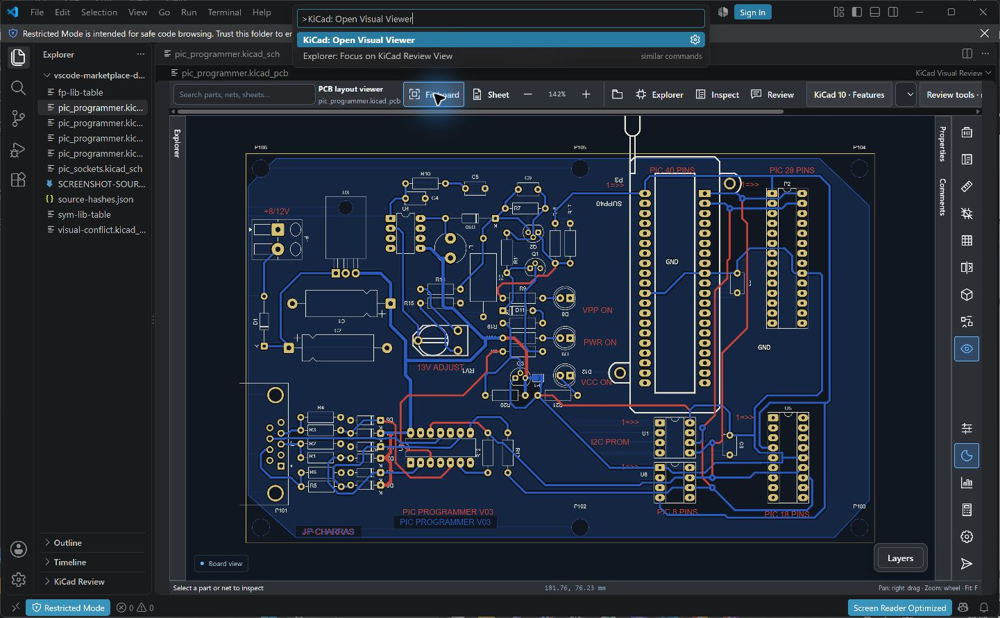 | 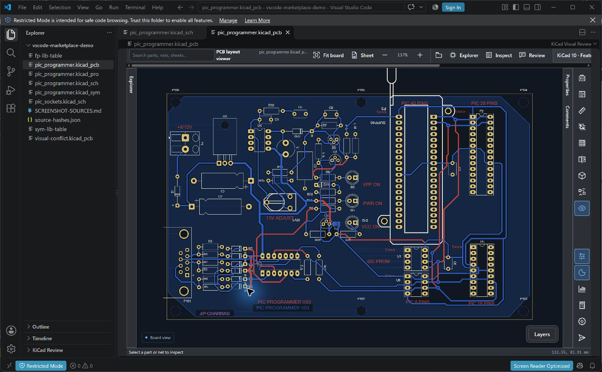 |

1. Open the folder containing the project.
2. Select a `.kicad_sch` or `.kicad_pcb`. If it opens as text, choose **Open With… → KiCad Visual Review**, or run **KiCad: Open Visual Viewer** from the Command Palette.
3. Use the **KiCad Review** Explorer section to change drawings. Run **KiCad: Open Paired Schematic and PCB Review** for a companion editor.
4. Close and reopen a drawing after external edits. Run **KiCad: Refresh Review Navigator** after adding project files.

Desktop local-file review works offline. Web extension hosts depend on the files and permissions supplied by their workspace provider. See the [VS Code guide](vscode-extension/GUIDE.md).

### Phone, tablet and desktop controls

Pan and zoom the drawing with touch gestures or the desktop camera controls. On Android, long-press an object for its context menu, then choose **Properties/Inspect** when needed. Ordinary cross-selection highlights matching objects rather than requiring the Properties panel to open. Use the sidebar/tool-rail toggle and **Focus view** to recover drawing area. Back returns from full-page tools; it is separate from reimporting a project. Respect loading and unsaved-draft warnings.

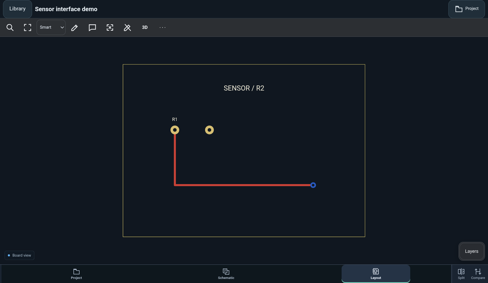

The tablet capture is a retained responsive/device preview; use the physical-phone captures above for on-device examples. Foldables adapt to the available window size; a screenshot does not certify every hinge or cutout configuration.

### Optional local browser launcher

To keep a browser viewer beside KiCad, use the extension's local folder picker, or use the optional source launcher with Python 3.10+ from the repository root:

```sh
python -m kicad_vizdiff.local_viewer --project "/path/to/your/project"
```

On Windows, `py` can replace `python`; on Linux/macOS it is commonly `python3`. Open the printed loopback address, keep the process running and use **Reload saved project** after saving external edits. Stop the server with **Ctrl+C**. Saved-file viewing needs no KiCad installation or internet connection; it does not synchronize unsaved editor changes. [Complete launcher instructions](docs/LOCAL-VIEWER.md).

## 2. Navigate and inspect drawings

- Search for a reference, value or net; use **Explorer** for parts, nets and layers, and **Inspect** for saved properties.
- In schematics, open a child sheet and return to its parent with sheet navigation. **All sheets** provides a project-wide overview when the required sheets are available. See [sheet navigation](docs/SHEET-NAVIGATION.md).
- In layouts, toggle layers, flip the board, or focus a copper layer. Show/hide side panels to regain canvas space on a phone.
- Select a part or net to highlight matching saved geometry. Paired views can follow matching selections; ambiguous or incomplete identities limit cross-probing.
- Enable **Net names** in Layers for labels on supported straight tracks and filled copper polygons. Labels depend on visible layers, saved net data and available space. They are display overlays, not connectivity changes. See [copper net names](docs/copper-net-names.md).
- Open 3D for board geometry and available supported models. Import models with the project; missing external libraries or unresolved paths are not supplied merely by installing KiCad. The VS Code guide lists workspace model formats and limits.

### Saved project settings and themes

Open **Project settings / Board setup** to inspect the saved configuration, stackup, layer properties, constraints and available rule tables. These are saved-data views; they do not replace KiCad's board-settings editor or run its rules engine. Review rules that the parser reports as unsupported in native KiCad.

Choose the available interface/drawing theme or KiCad-style preset in settings. Interface theme, drawing colors and PCB layer palette are separate controls. Use layer visibility, filled-copper/zone-outline toggles and imported ERC/DRC show/hide controls to simplify the active drawing. Layer colors default to the KiCad palette described in section 8.

| Saved setup and constraints | Saved stackup |
| --- | --- |
|  |  |

These captures use synthetic saved project data; they illustrate inspection rather than native settings editing.

### View models in 3D

1. Import the project with its referenced model files and select **3D** from Layout tools.
2. Orbit/zoom to inspect the board and select a part to correlate it with the saved layout identity.
3. Inspect missing-model diagnostics. Supply supported relative WRL/VRML, GLB or STEP/STP files with the project. VS Code restricts models to accessible workspace paths and documented byte/request limits.
4. Distinguish real loaded models from any labelled procedural fallback bodies. Neither a proxy nor an unresolved model proves the physical package.


This local fixture loads one repository-relative cuboid WRL model. General embedded-file assets, arbitrary library variables and model paths outside the granted project are not promised. [File compatibility and unsupported constructs](docs/KICAD-COMPATIBILITY.md).

Rendering warnings matter: a visible preview is not proof that every source construct was interpreted.

## 3. Measure, probe and review board data

Choose **Measure** in a PCB drawing, then select two points for a distance. Measurement options include angle, geometry/grid snapping, units and saved board extents. For an angle, select endpoint → vertex → endpoint. Exit measurement mode when finished. Desktop viewers also provide the **M** shortcut. Measurement uses saved 2D geometry; 3D measurement is unavailable.

Use **Highlight testpoints** (pin icon) to highlight candidates on the active drawing. Toggle it off to retain your existing part/net selection. The overlay shows up to 200 testpoints; all remain searchable. In Explorer, choose **Testpoints** to filter the current drawing and focus its search field. Rows include saved net names; search by reference, value or `net:SENSE`. These actions are shared by Android, Chrome and VS Code.

Open **Testpoints & nets** to search candidate testpoints and their saved nets. Select a row to locate it in the drawing and export CSV for a bench checklist. Check classifications and connections against the actual board before probing.

**Board analytics** summarizes saved track lengths, zone polygon areas and routing/placement review candidates. Imported **ERC/DRC** reports can show findings and markers. These controls do not run native KiCad checks, refill zones or establish manufacturing readiness. Candidate airwires and placement flags are not native unrouted/unplaced counts.

| Testpoint table | Saved board analytics |
| --- | --- |
| 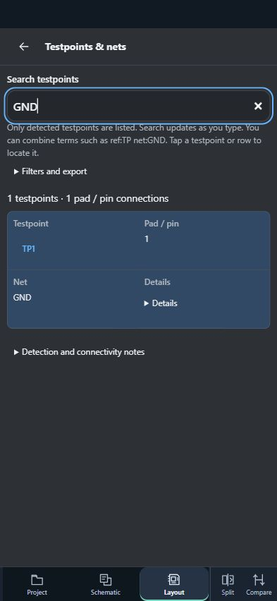 | 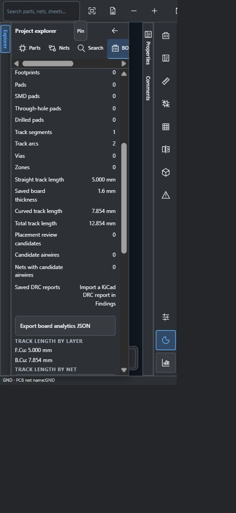 |

These are retained local tool/fixture views. Analytics describes saved source geometry and candidates, not a fresh native routing or manufacturing check.

## 4. Use the BoM field table

Open **BoM & assembly** in Android/browser project tools, or the drawing's **Open BoM manager** / **Assembly** controls. VS Code supplies the drawing manager; standalone imported BoM/iBOM pages belong to Android and the browser extension.

1. Filter parts by reference/value/field text, population, side or progress.
2. Open **Fields** to choose table columns. The phone table scrolls horizontally while keeping its first column and headers visible.
3. Enable grouping by **Value**, **Footprint**, **Value + footprint**, **Rate** or custom fields. Rate uses entered unit price and currency; missing prices are not zero. Different fields show `<mixed>`.
4. Select a reference to locate its saved object. Use **Manage** to enter procurement fields and local assembly progress. Editing a grouped row affects its listed parts; ungroup for individual control.
5. Export visible CSV for the current columns/groups, and metadata JSON to preserve local management drafts. Export before clearing storage or moving devices.

Saved design fields remain read-only. Management drafts are scoped to the saved source/revision and variant. Prices are entered locally; there is no live purchasing or currency conversion. Repeated hierarchical instances are not expanded into manufacturing quantities. See [BoM and assembly](docs/BOM-ASSEMBLY.md), [field table and grouping](docs/bom-field-table.md) and [supported import formats](docs/BOM-IMPORT.md).

| Chrome BoM field grid | VS Code BoM and assembly |
| --- | --- |
| 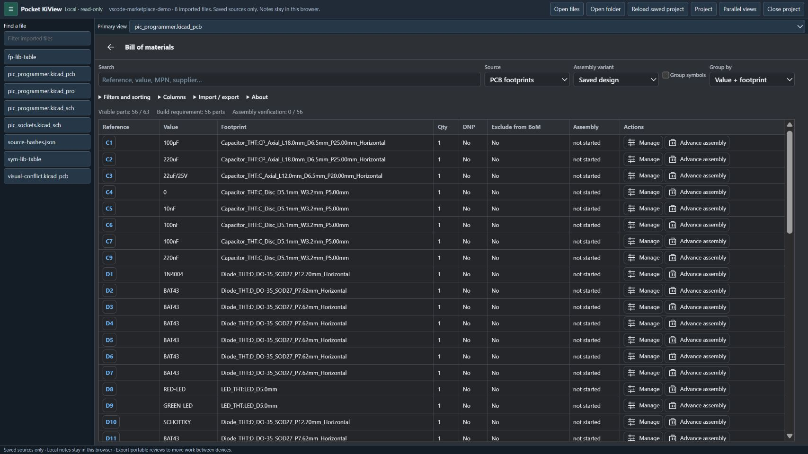 | 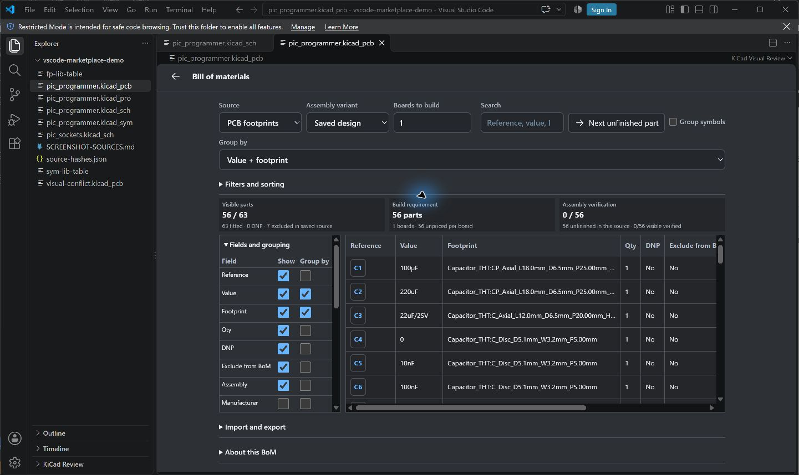 |

The Chrome table capture uses the local loopback workspace; the VS Code capture uses the installed extension.

### Import an existing BoM

In Android/browser project tools, open **BoM & assembly** and import supported KiCad/generic CSV or TSV, InteractiveHtmlBom JSON/recognized standalone HTML, or WayriCAD BoM Studio saved exports. Imported report HTML is extracted as bounded data; repository scripts are not executed. Keep references and saved board identity consistent to locate parts. An exported BoM Studio variant cannot recreate variants absent from its file. [Exact import formats and limits](docs/BOM-IMPORT.md).

### Variants and DNP/DNI

Use **Manage variants** to create/import a review variant and stage fitted/DNP, Value, Footprint or MPN overrides. Choose **Save variants** to retain edits. The selected variant affects BoM quantities and supported population overlays without changing the source drawing.

Enable **DNP / DNI** in PCB drawing tools to highlight omitted footprints. BoM exclusion alone does not mean DNP. Imported BoM Studio exports describe the exported variant; they cannot reconstruct variants omitted by the producer. See [variants](docs/variants.md).

### Reset progress or management fields

Export metadata first if you may need to restore it. Then choose:

- **Manage → Reset saved fields…** for one part or grouped row.
- **Reset progress / fields → Reset matching parts…** for the complete filtered result.
- **Reset entire source…** for the current source, including DNP/excluded parts.

The warning lists the affected identities and count. Choose assembly progress, procurement status, or all local management fields; acknowledge the warning before confirming. Changing the mode clears acknowledgement. Assembly resets to `not started`, procurement to `not ordered`; resetting all fields removes local overrides so original saved fields reappear. Cancel writes nothing. Source drawings and variant definitions are unchanged. Full details: [reset warning and scope](docs/bom-field-table.md#reset-saved-management-fields).

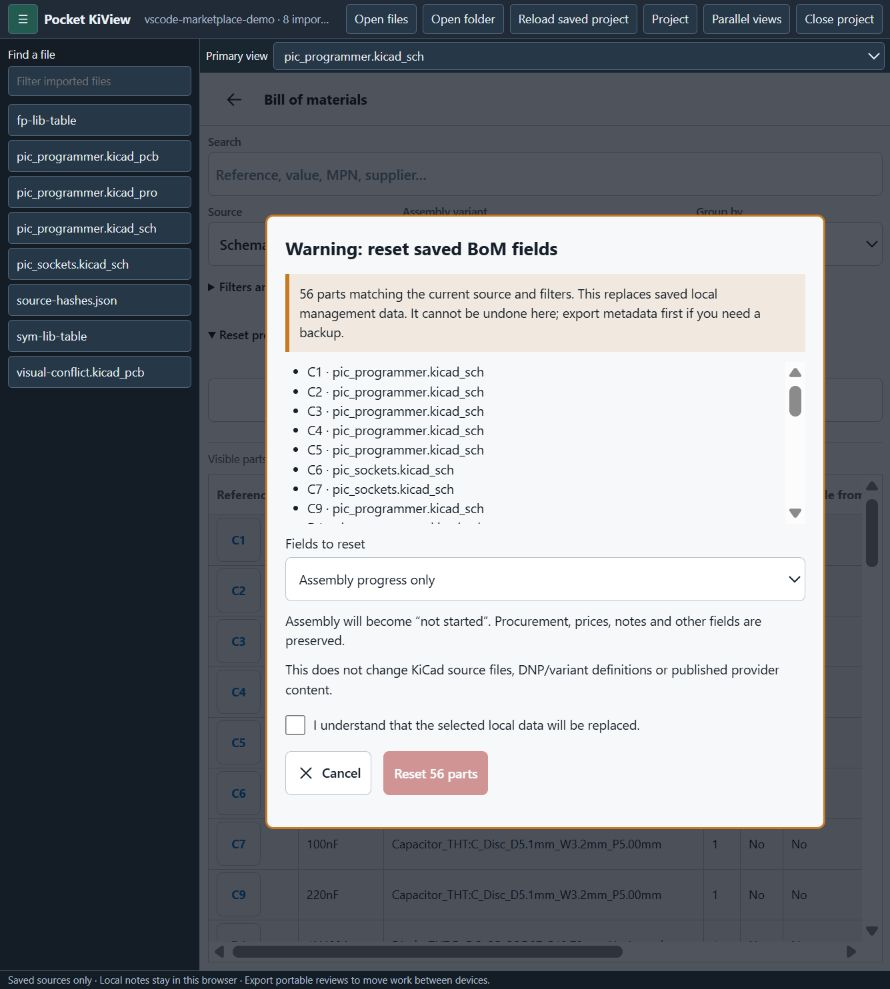

## 5. Open fabrication files, documents and results

| Tool | Workflow and boundary |
| --- | --- |
| Gerber viewer & analyzer | In Android/browser, import fabrication layers and Excellon drills, toggle films, adjust opacity, measure, and export analysis JSON. Parsed bounds, stroke widths and drill findings are screening data, not complete DFM. Unsupported macros, transforms and slots are reported. VS Code provides inline Gerber/drill inspection, not the standalone analyzer page. [Gerber guide](docs/GERBER-VIEWER.md). |
| PDF viewer | Android/browser: choose a PDF from project files or **PDF viewer**. Navigate pages, fit/zoom/rotate, use bookmarks, text search and extracted text. Scans need an existing text layer for search. No PDF editing, OCR or signature verification. This standalone page is unavailable in VS Code. [PDF guide](docs/PDF-VIEWER.md). |
| Analysis & simulation | Android/browser: open a saved report from project tools. Choose Graphs, Data, Report or Source; use available traces and A/B probes. Supported spatial exports offer 2D/3D overlays. A PCB attachment requires an exact saved source binding; missing spatial data is not guessed. This viewer reads results and does not run solvers. VS Code does not open the standalone graphical results page. [Formats and probing](docs/ANALYSIS_VIEWER.md). |
| Calculators | Android/browser: open **Calculators**, choose a circuit/tool and enter values in the displayed units. Inspect its diagram, calculated outputs, assumptions and warnings. Standalone calculator pages are unavailable in VS Code. [Calculator guide](docs/CALCULATORS.md). |

KiCad simulation workbooks contain setup rather than waveform samples. Export CSV/TSV or supported ASCII RAW data from the simulation tool to inspect actual saved waveforms. Binary RAW is unsupported.

| Fabrication layer viewer | Integrated PDF page |
| --- | --- |
| 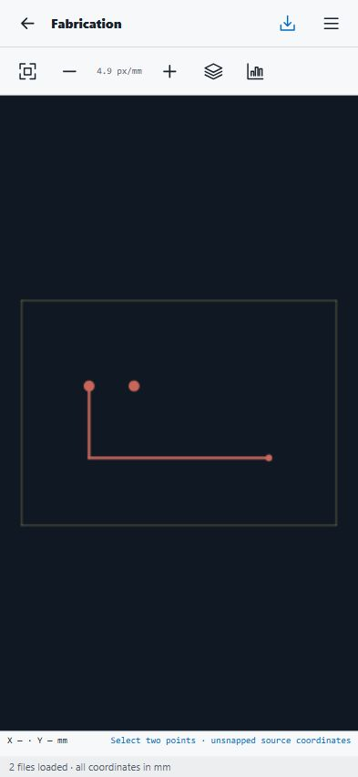 | 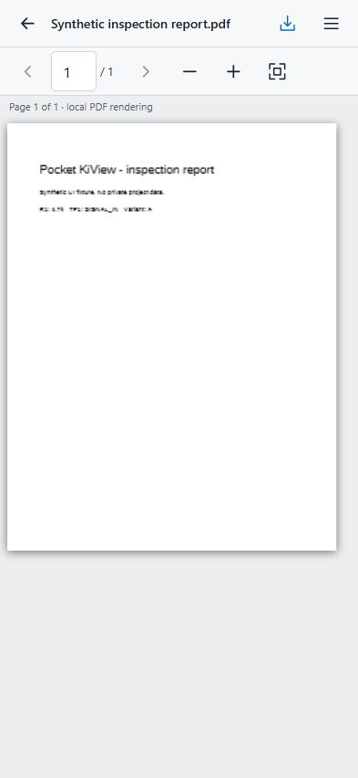 |

### Interactive circuit calculators

Open **Calculators**, select a tool and adjust its inputs or unit prefixes. Use the sliders to explore values, click diagram elements to select their inputs, probe supported plots, retain a reference to compare results, and export calculation JSON where offered.

The 17-tool catalog covers Ohm/power, loaded divider, regulator, LED resistor, track width, via resistance, resistor colors, wavelength/period, length conversion, RC filters, series RLC resonance, 555 timing, ideal op-amps, ideal buck and boost converters, reactance and resistor thermal noise. These use stated analytical models; they do not run SPICE or establish component ratings. [Circuit workbench](docs/calculator-workbench.md) and [base equations](docs/CALCULATORS.md).

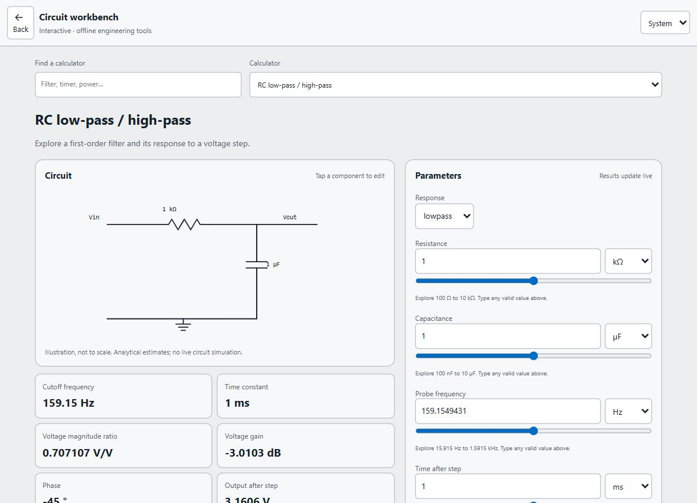

### WayriCAD simulation results

1. In WayriCAD / kiWay, save or export the result and its numerical data. Supported producer formats include quickTherm full JSON, quickPI mesh/result bundles and transient waveforms, and quickSI saved traces/reports. An HTML report alone may not contain the samples needed to recreate a plot.
2. Include the saved exports in the project folder/ZIP, or open a supported report directly. In Android use **Project → Analysis & simulation**; in the browser use **Analysis** in the project viewer.
3. Choose **Graphs**, **Data**, **Report** or **Source**. Select a trace or saved frame and use the available probes to inspect values. Supported spatial fields offer 2D/3D overlays; waveform-only results remain plots.
4. To attach spatial results to a PCB, include the exact board referenced by the result's saved source hash and the required coordinate/layer metadata. A different board revision is not silently substituted. Without an eligible board binding, inspect the standalone saved field.

This cross-compatible workflow displays saved exports; it does not launch WayriCAD solvers, synchronize live sessions or promise every producer version/schema. Include result files in the offline project copy to review them without a network connection. The standalone results viewer is available in Android/browser, not currently in VS Code. See the [format matrix and producer evidence](docs/ANALYSIS_VIEWER.md#verified-formats).

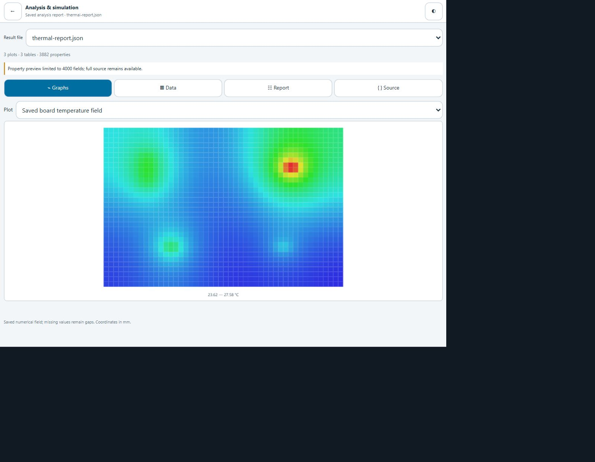

The saved-analysis image demonstrates a retained local results fixture. Spatial overlays require actual exported field samples and valid source coordinates; a screenshot or HTML report alone cannot supply missing numerical data.

## 6. Record, share and transfer a review

Use **Review** / **Comments** to anchor a note to a drawing object, position or area. Add severity, tags and state; review the destination and any image before publishing. Saving a local draft does not post it.

In the browser and supported app flows, GitHub Issues/Discussions and GitLab issues/issue-discussion threads require authorized account access. GitLab issue discussions are not standalone GitHub-style Discussions. Remote history/readback differs by host; use the [comments guide](docs/COMMENTS.md) and [Git host matrix](docs/GIT-HOSTS.md) for exact scope. Local state changes do not automatically close remote issues.

VS Code writes annotations to a `.kicad-review.json` sidecar. Inspect it in Source Control and commit it with normal Git tools to share it. In a trusted local checkout with a matching supported Git remote, connect an account to read conversations and explicitly publish supported notes and screenshots to GitHub/GitLab. Pinned annotation publication/readback requires the displayed sources to match committed Git blobs. Assembly drafts use separate local storage.

Use portable review export/import to transfer supported notes, BoM metadata, variants and 2D view/measurement state. Open matching source drawings on the destination first: import checks paths and content fingerprints. Portable reviews do not include CAD sources, original photos, model files, credentials or entire remote conversations. Export is explicit transfer, not device synchronization.

For photo-assisted assembly review, import top/bottom photographs, align known component centers and inspect matched references. Population suggestions require reviewed reference photos and manual confirmation; the overlay does not track camera movement. See [photo alignment and testpoints](docs/PHOTO-AR-TESTPOINTS.md) and [population inspection](docs/POPULATION-INSPECTION.md).

### Android walkthroughs and slide decks

In the Android project/drawing tools, **Present project** walks through the available drawings. Use **Create slides → Add current view** to capture selected views, add titles and presenter notes, reorder the deck and choose **Present slides**. **Export presentation** saves a local HTML presentation containing the captured drawings and notes. Check its contents before sharing; this export is distinct from source ZIP and portable review exports. These Android presentation/export controls are not advertised as Chrome or VS Code features.

### Photo-assisted inspection

1. Open a PCB and **Photo & AR review**. Import a still photo or capture one where the device/browser supports it.
2. Select the board side and align four known component centers. Clicking a matched component can locate its saved PCB/schematic identity; resolve ambiguous sheet matches explicitly.
3. Retain separately aligned front/back photographs. Review each candidate as **Fitted**, **Empty / DNP**, or **Unknown**.
4. For assisted comparison, supply reviewed fitted **and** empty reference photos for the same board revision. Missing or ambiguous evidence remains unknown. This is still-photo alignment, not live spatial tracking or arbitrary AI component recognition.
5. Inspect mismatches against the selected saved variant. Variant inference needs at least two visible distinguishing components and one contradiction-free candidate; it cannot distinguish invisible value/MPN changes.
6. Export the inspection log and references separately. Review the images and destination before preparing/publishing a supported GitHub Discussion draft. Local photos are not automatically uploaded or included in portable reviews.

Physical-photo detection accuracy has not been established. This workflow does not verify solder joints, polarity, part value or hidden connections. [Alignment and picking](docs/PHOTO-AR-TESTPOINTS.md) | [Population, variants and inspection logs](docs/POPULATION-INSPECTION.md).

### Read before publishing

Keep a local draft first. Check provider, repository, issue/Discussion number, attached capture and visibility before selecting **Comment** or **Publish**. Browser login does not connect Android. VS Code can use its native GitHub account consent; Android/Chrome retain their separate current account workflows. GitLab credentials are tied to the exact selected host. Do not paste credentials into a review note.


This image shows a local demonstration draft, not evidence that an external comment was published. For current conversation reading and reply steps, see section 8 below.

## 7. Resolve a Git conflict in VS Code

1. Select a marker-conflicted `.kicad_sch` or `.kicad_pcb` and run **KiCad: Resolve Git Conflict Visually**.
2. Inspect **Current** and **Incoming** with linked cameras and saved-object difference highlights.
3. Choose **Use current** or **Use incoming**. The choice applies to every conflict marker block in the file; it is not a per-component semantic merge.
4. Save a resolved copy, or explicitly confirm replacement of the conflicted file. A trusted workspace and unchanged saved source are required.
5. Optionally confirm **Stage resolved file**. Nothing is committed or pushed automatically.
6. Open the resolved design in KiCad and run native checks before accepting it.

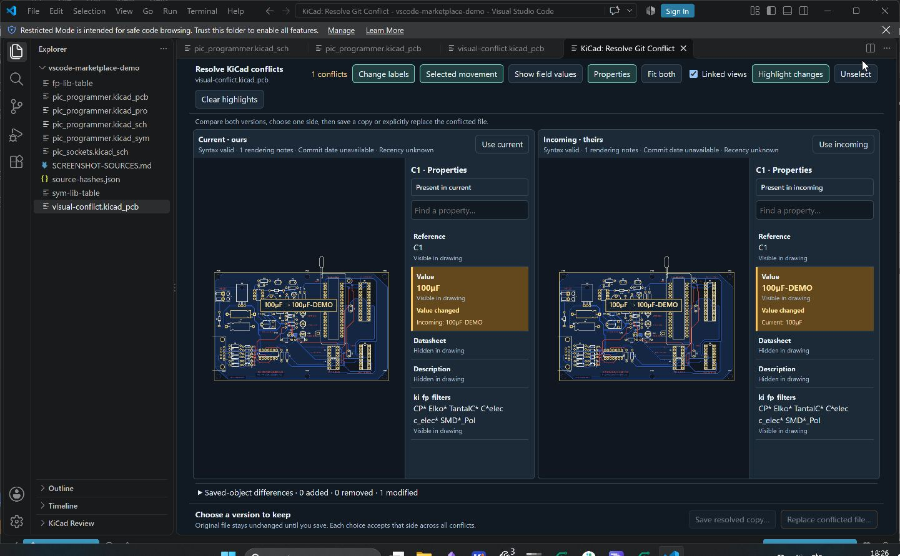

The installed-extension capture uses a deliberately conflicted capacitor Value field in the KiCad PIC Programmer demo. Local merge-conflict review works offline with local saved files; GitHub/GitLab login is unnecessary. This accepts one complete side across the file's marker blocks, not individual objects from both revisions.

See the illustrated [VS Code conflict guide](vscode-extension/GUIDE.md#resolve-git-conflicts-visually).

## 8. Workspace, Git and conversation controls

Review cards distinguish **Review: open / skipped / resolved / wont-fix** from
**Issue: open / closed**. A closed GitHub issue does not automatically resolve
its design annotations. Refresh the selected thread to read its current GitHub
state. Phone comments use the connected Android GitHub account; website login
alone does not connect the app.

### More room for drawings and tables

Use **Focus view** (fit-frame icon) to hide drawing sidebars and, in the local
browser workspace, its outer controls. **Restore controls** or Escape brings the
controls back without reopening the file. The file-list toggle remembers your
choice. In conflict review, **Properties** opens both field inspectors and
**View options** contains the secondary display controls. In the BoM manager,
**Filters**, **Columns** and **Totals** expand only when needed; opening one
advanced section closes the others so the table keeps its working space.

### Repository files and commit graph

Open **Repository** from the drawing tools or project page to browse files,
branches and commit history. Expand folders, search loaded paths, and open a
commit for its complete message, author, date and parent IDs. Graph colours
identify lanes; lines follow actual parents, including merges. Load older
commits to extend the graph. On phones, switch between **Files** and **Commit
history**; desktop views show both together.

Connected GitHub and GitLab projects expose repository metadata using the
client's existing authorization. Listings are bounded and show warnings when
truncated; expand folders to fetch additional contents. Browsing another
revision does not check out or modify files. VS Code uses its built-in Git
provider for history and working-file status colours. With native Git available,
select a commit and choose Browse files to inspect its saved tree. Opening a file
creates a separate read-only viewer pinned to that commit, including saved sheets
and model assets. It never replaces working files. Historical viewers do not write
workspace annotations or publish remotely. Open a nested repository directly when
its ancestor folder is the workspace. Restricted workspaces
and plain file imports show available files and explain unavailable history.


### 3D selection outlines

Selected parts use a clean edge outline with no triangle diagonals. Cross-selection
combines a component body, model meshes and matching pads into one component
boundary. Outlines respect scene depth so hidden edges do not show through the
board. Clearing selection removes the outline without changing model materials.


### KiCad layer colours

PCB objects and layer swatches use the KiCad Default palette: front copper red,
back copper blue, distinct inner copper layers, and matching silkscreen, mask,
paste, fabrication, courtyard, outline and user-layer colours. Solder mask and
paste retain their default colour alpha. The same palette supplies recognized
Gerber layer roles and the 3D copper preview; model-provided material colours and
intentional review/net-class overrides are retained. This is the built-in default
palette, not an import of a user-customized KiCad colour theme.

Palette reference: [KiCad built-in colour themes](https://docs.kicad.org/doxygen/builtin__color__themes_8h_source.html).


### Stop a load

Select **Stop** on a loading surface to cancel that read or import. Preparation
workers terminate, pending read results are discarded, and stopped initial
drawings offer **Retry loading**. Opening another file cancels the previous
preparation. The existing project and sign-in are retained. Publishing, uploads
and saved-library writes do not show Stop because a remote write cannot be
rolled back by cancelling the screen. Shared snapshot downloads continue when
another view still needs them. VS Code can stop preparation and stop waiting for
a source read; its public filesystem API cannot abort an already issued host read.
Elapsed time uses hours and minutes for long jobs. Initial drawing waits are
bounded; use a smaller project or retry if the timeout message appears.


### Read and reply to issue conversations

In Chrome, Android or a trusted VS Code Git checkout, open **Review → Comments →
View comments**. Choose Issue (or a GitHub Discussion), enter its number and select
**Load thread**. The reader shows the issue body, ordinary comments, grouped replies,
authors, dates and remote open/closed state. GitLab Discussions belong to an issue;
the reader uses that issue's number. Bounded loading reports omitted/truncated data.

Use **Reply** to prepare an anchored draft, review its existing-thread destination
and explicitly publish. A local review state such as skipped/resolved is separate
from the provider's open/closed issue state. The viewer does not provide a complete
notification inbox or live synchronization.

For VS Code, use the account/settings control in Comments. GitHub uses VS Code's
native account consent; GitLab uses an exact-host token prompt backed by
SecretStorage. The workspace must be trusted and have a supported, unambiguous
Git remote. Thread reading can work on a changed drawing; publishing and pinned
annotation readback require its displayed sources to match raw committed Git
objects. Commit changes and reopen if the source-verification check rejects them.


## 9. Create Draftsman documentation

Open a drawing, then choose **Draftsman** from its tools. The editor stays in the current tab and creates a separate drawing document. It does not edit the schematic or PCB.

1. Set the sheet size, orientation, title, revision and units in **Sheet & title block**.
2. Select a loaded PCB and add a mechanical 3D view. Choose top, bottom, a side or isometric; adjust viewpoint, scale and rotation in Properties. Copper and electrical overlays are hidden.
3. In a top mechanical view, use **Auto dimensions** for saved PCB outline width/height, or **Dimension** to place two points with hole/corner snapping. Other projections currently reject source-coordinate dimensions. Add notes and a fitted-parts BoM as needed.
4. Add another sheet for an assembly view or extra detail. Use Undo/Redo to revise the document.
5. **Save draft** retains the editable document in this browser profile. Use **Download → Editable document** for a portable `.kivi-draft.json` backup, or export PDF/SVG for sharing.

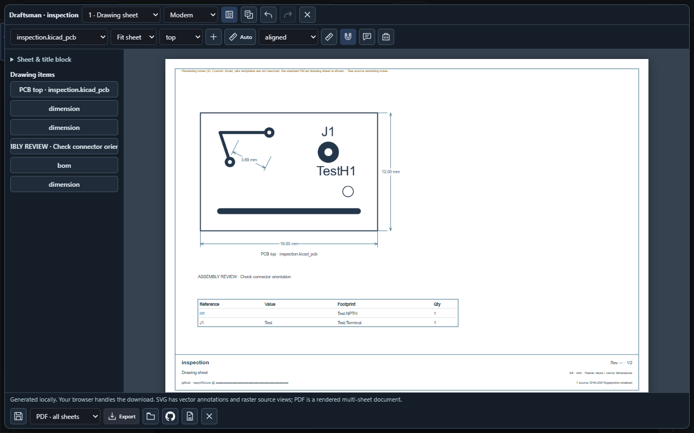

This is a local browser source preview using the retained synthetic `inspection.kicad_pcb` test fixture. The repository/revision in this capture is test data; it does not demonstrate a live repository write or a physical Android device. No desktop or Android system bars are included.

**0.12.70:** the template picker offers **Modern** and **KiCad sheet**. The KiCad-style alternative adds a worksheet boundary, coordinate zones and title block; it does not load custom `.kicad_wks` worksheets. Compact icons retain descriptive tooltips and accessible names. The magnet toggles geometry snapping: nearby saved hole/circle centres, corners, line edges and rounded edges show a cursor cue. Hold **Alt** to bypass snapping temporarily or **Shift** to constrain the second point. On touch screens, drag to preview and release to place a dimension point. **Escape** cancels placement.

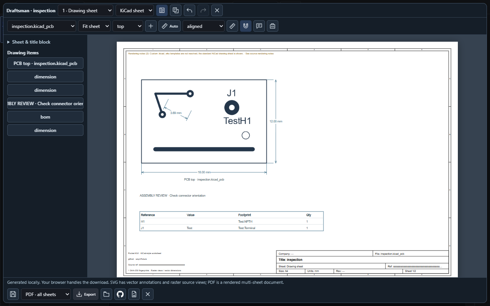

[Watch the local Draftsman walkthrough](docs/images/draftsman/walkthrough.webm): choose the KiCad-style template, preview a mounting-hole snap, add dimensions/notes/BoM, create a second sheet and export a PDF. This uses the same synthetic local fixture; it ends before any simulated provider-write workflow.

**Save to folder** asks where to create a separate output folder when supported. **Save to repo** is an extension-only, account-authorized action: review the repository, new branch and path before confirming. It creates documentation on a new branch from the viewed commit. Downloading a PDF does not publish anything.

Drawing views in exported sheets are raster previews; dimensions, notes and tables in SVG are vector elements. Automatic dimensions reflect saved outline geometry, without inferred manufacturing tolerances. Read the [complete Draftsman guide](docs/DRAFTSMAN.md) for source matching, export limits and partial-save handling.

## 10. Troubleshooting and support

- **Missing subsheet/model:** import the complete project folder/ZIP and inspect path or size warnings. Absolute/external model paths may be unavailable.
- **Old drawing after an edit:** reimport browser snapshots, reload the loopback project, or close/reopen the VS Code editor.
- **Private repository fails:** check account access and the exact host/repository; a 404 may mean denied access. Android does not inherit a desktop browser's cookies.
- **Drafts missing on another device:** export/import their metadata. Local storage is separate for each app/browser profile, and loopback ports have separate browser storage.
- **Large project is incomplete:** inspect truncation and parser diagnostics; reduce the imported set rather than assuming a partial view is complete.

Contact [support.kivi@sigharmonic.com](mailto:support.kivi@sigharmonic.com) with the app/extension version, operating system, exact steps and a non-confidential minimal example. Do not include account tokens or private project data without authorization.

## Compact views and experimental Fast PI

The icon-and-label view strip switches Schematic, Layout, 3D, Draftsman and
Simulation. Simulation separates imported KiCad/wayriCAD results from Fast PI.
See [Fast PI setup, outputs and numerical limits](docs/FAST-PI.md) before using
this experimental two-contact DC copper workflow.

## Independent browser windows

Use **Detach** or drag a drawing tab outside the viewer window to separate the
schematic, PCB layout or 3D view. Each has its own camera; **Cross-select detached
views** controls selection sharing. [Supported hosts and setup](docs/DETACHED-VIEWS.md).
