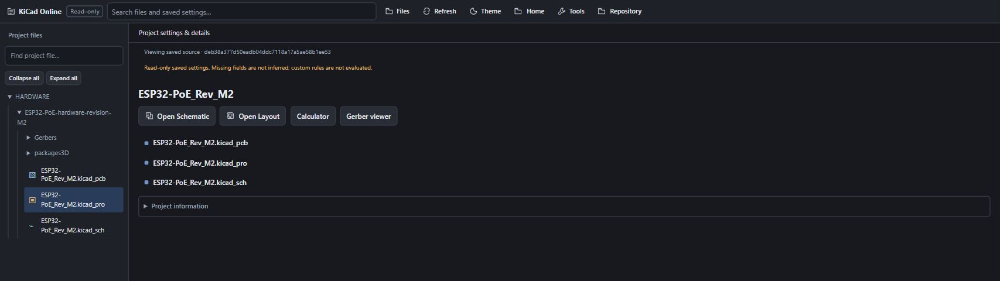
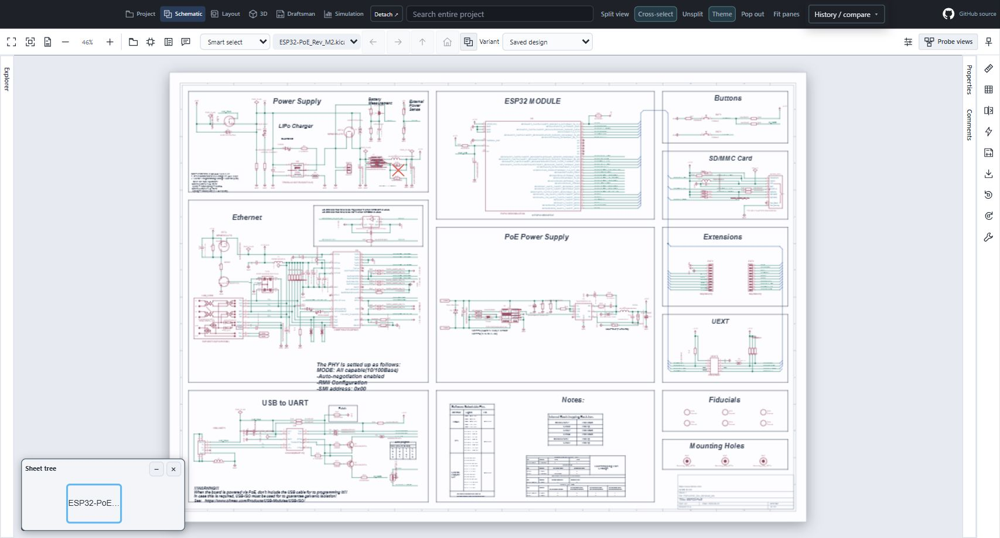
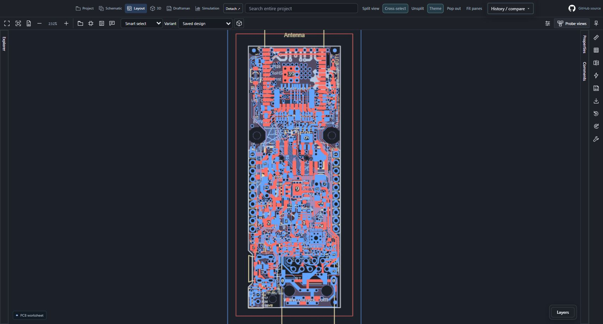
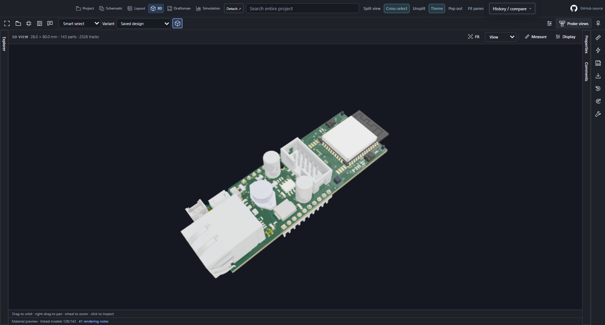
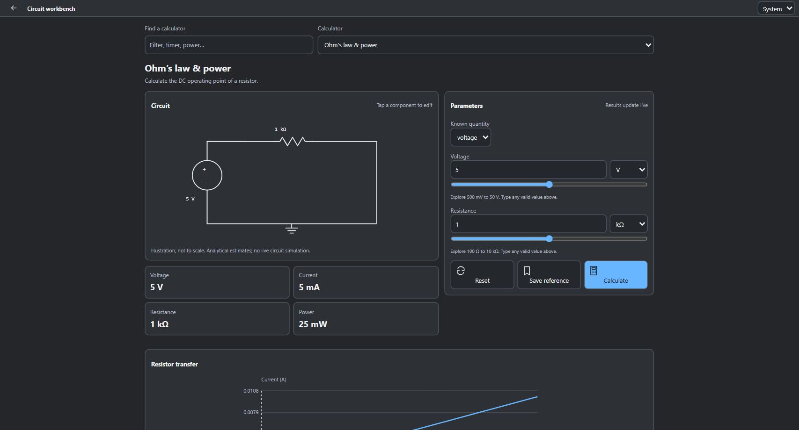
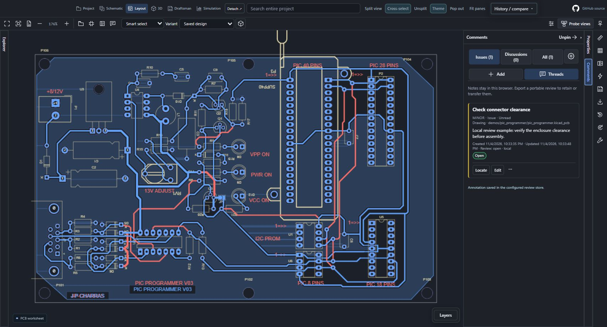
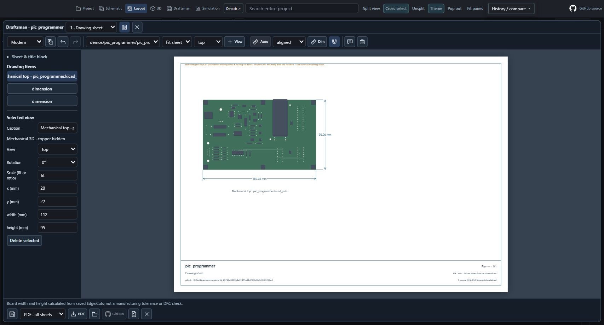
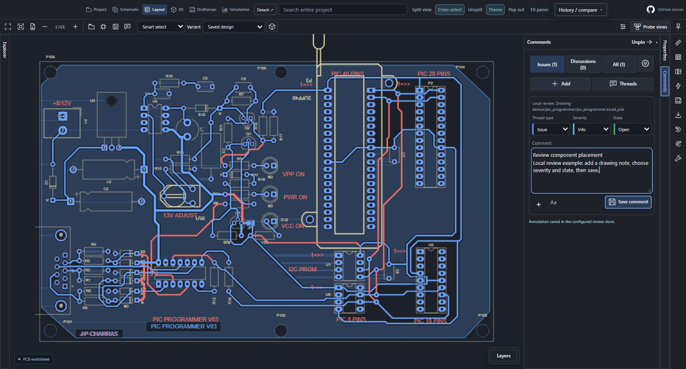

# KiCad Online — fresh branding screenshots

[Demo board acknowledgements](DEMO-BOARD-CREDITS.md) — OLIMEX ESP32-PoE M2 and KiCad PIC Programmer are the work of their upstream authors and contributors; their design/model licenses remain applicable.

These images are intended to show the current KiCad Online branding. They are fresh browser captures of the current source, not edited or relabelled screenshots from an earlier release. Package publication and installed-device acceptance are separate checks.

## Public source and capture method

- Board: [OLIMEX ESP32-PoE revision M2](https://github.com/OLIMEX/ESP32-POE/tree/deb38a377d50eadb04ddc7118a17a5ae58b1ee53/HARDWARE/ESP32-PoE-hardware-revision-M2).
- Source revision: `deb38a377d50eadb04ddc7118a17a5ae58b1ee53`.
- Files: `ESP32-PoE_Rev_M2.kicad_pro`, `ESP32-PoE_Rev_M2.kicad_sch`, `ESP32-PoE_Rev_M2.kicad_pcb`, and the retained public linked component models.
- Viewer assets: current source checkout, served through an allowlisted loopback-only harness. The harness uses the production local-project transport and production viewers; it does not draw replacement board graphics.
- No private repositories, organization designs, credentials, taskbar or Android status bar are used. The harness navigation bar is clearly labelled as a public current-source preview and can be excluded by capturing the production viewer frame.

## Captured views

Five fresh captures are saved under `docs/images/0.12.85/`; hashes and source provenance are in [the capture manifest](images/0.12.85/capture-manifest.json). The 3D view loaded **126 / 143 linked models**, with missing models and geometry notes disclosed in the viewer. This does not claim all model assets exist.

| Filename | View | What it establishes |
| --- | --- | --- |
| `01-project.jpg` | Project launcher | KiCad Online header, source file actions and tree |
| `02-schematic.jpg` | Schematic | Saved public schematic in the branded viewer |
| `03-layout.jpg` | Layout | Saved public PCB in the branded viewer |
| `04-3d.jpg` | 3D | Actual linked model rendering; disclose any omitted/missing model warnings |
| `05-calculator.jpg` | Circuit workbench | Current tool appearance and analytical results for the displayed inputs |

The screenshots below were visually inspected and cropped to exclude harness navigation and operating-system bars. They were not retouched to change the UI.

### Project launcher

### Schematic

### PCB layout

### 3D linked models

### Circuit workbench

## Review and mechanical document examples

These additional captures use the public [KiCad PIC programmer demo](https://github.com/KiCad/kicad-source-mirror/tree/29798a640054e91411a44d230bd3a3425b3166e4/demos/pic_programmer), at revision `29798a640054e91411a44d230bd3a3425b3166e4`. They show the production shared viewer from source commit `d44ccdc`, served locally. They are not installed VS Code screenshots. The note and draft are explicitly local examples, not live GitHub/GitLab conversations. Draftsman shows fallback component bodies because this retained demo has no linked model assets.

The three images were uploaded to Mozilla and the captions were saved and re-opened to verify persistence. Chrome's pending 0.12.85 review locks image edits; its two existing layout/3D images remain. VS Code embeds images through the packaged README, so the source additions appear inline on its next package update. [Additional capture manifest](images/0.12.85/feature-capture-manifest.json).
