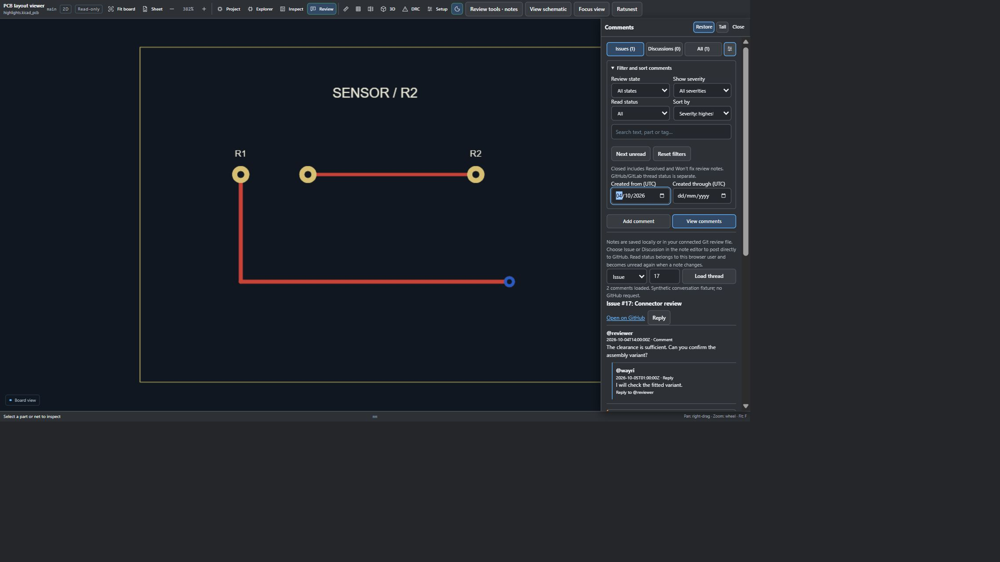

# Review comments and Git host integration

KiCad Visual Review stores comments alongside the design context they refer to: repository, revision, KiCad file, optional object identity or reference, and a point or rectangular area in drawing coordinates. Each note can also carry severity (`info`, `level-1`, `minor`, `major`, or `critical`), tags, mentions, text, timestamps, and a local state (`open`, `skipped`, `resolved`, or `wont-fix`). Area captures can include a PNG. These annotations help reviewers discuss saved design data; they do not modify the schematic or board.

## Where notes are stored

In the browser extension, notes use browser-local storage by default. To share them through Git, open the extension's **Options**, choose **Connect existing file** or **Create review file**, and select `.kicad-review.json` in your checkout. The extension validates the file and its permission, then reads and writes it as the shared annotation store. Stage and commit the file with your normal Git workflow; the extension does not create commits. Chrome may ask you to renew file access after a restart. Disconnecting the file returns the viewer to browser-local drafts; it does not migrate those drafts automatically. Use the review JSON export/import controls when you want to move drafts explicitly.

The sidecar uses schema version 1 and contains annotations, including confirmed GitHub or GitLab thread references, but never credentials. It is limited to 1,000 notes and 4 MiB. Notes have a 4,000-character text limit and at most 20 tags of 40 characters each. JSON import/export is limited to 100 notes and 1 MiB; browser-local storage is limited to 100 notes per file and revision. PNG captures are limited to 1,024 pixels per side and 262,144 data-URL characters, and the total sidecar limit still applies. Remove captures or store large evidence separately if the sidecar approaches its limit.

The extension serializes its own browser-tab writes, checks whether the file changed externally before saving, and rejects stale note edits. This is optimistic conflict detection, not a lock shared with other applications. Avoid editing the sidecar in an editor while the browser is saving. Invalid existing JSON is left intact rather than replaced. If a conflict is reported, reload the notes and retry your edit.

## Connecting GitHub

Open **Review → Add comment**. The compact composer has three colored dropdowns: Issue/Discussion, severity and local review state. Write the title on the first line and the review on following lines. Type `@` for account suggestions (arrow keys and Enter work), or enter a username yourself. Paste PNG/JPEG/WebP screenshots directly into the box; they are normalized to a bounded PNG preview. Tags and account/Markdown controls live under **Tags and advanced options**. The destination beside **Comment** defaults to New issue. Select an existing thread and enter its number, or choose Discussion and load a category for a new discussion. **Save draft** never publishes. A saved note retains its Issue/Discussion type; publication checks type, permissions and repository policy.


The screenshot uses actual rendering and mocked transport. No live post was made.

In Chrome and Android, GitHub publishing is optional. Open the account settings, choose repository access and press **Sign in with GitHub**. Users approve a device code on GitHub. Public access requests `public_repo`; private access requests the broad read/write `repo` scope. From v0.11.10, the publisher App public client ID is included, so normal users do not need advanced configuration. [Publisher setup](GITHUB-SIGNIN.md) documents maintenance and custom builds. Advanced settings offer a custom client ID or a manual personal access token. A manual token must have access to the repositories you review. Issue and pull-request comments require Issues write access. Discussions require access through GitHub GraphQL. Fine-grained tokens may also need access to the target repository. GitHub decides final permissions, and denied or missing access is reported.

Browser extension tokens are encrypted in extension session storage with keys held only in memory. Supported Chrome sessions retain keys through background idle; browser restart, extension reload or key-worker loss requires sign-in again. Other browsers also lose sessions on background restart. Sessions expire within eight hours. Tokens are not written to `.kicad-review.json` or exposed to host page scripts. Pending OAuth device secrets stay in background memory; a custom public client ID is stored in local settings. **Sign out** purges credentials and cancels login; **Reset GitHub connection** also clears that ID. Uninstall clears local storage but does not revoke GitHub authorization. See [security, revocation and live-browser verification limits](../SECURITY.md).

## Repository comment policy

Before publishing, the extension checks the target repository's `.kicad-review-policy.json` on its default branch. If the file is absent, the default policy allows any signed-in account that can publish to the repository. A malformed or unverifiable policy blocks publication. The file format is:

```json
{
  "schemaVersion": 1,
  "commenting": {
    "mode": "contributors",
    "allowlist": ["reviewer-login"]
  }
}
```

`mode` can be `all`, `contributors`, `collaborators`, or `allowlist`. The optional `allowlist` is limited to 100 GitHub logins. In `all` mode, a connected account may publish. The other modes require the extension to identify the signed-in account; the repository owner and listed accounts are accepted, while `contributors` additionally checks GitHub's contributor list and `collaborators` checks collaborator permission. `allowlist` accepts only the owner or listed accounts. If GitHub cannot verify the required identity or repository status, publication is blocked rather than assuming access. The policy is checked against the public default branch, so changes there govern all revisions being reviewed.

## Publishing a note

Use **Comment** in the composer to save and publish in one action, or save a draft first. Choose its GitHub destination (a new issue, an existing issue or pull request, a new discussion, or an existing discussion); for a new discussion, load and select a category. Then click **Publish to GitHub** on the note. Saving or opening a drawing never publishes automatically. The extension posts a new issue for a new issue destination, an issue comment for an existing issue or pull request, a new discussion, or a discussion comment, as appropriate.

Published text includes the note, severity, state, tags, mentions, date, repository, revision, file, and available object/location/variant anchors. **Post to GitHub** uploads an area capture as a GitHub repository attachment and inserts its image URL into the Issue or Discussion body. Upload requires repository write access and an OAuth or personal access token. If it fails, the draft remains and no text-only post is made: fix access or remove the screenshot explicitly. A confirmed upload is reused when retrying the same image/note/destination repository. GitHub App tokens and Enterprise Server uploads are unsupported. This follows [GitHub's official attachment uploader](https://github.com/cli/cli/blob/trunk/internal/attachments/client.go).

A hidden `kicad-review:v1` marker preserves validated note metadata and attachment URLs for readback. PNG bytes remain in the local review file and are excluded from that marker. In the browser edition, **Open GitHub composer** fills a form without submitting; this manual path still requires downloading and attaching the PNG yourself. Review the selected repository and screenshot before posting, especially for private designs. GitHub controls attachment access and retention; deleting a local note or signing out does not remove an uploaded asset. An upload followed by failed text publication may leave an unreferenced asset. Automated tests exercise simulated API responses; live screenshot publication remains unverified.

On confirmed success, the local note records the GitHub repository, thread number, URL, publication time, and available remote ID. Repeating a confirmed publication recovers its saved receipt and does not create another post. If the request outcome is uncertain (for example, a network interruption after GitHub may have accepted it), the extension marks it pending and will not retry automatically, because that could duplicate a comment. Inspect GitHub before taking further action. Since v0.12.9, for newly recorded uncertain GitHub posts, enter the Issue or Discussion number in the recovery control shown after a posting error and choose **Recover published comment**. This performs read-only annotation lookup and requires one exact saved annotation from the account that attempted publication. It records the confirmed link and screenshot attachment receipt without posting again. Changed annotations, another author/account, multiple matches, missing posts, and old pending records without an author/content binding remain protected from retry. The bounded thread scan can omit older comments; inspect GitHub manually if recovery finds no exact match.

The state shown on a note is local review metadata. Marking a note resolved or skipped does not close a GitHub issue or edit an earlier GitHub post. The extension does not automatically synchronize remote issue state or edits back into the note.

## Reading existing GitHub annotations

**Load GitHub annotations** uses the connected account when available, including for authorized private repositories. Public Issue/PR reads use the anonymous REST API when signed out. Only valid markers matching the exact repository, revision and drawing become cards; ordinary messages do not become drawing annotations. Use the separate thread reader below for the full conversation.

Select **Issue / Existing issue** and its number to read the body and up to 500 comments. Selected PRs use their body and Issue-comment conversation. Without a selected thread, refresh scans at most 200 recent Issue/PR bodies, without fetching every conversation.

For Discussions, sign in, choose **Discussion / Existing discussion**, enter its number and **Load GitHub annotations**. Authenticated GraphQL reads marked body, comments and replies, bounded to 500 source records and 20 requests. Warnings describe truncation, invalid data and API limits.

Cards show actual GitHub authors, posting/editing times and canonical links. **Reply** creates a fresh draft at the same anchor and selects the existing thread; enter text and **Post to GitHub** explicitly. Successful posts select their confirmed thread for subsequent refresh. Multiple reviewers can append posts and refresh them. Discussion replies from this viewer append to the conversation, rather than nesting under an individual reply.

Readback holds one account identity through pagination. Sign-out, account changes or credential expiry abort it. It does not synchronize remote state or edits into existing local notes, close issues or replace GitHub conversations and notifications. Authorized private PR revision comparison is supported.

## GitLab and VS Code

GitLab notes are isolated by HTTPS server, project, revision and file. In Options → **GitLab accounts and servers**, connect an expiring token or configure a non-confidential OAuth Application ID and exact browser redirect URI. OAuth uses PKCE with `api` scope; no bundled GitLab Application ID or client secret is supplied. Private reads use the selected server's credentials; posting also needs project write permissions. For self-hosted GitLab, first choose **Grant server access** for its exact HTTPS origin. Credentials use the encrypted session lifecycle described in [SECURITY.md](../SECURITY.md).

In the editor select **Issue** to create a new issue or add a note to an existing one, or **Discussion** to create a discussion thread within an existing issue. GitLab discussions require an issue number and have no standalone category selector. **Preview GitLab Markdown** shows the formatted section; **Post to GitLab** saves a draft and explicitly publishes it. Confirmed links are saved in the annotation. Uncertain publication outcomes block automatic retries. Mentions can notify users when actually posted, subject to GitLab behavior and permissions; local mentions alone send no notification.

In the **GitLab** tab, select an existing issue number and **Load GitLab annotations**. Readback scans its description and up to 500 issue notes for validated markers matching the server/project/revision/drawing. Ordinary comments and grouped replies are available through **Load thread**, separately from drawing annotations; annotation refresh does not synchronize remote edits into local notes. GitLab posts upload captures as project PNG attachments and embed the validated image URL. Private/internal projects must enable **Require authentication to view media files** first ([GitLab media security](https://docs.gitlab.com/security/user_file_uploads/)). Remote private previews may additionally require website sign-in. Upload receipts prevent repeated confirmed uploads; uncertain outcomes block automatic retry. Removing a local note does not delete remote uploads. Marking a note resolved/skipped never closes the remote issue. Repository policies are checked before posting; contributors-only mode fails closed without verifiable account membership or an explicit allowlist. Prefer `collaborators` or `allowlist` when controlling reviewers. Browser GitLab notes remain local/exportable; that browser's connected GitHub sidecar control is not used for GitLab. VS Code keeps either provider's confirmed references in its workspace sidecar. Current merge-request Changes pages support an inline changed-drawing selector. Historical diff versions, merge-request comment publication and URL-subpath installations are not supported. See the [illustrated GitLab guide](using-gitlab-integration/README.md).

The VS Code extension keeps local annotations in the workspace `.kicad-review.json` and supports remote collaboration when a trusted local checkout has a matching Git remote. In **Review**, open the account/settings control: GitHub uses VS Code native sign-in and repository consent; GitLab asks for an exact-host token stored in VS Code SecretStorage. No manual GitHub token or device code is required in VS Code. Credentials never enter the webview or sidecar.

Choose Issue or Discussion, enter its number and click **Load thread**. To create an issue or reply, check the draft, destination and optional screenshot, then explicitly choose **Comment** or **Publish**. GitLab Discussions belong to an existing issue. Both providers enforce repository policy and permissions; successful uploads and publications retain receipts to protect retries.

Before pinned annotation readback or publication, VS Code verifies the displayed drawings against raw committed Git blobs. If they differ, commit the changes and reopen the drawing. Ordinary conversation reading remains available without attributing dirty source to HEAD. A changed remote or commit also requires reopening. Native Git is required for this source check; Restricted Mode, projects without a matching remote and historical snapshots do not publish. Local anchors stay local in the sidecar; the host maps validated publication anchors to the remote commit and repository path. Copying a sidecar alone does not configure an account or authorize remote writes. Browser and VS Code writes do not share an atomic lock, so avoid editing the same sidecar from both at once.

VS Code annotation refresh without a selected GitHub thread scans up to five recent issue conversations. Select a specific issue or Discussion number for targeted readback. GitLab annotation refresh requires a selected issue. These scans can be incomplete and do not constitute an issue inbox.

Automated checks use mocked provider responses. They do not create live issues, discussions, or comments, and they do not prove that a particular repository's token permissions or policy will allow publication.


## Direct posting from the comment editor

The note editor has a **Post to GitHub** section. Select Issue or Discussion, new or existing thread, a title or thread number, and a category for a new Discussion. **Preview GitHub Markdown** displays the generated section without posting. **Post to GitHub** saves a draft, sends the formatted review through the selected GitHub API, then records its confirmed link. **Save draft** keeps a note without a remote write. Failed posts retain an editable draft; ambiguous results retain the backend's pending-publication protection rather than automatically retrying.

Posted Markdown contains review text and a design-context table with severity/state, Issue/Discussion type, component or net, point/area, repository, revision/file permalink, variant, identifiers, tags, mentions and UTC times. The validated hidden annotation marker remains available for supported readback. PNG data is excluded from the API body.

Authorized private repositories can receive Issue/Discussion posts. The connected account must have the relevant write permission and Contents read permission for policy verification. Private policy requests are authenticated on GitHub's API. A private policy 404 is treated as absence only after a complete authenticated root listing verifies that no policy file exists. Unverifiable access or policy blocks the post. Public policies retain anonymous verification. Authorized private annotation readback is supported; authorized private PR comparison is supported.

**Mention people** offers authenticated contributor/assignee suggestions on GitHub and project-member suggestions on GitLab, plus explicit account search. Select a result to add `@username`, or enter names manually. Listings are bounded and roles are suggestions, not access guarantees. No notifications occur until publication. Opening the composer automatically restores controls and a usable panel height; close it to maximize the drawing again.

In **Comments → View comments**, **Filter and sort comments** opens by default. Filter by Open, Closed (Resolved or Won’t fix), Skipped, an exact review state, severity, read status or text. Sort severity highest/lowest first, creation date newest/oldest first, or update date newest/oldest first. **Reset filters** restores all notes in the selected category in severity order. These choices also filter drawing annotation markers; they do not change saved review state or the remote issue status.

The Comments sidebar has **Issues** and **Discussions** category tabs, each with **Add comment** and **View comments**. Issue drafts map to GitHub Issues; discussion drafts map to GitHub Discussions, with a category required for new discussions. Use an existing thread number to add to that conversation. Selecting a category sets the type of new drafts, while browsing categories preserves an existing unsaved draft’s text and type. The editor’s Thread type control can explicitly change the draft type. **All** shows both categories and older unassigned notes; legacy notes with a confirmed remote conversation are classified from that conversation. State/severity/date filters, drawing markers, unread navigation and linked conversations respect the category. Saving a draft or browsing tabs never posts to GitHub. GitLab Discussions remain conversations within an existing GitLab issue, not GitHub-style standalone Discussions.


## Read conversations and filter creation dates

In **View comments**, choose Issue or Discussion, enter a thread number, and click **Load thread**. Linked annotation cards and conversations also provide **View thread**. Authors, timestamps, the original message, ordinary comments and Discussion reply relationships appear within Comments. **Reply** prepares a new anchored draft addressed to that thread; click **Comment** to submit it. Replies append to the conversation, rather than nesting under an individual Discussion reply. Reload with **Load thread** to see other reviewers' changes. There is no live subscription or automatic remote-state synchronization.

The gear button at the top exposes state, severity, read status, sort/search and **Created from / Created through** dates. Dates use UTC and include the entire final day. They filter drawing notes and loaded conversation messages; they do not restrict who can publish or alter GitHub history. Invalid or reversed ranges show an error. Reset filters clears the dates.



This screenshot uses a synthetic conversation. The reader is read-only and bounded to 200 comments, 10 requests, 64 KiB of text per entry and 1 MiB total. Truncation warnings direct users to the original provider thread. Public Issues can be read anonymously; Discussions and private threads require extension sign-in and repository access. Bodies are displayed as safe text, so arbitrary HTML and remote media cannot execute or load from a thread. GitLab also loads the selected issue description, ordinary notes and grouped discussion replies in Chrome, Android and VS Code. GitLab Discussions remain issue conversations. Its reader is bounded to 200 comments, eight discussion pages and 1 MiB of text, with explicit truncation warnings. There is no notification feed, full issue inbox or automatic refresh.

Clipboard images must be PNG, JPEG or WebP, at most 8 MiB and 40 megapixels before normalization. Screenshot publication uses the existing authenticated attachment upload; failure retains the draft instead of silently omitting its image. Cancelling or replacing a draft discards any still-running paste conversion.

### Review severity levels

The five levels, in increasing severity, are **Info** (blue), **Level 1** (green), **Minor** (yellow), **Major** (orange), and **Critical** (red). Existing values retain their meaning; Level 1 is stored as `level-1`. Select the level in the always-visible composer row before saving or posting. Review-note filters, sorting, drawing markers and attached chat reviews use the same scale. Attached chat review controls appear above the message box.

New GitHub Issue/Discussion posts and review replies include a self-contained coloured-symbol severity banner and a readable severity row. No external badge image is loaded. This is per-comment metadata in the message body; it does not automatically create repository labels or change the severity of an entire existing issue. Older annotations still load and display their saved severity.

The KiCad launcher uses this same compact browser composer. Local mode presents **Save comment** directly beside the composer actions; it saves a local note and does not publish to GitHub. Its design sources remain read-only.
