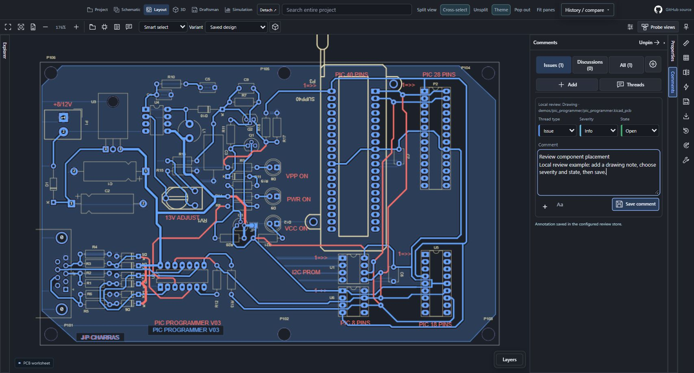

# Comments and review conversations

Record findings against a drawing, component, property, BoM field or rectangular area. Notes retain the saved file, revision and available location so you can return to the same design context.

[User guide](../USER-GUIDE.md#6-record-share-and-transfer-a-review) · [Repository access](GIT-HOSTS.md) · [Synchronization](REVIEW-SYNC.md)

## Add a local note

1. Select a part, pin or net, then open **Comments**. Use **C** from the drawing to start at the selection.
2. Choose a point or draw an area if the finding refers to a location.
3. Enter the finding and choose its severity and review state.
4. Choose **Save draft** or **Save comment** in local mode.

A local save does not post to GitHub or GitLab. Design values and connectivity remain unchanged.

For a property, use the comment icon beside its field in **Properties**. In **Assembly / BoM**, use the icon beside a cell. The draft retains the field name, reviewed value and part reference; grouped BoM rows retain up to 100 references. Ungroup a larger group before commenting. These actions apply to drawing-linked BoMs, not standalone imported report tables.

## Send to GitHub or GitLab

Choose the destination before sending: a new Issue, an existing Issue, or a supported Discussion. Browse existing threads in the panel or open one by number. GitHub requires a category for a new Discussion. GitLab Discussions are threads inside an existing Issue.

Review the destination, message and optional screenshot, then explicitly select **Comment**, **Post** or **Publish**. The exact label depends on the host and composer. The first remote send asks for destination and Terms acceptance; it is requested again if the stored acceptance is removed or the Terms version changes. Use **Destination…** to change a selected destination.

Supported GitHub website-session Issue workflows can send and read back comments using the matching signed-in browser tab, without connecting broad repository OAuth access. Other operations may require an optional [connected account](GITHUB-SIGNIN.md). GitLab requires access to the selected server and the relevant project permissions. Organization restrictions and repository comment policies still apply.

Use **Open GitHub composer** to prepare a draft on GitHub instead. Opening the form does not submit it. Attach any screenshot manually when using this route.

## Read replies and synchronize

Open **Comments → Threads** or **View comments**, choose an Issue or Discussion and load it. Select **Reply** to prepare a response. Ordinary messages appear in the conversation; they need no drawing metadata.

Visible readers normally check for updates every three seconds, with backoff after failures. Hidden panels do not poll. Use Refresh for a manual check. Provider limits, connection failures and background behavior can delay updates; this is not a live push service.

Synchronized KiCad Online annotations can display a marker or rectangular area in the schematic, layout or supported 3D view. Their metadata includes drawing path, saved revision and point/area coordinates in millimetres. **Locate** uses the saved identity or explicit coordinates on the matching drawing. A plain GitHub/GitLab comment without location metadata remains a conversation message; the viewer does not invent a marker for it.

Only matching, validated annotations become drawing notes. If a location cannot be resolved or the displayed source differs, open the referenced revision and drawing. Bounded thread reads can omit older messages; truncation warnings link to the original provider thread.

## Filter findings

Use **Issues**, **Discussions** or **All**, then filter by state, severity, read status, text or creation date. Sort by severity or creation/update time. Filters also control the annotation markers displayed on the drawing.

Severity runs from **Info** through **Level 1**, **Minor**, **Major** and **Critical**. It is per-comment metadata and does not create provider labels.

A linked note can display the provider thread's last fetched Open/Closed state. Refresh before relying on it. **Skip review** is local to the reader/profile; **Follow issue state** resumes the linked state. Changing a local dropdown or filter does not close a shared Issue. The separate **Close/Reopen issue or discussion** action requires permission and confirmation.

## Mentions and screenshots

Type `@` for available account suggestions, or enter a username manually. Suggestions depend on provider access; notifications happen only when the message is posted.

Paste a PNG, JPEG or WebP into the composer to preview a bounded PNG capture. Review the image before sending, especially for private designs. The connected attachment route needs the provider's upload permissions. A failed upload retains the draft rather than silently posting without the image. Deleting a local note or signing out does not delete a remote attachment.

This capture shows a local note, not a live provider post.

## Keep notes between sessions and devices

Browser notes are local to the profile by default. Export review JSON for backup or transfer. Where supported, Options offers **Connect existing file** or **Create review file** for a `.kicad-review.json` sidecar in your checkout. Stage and commit it with your normal Git tools; the extension does not commit it. Firefox uses explicit import/export instead of automatic selected-file writes.

VS Code keeps the sidecar in the workspace. Remote publication and pinned annotation readback require a trusted checkout, a matching remote and displayed source that matches committed Git blobs. Commit and reopen changed drawings when requested. Browser, Android and VS Code account sessions are separate.

Avoid editing one sidecar simultaneously in several applications. If a conflict is reported, reload notes before retrying. Disconnecting a sidecar does not automatically migrate its drafts into browser storage.

## Send failures and recovery

A confirmed post records its destination link. If posting succeeds but local saving or readback fails, the viewer reports a recovery warning rather than treating the remote post as absent.

An interrupted request can have an uncertain outcome. Check the provider before retrying to avoid duplicates. **Recover published comment**, when offered, searches for an exact matching saved annotation without posting again. If it finds no unique match, inspect the provider thread manually.

For access errors, check the matching source tab, account permissions, destination and repository policy. Signing out clears the local account session but does not remove remote posts or revoke the provider's authorization.

## Storage limits

Local browser notes are limited to 100 per drawing and revision. Review JSON import/export supports up to 100 notes and 1 MiB; a connected sidecar supports up to 1,000 notes and 4 MiB. Note text is limited to 4,000 characters. Captures count toward storage limits, so keep large evidence separately.

For schema, policy, provider-specific limits and implementation history, see the [technical comment reference](maintainers/COMMENTS-REFERENCE.md). [Contact support](mailto:support.kivi@sigharmonic.com) with a non-confidential example if a problem persists.
