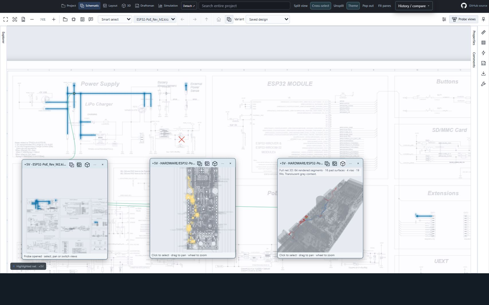
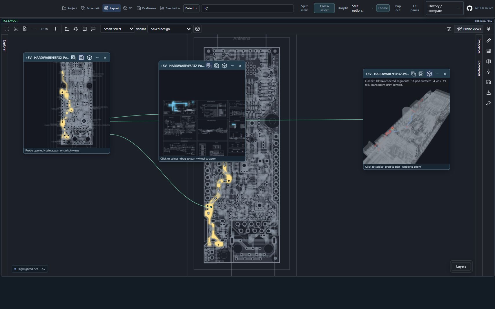
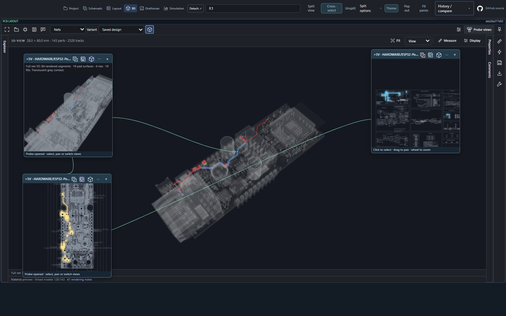
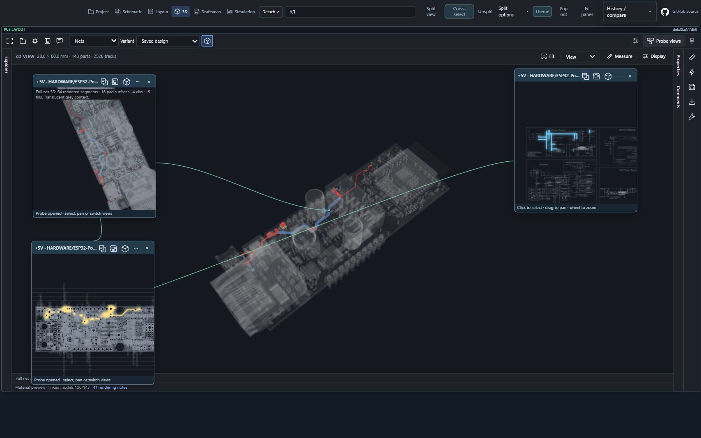

# Cross-probe popup workflows · 0.12.79

> Historical 0.12.79 capture: the R1 root-relative association limitation below is fixed in 0.12.80. It was a viewer identity-normalization defect; the saved public design files were not changed.

These **2 November 2026** captures demonstrate a shared **+5V net** with the **schematic, layout or 3D viewport as the starting view**. Each example retains the main view and opens independent floating miniature viewports. They are actual screenshots of the unchanged packaged 0.12.79 UI, using the same original public [Olimex ESP32-PoE M2 sources](https://github.com/OLIMEX/ESP32-POE/tree/deb38a377d50eadb04ddc7118a17a5ae58b1ee53/HARDWARE/ESP32-PoE-hardware-revision-M2) and linked model assets as the [main gallery](SCREENSHOT-GALLERY-0.12.79.md).

[Capture manifest and hashes](images/0.12.79/cross-probes/capture-manifest.json) · [Final DOM-backed interaction observation](images/0.12.79/cross-probes/interaction-observation.json).

## What was verified

| Main starting view | Schematic popup | Layout popup | 3D popup |
| --- | --- | --- | --- |
| Schematic | Shown | Shown | Shown |
| Layout | Shown | Shown | Shown |
| 3D | Shown | Shown | Shown |

This matrix concerns **net-based mapping on this saved board**, not certification of every part, pin or repeated sheet. The popup mode buttons and selected +5V identity were checked in addition to visually inspecting the drawings. Curved green guide lines connect selected geometry to popup boundaries; guides update when popups or their cameras move.

## 1. Schematic → layout and 3D popups

Start in the schematic. Select a component connected to the desired net—here **R1**, then its **Highlight net +5V** property action. Open **Probe views**, select the +5V occurrence and close the occurrence list. Keep one popup in Schematic mode. Use its **⋯ → Open probe** action to create siblings, then select **Layout** or **3D** in each sibling’s header. Drag the popup headers apart.

The main schematic remains visible, the PCB popup highlights the corresponding saved copper, and the 3D popup displays that net with translucent grey board context. The 3D popup reports **64 rendered segments, 16 pad surfaces, 4 vias and 19 fills**. These are renderer counts, not independent physical connectivity certification.

## 2. Layout → schematic and 3D popups

Start in Layout and select **+5V** through the connected component’s net action. Open its occurrence with **Probe views**. Keep the first popup in Layout mode; create siblings and switch them to **Schematic** and **3D**. Fit the main drawing while retaining the net selection. The source remains the PCB layout throughout this capture.

## 3. 3D → layout and schematic popups

Start in **3D**, set the selection filter to **Nets**, select the **Top** camera, and click the rendered +5V copper. The actual click was verified through properties showing **+5V**, saved code **1**, **13 pads**, **64 track segments**, **4 vias** and **19 zones**. Change the main camera to Isometric and open **Probe views**.

Keep the first popup in **3D**. Open another from that popup and switch it to **Layout**. From the layout popup, use **⋯ → Open probe** again and switch the new popup to **Schematic**. All popups remain within the same main workspace; this is also a demonstrated popup-from-popup workflow, not a separate operating-system/browser window.

## 4. Independent interaction

In the three-popup set above:

- Rotate the **layout popup 90° clockwise** through its options.
- Wheel-zoom and drag-pan inside the **schematic popup**.
- Drag inside the **3D popup** to orbit its camera.
- Move any popup with its header; keep the options menu closed while inspecting.

The main isometric viewport remains in place while the miniature cameras change. The recorded final state has three guide paths and three live popup canvases, with modes 3D, Layout and Schematic. The options menu also offers selection filters and a **Links** toggle; this capture does not claim a pin-selection acceptance test.

## Limits found during capture

**R1 component mapping is rejected on this saved Olimex revision.** Switching a component-only R1 probe from schematic to layout produced: “Saved schematic instance does not match this drawing; select the target sheet explicitly.” This protects against selecting an unrelated footprint when saved design associations disagree. The working examples above use the shared +5V net; they do not establish that this project’s component/pin associations are repaired.

The main 3D renderer loaded **126/143 linked component models**. Its existing unsupported pad/zone/drill geometry and missing-model diagnostics remain applicable; the images do not prove complete model or copper fidelity. Popup guides indicate the selected saved geometry, not electrical airwires or a newly computed connectivity solution. There is a four-popup limit.

These are local browser captures through the public-project bridge. They do not establish installed Chrome/Firefox extension behavior, VS Code GPU acceptance, detached-browser-window synchronization, provider writes or physical Android acceptance. No new application release or source modification was made for these screenshots.
