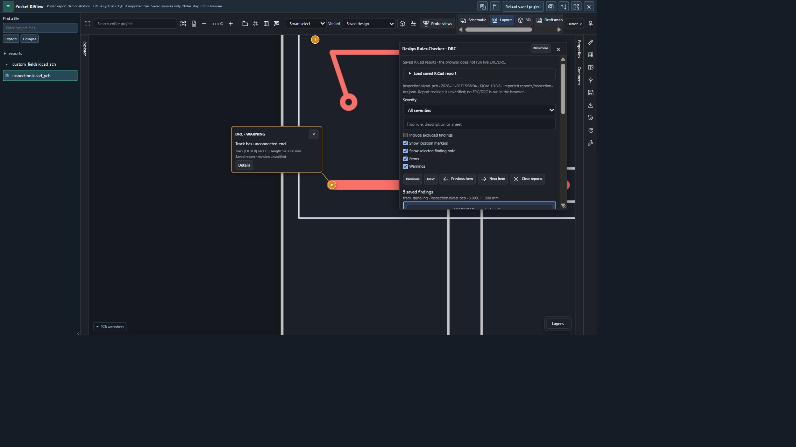
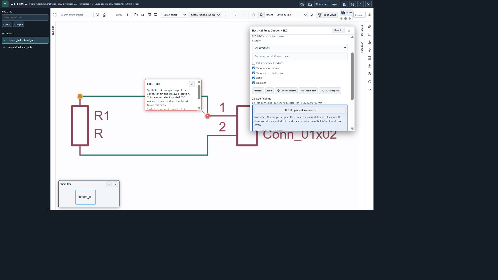

# View saved DRC and ERC reports

Pocket KiView reads supported KiCad JSON rule reports and places their saved
findings on the matching PCB or schematic. It does **not** run KiCad's ERC/DRC
engine in the browser. A report may be older than the loaded design; the viewer
shows its producer/date/source and revision uncertainty.

## Open and inspect

1. Open the project with its report JSON files. Repository/project discovery looks
   for saved ERC/DRC candidates, including uppercase `.JSON` filenames. Manual
   JSON import is available in the checker's **Load saved KiCad report** section.
   The supported report limit is 5 MiB.
2. Open **Explorer → ERC / DRC**, or click a report marker in the drawing. The
   floating checker can be moved, minimized or closed.
3. Click a finding or its individual item. The viewer jumps to the saved location
   and shows an arrow, severity marker and note. **Details** opens the complete
   finding context. Previous/Next and Previous/Next item navigate the report.
4. Filter by severity or text. **Show location markers**, **Show selected finding
   note**, **Errors** and **Warnings** control the visible annotations separately.
5. Associate a report with the correct drawing when required. ERC hierarchy paths
   must map to actual loaded sheets before markers/jumps are enabled; the viewer
   does not guess child-sheet coordinates or invent locations for text-only items.

Manual repository imports validate the returned file path, and late responses
cannot restore a cleared/disposed report session. Report JSON remains data, not
executable page content.

## PCB example — retained native DRC export

The public synthetic PCB fixture `inspection.kicad_pcb` has a retained **KiCad
10.0.6 DRC export** containing five findings. Some findings have multiple items,
so six location markers appear. The demonstration below clicked the dangling
track marker, jumped to its saved point and opened the complete note. Marker
visibility was checked off (zero visible markers) and back on (six restored).

## Schematic example — explicitly synthetic ERC data

The schematic capture uses `custom_fields.kicad_sch` with **synthetic QA ERC
data**, one example error and one warning. It demonstrates report ingestion,
sheet association, markers, notes and severity visibility. It is not evidence
that a native KiCad ERC run found those errors.

These captures were taken in the integrated browser using the shared viewer and
public fixtures, with no provider account or private organization content. They
demonstrate report visualization, not installed Firefox/Chrome/VS Code or mobile
acceptance of every rule-report version. Older/newer unsupported report fields
are diagnosed; the native KiCad check remains the authority for design closure.
