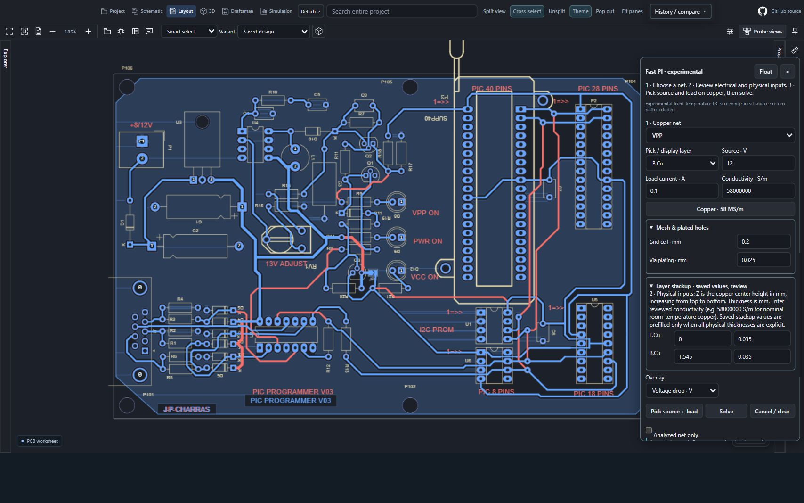
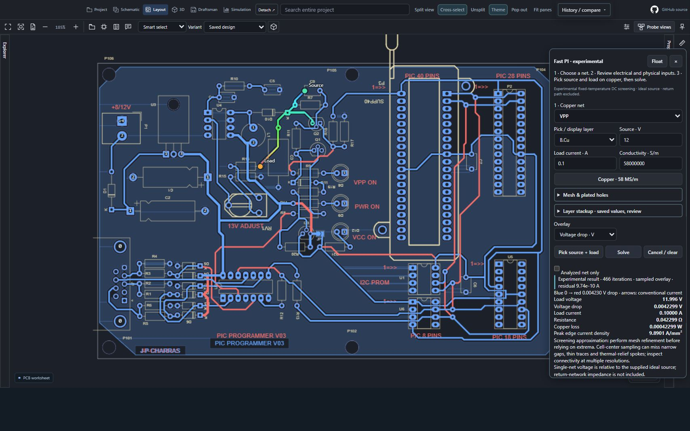
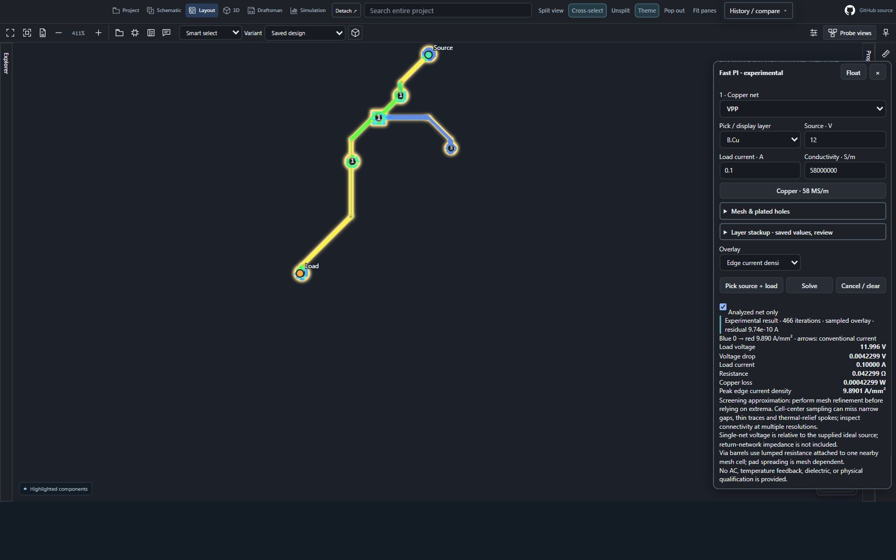
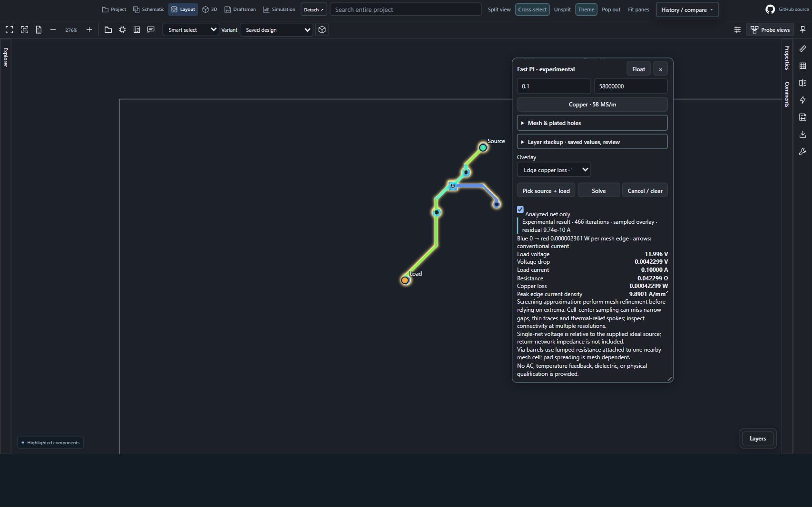
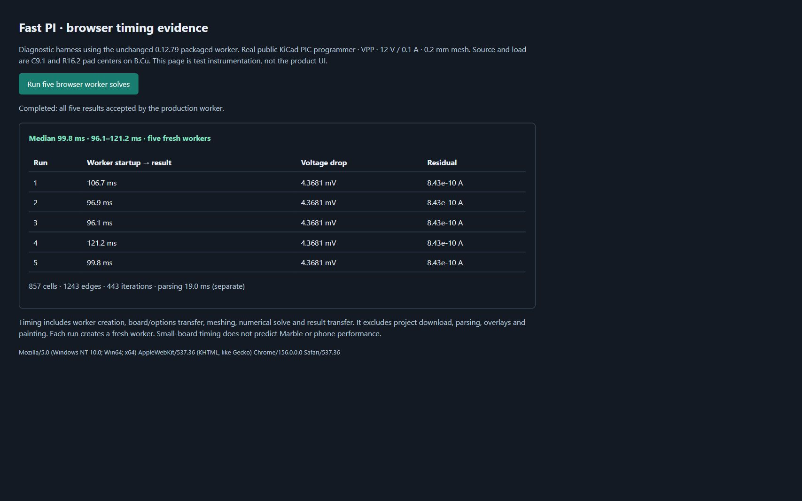

# Fast PI: setup, results and measured speed · 0.12.79

Captured on **2 November 2026** using the unchanged packaged 0.12.79 browser viewer. These are real results, not imported simulation pictures. The five images supplement the [38-image workflow gallery](SCREENSHOT-GALLERY-0.12.79.md).

The source is KiCad’s public [PIC programmer PCB](https://github.com/KiCad/kicad-source-mirror/blob/29798a640054e91411a44d230bd3a3425b3166e4/demos/pic_programmer/pic_programmer.kicad_pcb), immutable revision `29798a640054e91411a44d230bd3a3425b3166e4`. Original PCB SHA-256: `b9d90e6184a1e4873d50be65da1faefaf7d003638ed16cef8e0212f247e64da7`. The saved design was not altered. KiCad and the design authors retain their rights; no endorsement is implied.

## Setup

1. Open the board’s **Layout**, then **Simulation → Fast PI** or the Fast PI toolbar action.
2. Choose **VPP**, with **B.Cu** as the picking/display layer.
3. Enter **12 V**, **0.1 A**, and nominal room-temperature copper conductivity **58,000,000 S/m**. These are explicit demonstration assumptions, not inferred circuit ratings.
4. Review the saved two-layer copper stack: **0.035 mm** copper thickness on each layer, copper centers **0 and 1.545 mm**. Enter **0.025 mm** assumed plating and a **0.20 mm** grid.
5. Select **Pick source + load** and click copper near **C9.1**, then **R16.2**. Select **Solve**.

The 0.10 mm grid exceeds the current work budget for this net; the application requests a coarser grid. VPP’s saved geometry includes tracks and through-hole pads, with no filled zones. This example does not establish filled-zone accuracy on a complex power plane.

## Browser results and interactions

The manual-click browser run produced:

| Quantity | Displayed result |
| --- | ---: |
| Source / load current | 12 V / 0.10000 A |
| Load voltage | 11.996 V |
| Voltage drop | 0.0042299 V · **4.230 mV** |
| Resistance | 0.042299 Ω · **42.299 mΩ** |
| Copper loss | 0.00042299 W · **0.423 mW** |
| Peak sampled edge current density | 9.8901 A/mm² |
| Iterations / residual | 466 / 9.74 × 10⁻¹⁰ A |

**Voltage drop:** retain the full layout context and inspect the source/load markers and sampled gradient. Arrows indicate conventional current; only a sampled overlay is drawn.

**Current density:** enable **Analyzed net only**, switch Overlay to **Edge current density**, and zoom into the path. Pad numbers remain visible. Unconnected islands are not assigned invented voltages.

**Copper loss:** switch to **Edge copper loss**, select **Float**, and drag the panel header. The legend is loss per mesh edge; the sidebar reports total copper loss. The shown floating panel was moved and scrolled through actual UI interactions.

## Measured speed

A separate diagnostic page measured the **unchanged packaged Fast PI worker** on the same original board, with repeatable **pad-center** contacts at C9.1 `(143.002, 49.784)` and R16.2 `(128.270, 75.184)` mm, both on B.Cu. These differ slightly from the manually picked contacts in the product screenshots, so the result is **4.3681 mV**, rather than 4.2299 mV.

| Measurement | Observed time |
| --- | ---: |
| Browser, five freshly created workers: median | **99.8 ms** |
| Browser worker runs: minimum–maximum | **96.1–121.2 ms** |
| Solver-only Node.js, 15 runs: median | **50.6 ms** |
| Solver-only Node.js: minimum–maximum | **47.3–74.0 ms** |

The browser measurement starts immediately before creating each worker and ends when its result message arrives. It includes worker startup, board/options transfer, meshing, solving and result transfer. It **excludes project download, parsing, overlay generation and painting**. All five workers returned an accepted result; each used **857 cells, 1,243 edges and 443 iterations**. The Node benchmark excludes worker startup and uses the same production solver bytes. Both ran on this Windows computer with an **Intel Core Ultra 7 255H**; Node version was **24.14.0**. These timings are not a whole-app load benchmark or a promise for Marble or Android devices.

The next image is explicitly **benchmark instrumentation**, not a new product screen:

[Raw browser measurements](images/0.12.79/fast-pi/browser-worker-benchmark.json) · [Solver measurements and mesh study](images/0.12.79/fast-pi/solver-benchmark.json) · [Capture hashes and provenance](images/0.12.79/fast-pi/capture-manifest.json).

## Accuracy and acceptance limits

The pad-center mesh study produced **3.859 mV at 0.19 mm**, **4.368 mV at 0.20 mm**, **4.535 mV at 0.22 mm**, and **4.041 mV at 0.25 mm**. The approximately **12% change from 0.20 to 0.19 mm means this example is not mesh-converged**. The non-monotonic change is consistent with cell-center sampling of narrow copper, contacts and holes; a low numerical residual alone does not establish geometric accuracy. Do not use this demonstration for sign-off or trust its peak density without refinement and comparison with an independently validated solver.

Fast PI is **experimental fixed-temperature 2.5D DC screening** with an ideal source. It excludes return-network impedance, AC behavior, dielectric effects, thermal feedback and component device models. Through-hole barrels are lumped resistances; local spreading and narrow features depend on the grid. The solver’s 13 focused checks passed, including analytical strip resistance, current balance, power conservation, layer transitions and rejection of disconnected/unsupported geometry. Those checks do not qualify arbitrary boards.

The earlier Olimex case remains unsupported because of slotted drilled pads. No omitted geometry was removed to manufacture a successful result. These captures use the local public-project bridge; they do not establish installed Chrome, VS Code, provider-write or physical-Android acceptance.
