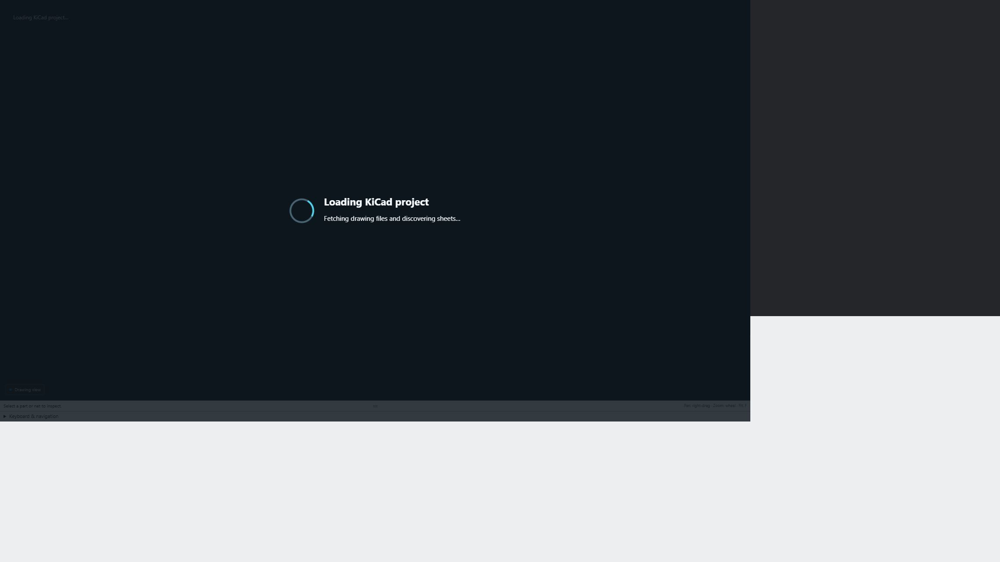

# Loading performance

Version 0.12.18 prepares the initial schematic or PCB in a bundled Web Worker. Project indexing, geometry and connectivity run away from the browser UI thread. A centered spinner shows the current stage and elapsed time during fetching, preparation and display. It clears on success or failure; changing files cancels stale preparation. Stages describe actual work rather than an estimated percentage.

This screenshot captures the production schematic viewer loading public Marble sources through local fixture transport. It does not demonstrate installed-extension authentication or remote network performance.

## Measured changes

Measurements were made on the same Windows host using Node.js. They measure individual preparation phases, **not total download-to-display time**. Hardware, repository access, project size and browser performance affect results.

| Workload | Before | After | Interpretation |
| --- | ---: | ---: | --- |
| Project model preparation, 25 retained Marble schematics, 22.8 MB source | 3,857 ms across two builds | 1,016 ms, one build | About 3.8× faster for this phase; single-run comparison |
| Full Marble PCB settings, 44.1 MB source | 1,337 ms | 980 ms | 27% faster, median of five runs |
| Heap allocation delta during that settings parse | 386.6 MiB | 55.9 MiB | About 86% less allocation; this is not peak memory |
| Cross-sheet matching stress fixture, 128 sheets / 8,192 networks | 422 ms | 11.3 ms | About 37× faster, same-VM median; synthetic stress case |

The old settings entry point rejected the full Marble PCB at its 8 MiB limit. The settings timing compares its full-AST parser with the input limit aligned to the drawing parser's existing 64 MiB PCB limit. The new settings scanner accepts this board, validates skipped geometry, and retains the same saved settings without constructing a geometry AST. Non-PCB settings retain their 8 MiB limit.

## What changed

- Project object extraction and schematic metadata share a parse rather than independently parsing every file. The redundant viewer preflight model build is removed.
- Connectivity extraction also shares parsed forms. Sheet matching indexes hierarchy links, memoizes reachability and expands each global label alias once.
- PCB settings parsing skips allocation of drawing geometry while validating its syntax and resource bounds.
- Settings display caches unchanged sections and constraint rows. A page-local parsed-settings cache retains at most three entries and 96 MiB of estimated source storage; reuse requires the same revision and exact source. It clears when the page closes and does not persist repository files.
- Initial drawing and settings preparation run in local workers. Workers perform no repository requests and receive no credentials.

Existing saved-source validation and traversal bounds still apply. These changes do not add fresh copper filling, native ERC/DRC computation or resolve unsupported models. Model network lookup and conversion remain separate costs. First visits to other sheets can still require preparation; the worker change targets initial loading. Browsers without usable workers and the VS Code webview use the synchronous fallback, with the loading surface painted before preparation. The standalone hosted app has a separate loader and is not covered by these worker improvements.

## Reproduce

Run `node --expose-gc extension/tests/benchmark-project-settings.cjs` against the retained local Marble fixture. The benchmark reports five-run medians and compares the old full-AST path with the new scanner, checking result equality. The fixture is not bundled in releases.

Run `node extension/tests/net-model.bench.cjs` for current matching timings, or pass a prior `net-model.js` path to compare both implementations in one VM. Synthetic fixtures are generated by the benchmark. Keep actual-board measurements separate from synthetic stress improvements.

After updating, reload the extension and refresh repository tabs so the HTML, scripts and worker come from the same package.
