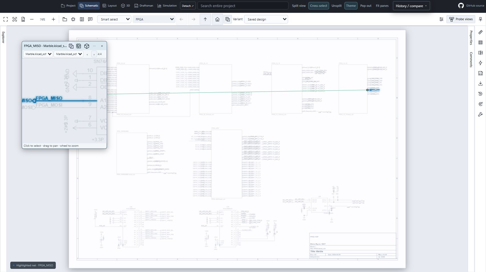
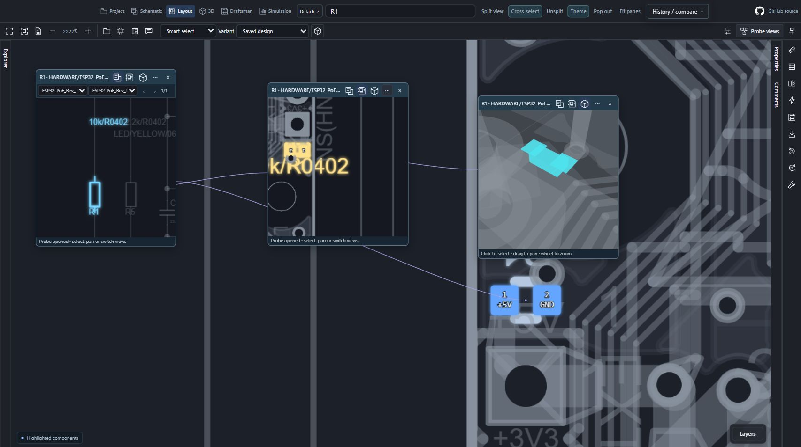
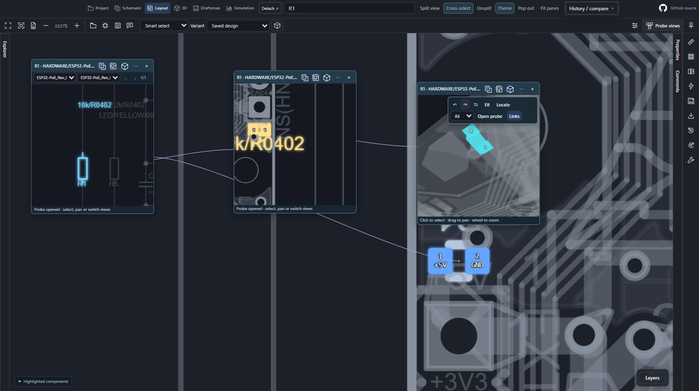

# Independent cross-probes · 0.12.80

These are real public saved boards in the packaged viewer, running in the integrated browser through a local snapshot bridge. They are not mockups or installed-store/device acceptance.

## Multiple highlighted sheets

Marble's **FPGA_MISO** has four connected sheet occurrences. The popup has independent **Probe sheet** and **Highlighted occurrence** dropdowns plus Previous/Next. The parent remained **FPGA** while the popup visited FPGA_12_13, PMOD and MMC. An unrelated manually browsed sheet has no highlighted occurrence; Next returns to the connected set. Repeated instances retain their saved hierarchy identity.

## R1 association fix and three views

R1 now resolves across the real Olimex M2 schematic and PCB. The source PCB stores a root-relative symbol path; the schematic stores the same path prefixed by its document UUID. The viewer normalizes only that known root and preserves identity outside the bounded properties snapshot. It continues to reject ambiguous repeated placements and foreign roots. No saved design files were edited.

Press **P** on a selected item. Switch its probe among Schematic/Layout/3D; open a sibling from its options menu or press P while the probe is focused. Each probe pans, zooms and moves independently. The middle layout probe above is rotated 180°; guide endpoints attach to saved pad/body geometry instead of distant field text.

## Flip and rotation

The 3D probe above was flipped and rotated 90° independently. Options are tucked behind the ellipsis. Main and popup **F** flips; **R / Shift+R** rotates 90° clockwise/counterclockwise. Popup **[ / ]** also rotates; main PCB brackets retain layer cycling. Main **D** opens a selected component's safe datasheet link, **C** comments, **P** opens a probe, **T** changes drawing theme. Typing fields retain normal keyboard input.

Sources: [Marble](https://github.com/BerkeleyLab/Marble/tree/a426777d92c0f22a546d4740b419a3937e0c1f90/design), [Olimex ESP32-PoE](https://github.com/OLIMEX/ESP32-POE/tree/deb38a377d50eadb04ddc7118a17a5ae58b1ee53). [Capture hashes and limits](images/0.12.80/capture-manifest.json).
