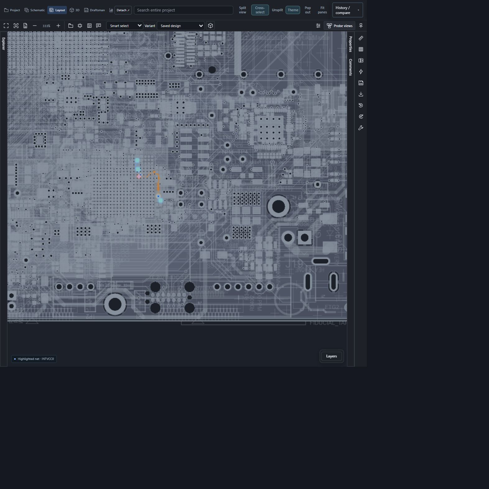
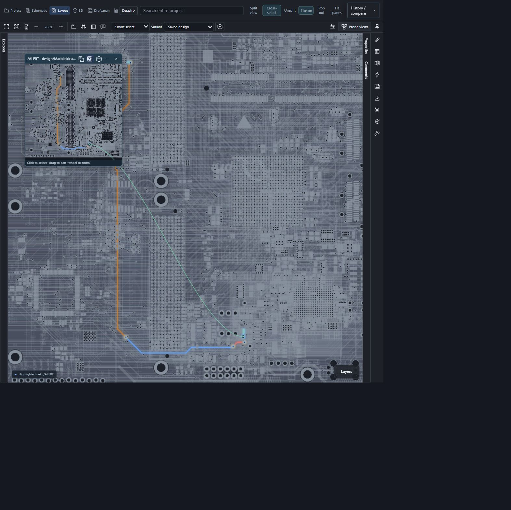
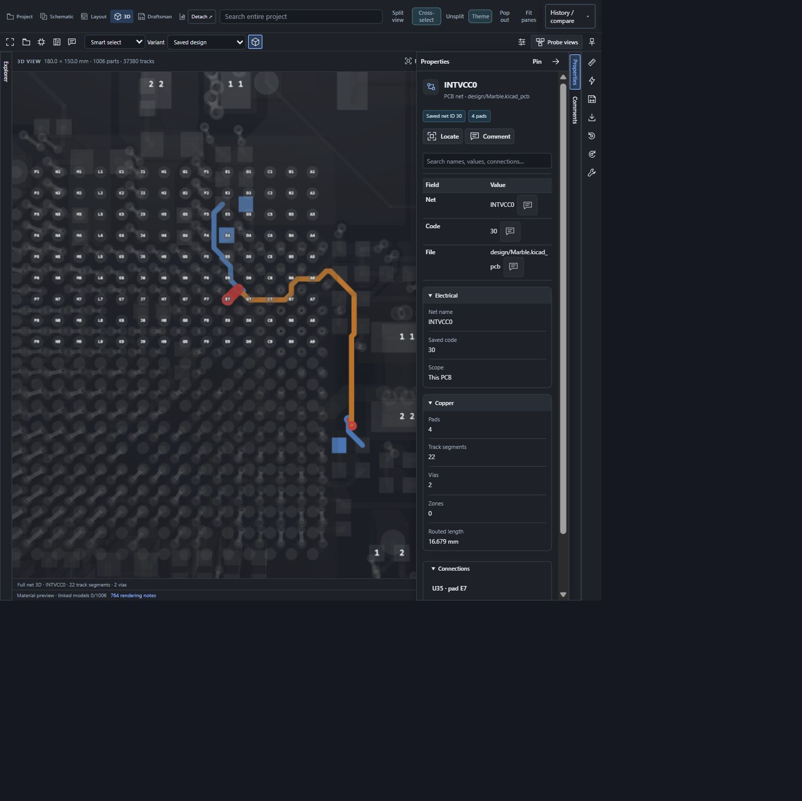
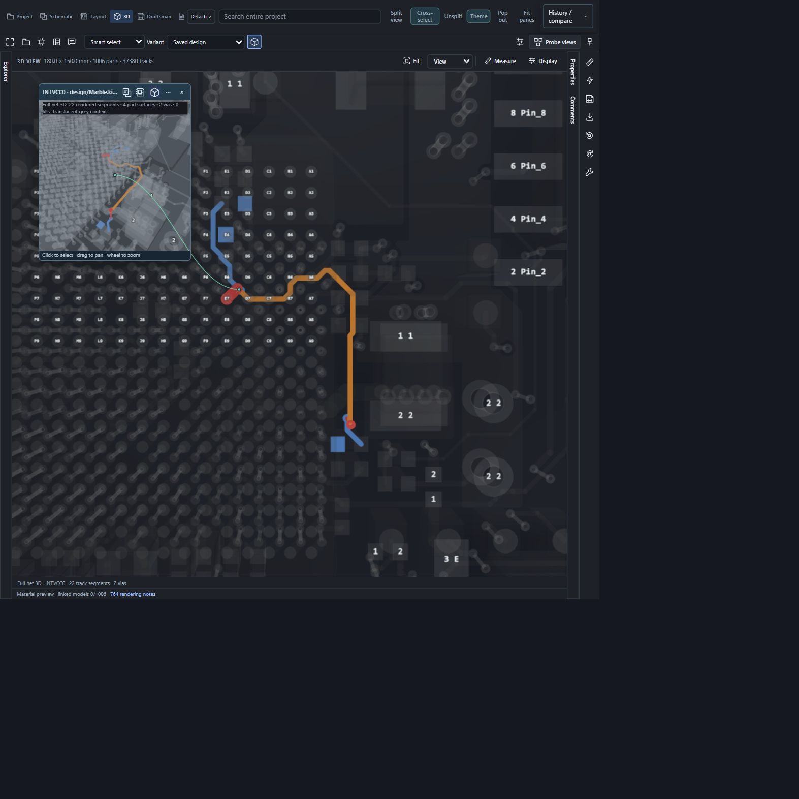
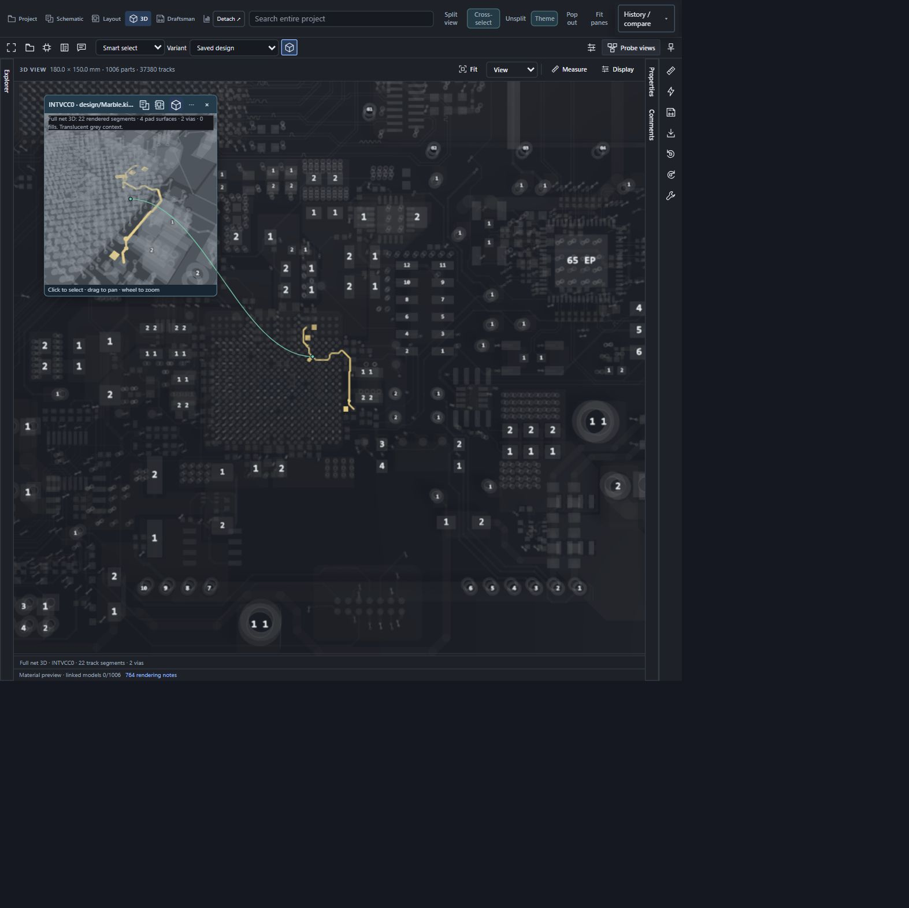

# Layer-colored net highlights — 0.12.89

## Source and method

The complete public [BerkeleyLab/Marble PCB](https://github.com/BerkeleyLab/Marble/blob/a426777d92c0f22a546d4740b419a3937e0c1f90/design/Marble.kicad_pcb) was reused from the retained acceptance corpus: 44,059,775 bytes; SHA-256 482850dbaaef9157e2e98af765a3c0d4d9c9f800daae224a54bf10e0621f52b0. Saved board version 20211014, 12 copper layers, 1,006 footprints and 37,380 tracks. See [demo-board credits](DEMO-BOARD-CREDITS.md).

An integrated-browser localhost harness buffered the PCB and accompanying project file into the production project/workspace/viewer. No repository API requests or new source downloads were required. This verifies the shared rendering UI, not the installed Chrome/Firefox/VS Code host or Android device.

## Observed interactions

| Check | Result |
| --- | --- |
| Full PCB loads in layout and 3D | Passed |
| /ALERT selected across layout and independent layout probe | Layer colors visible; 30 segments, 3 pads and 4 vias |
| INTVCC0 selected in 3D and independent 3D probe | Front red, In2 orange and back blue visible; 22 segments, 4 pad surfaces and 2 vias |
| Switch Layer colors → Accent → Layer colors | Both main and probe update on the existing selection |
| Independent 3D popup zoom; R / Shift+R rotation | Passed |
| Return from 3D to layout and Fit highlights | Selection and layer-color preference retained |
| Captured browser script errors | None |

### Layout

### 3D and independent probe

## Limits

These are unretouched browser-content captures; they include only a public board. No external component models were included: 0 of 1,006 linked models resolved, so component bodies are footprint proxies rather than acceptance of real component models. Rendering diagnostics remain: 18 unfilled zones have boundaries only; zone budgets omit some geometry; 2,847 drill loops were not cut; 101 front and 25 back unsupported pad shapes were omitted. Selected-net coloring does not resolve these pre-existing fidelity limits. The small selected nets above fit the bounded overlay.

Same-origin detached-window preference propagation is covered by automated checks; a separate installed detached-window session and physical Android device were not exercised in this run. No performance benchmark or universal rendering-fidelity claim is inferred from these checks.
