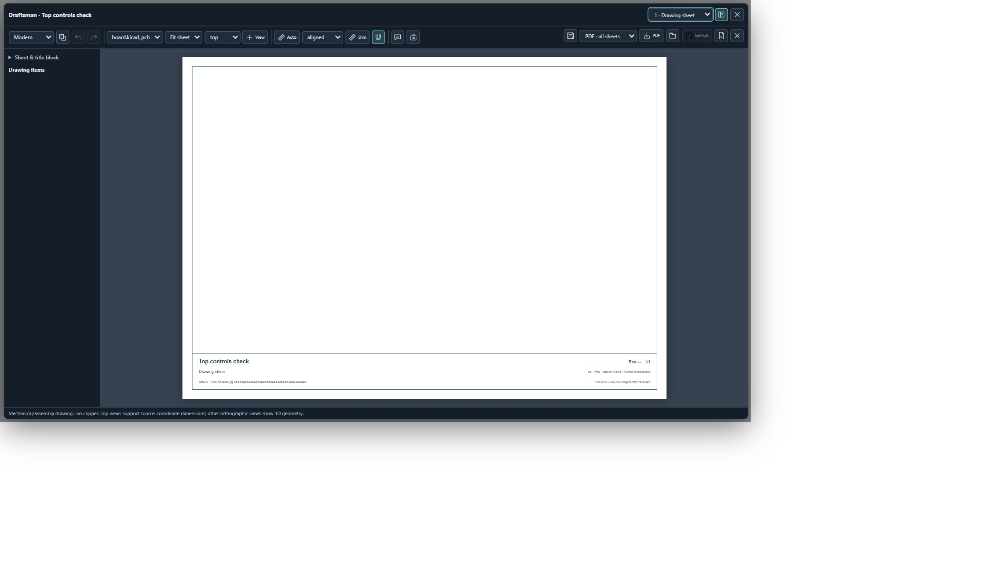
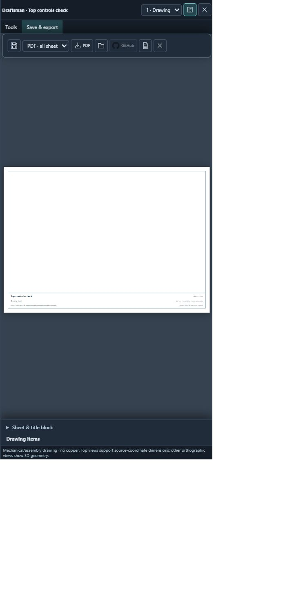
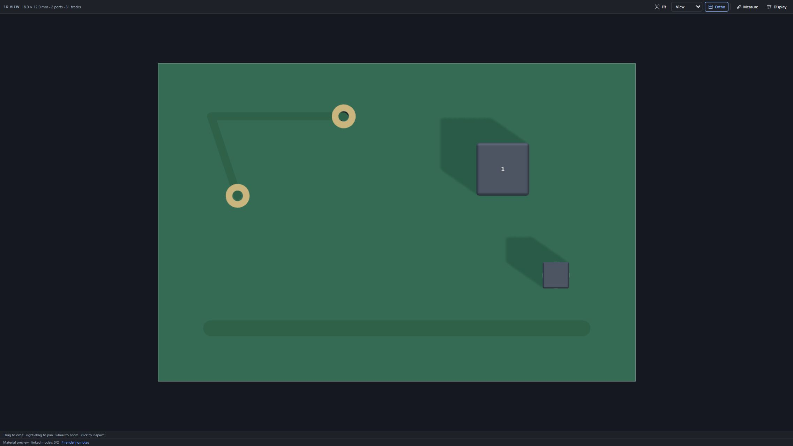

# Top controls and orthographic inspection — 0.12.90

Production viewer components were checked in the integrated browser on 5 November 2026. The Draftsman check uses an empty source-bound document and a tiny synthetic PCB; the 3D check uses the retained public project fixture [inspection.kicad_pcb](../extension/tests/fixtures/net3d/inspection.kicad_pcb). These checks establish UI layout and projection behavior, not a new complex-board fidelity or physical-device result.

- Project dashboard is the first top navigation action and opens the extension dashboard. Standalone drawings use the top toolbar. Placement and destination checked using the existing viewer harness.
- Desktop Draftsman drawing and export controls remain above the document. PDF button bounds were verified above the document body.
- At a 390 × 844 CSS viewport, Tools and Save & export open from the top; tapping the drawing collapses export controls. Close remains accessible.
- Top + Ortho shows a parallel projection. Turning Ortho off with Sharp antialiasing active renders successfully; no script errors recorded.
- Numerical and lifecycle regressions cover target-plane scale on switching, depth-independent orthographic size, resize/fit, correct OrbitControls camera ownership, BGA annotations, links and anchors.

The 3D fixture uses footprint proxy bodies; this is not evidence of real component-model loading. Main camera switching was exercised in-browser; independent popup switching also passed automated lifecycle checks. Browser screenshot scale may differ from CSS viewport dimensions.
