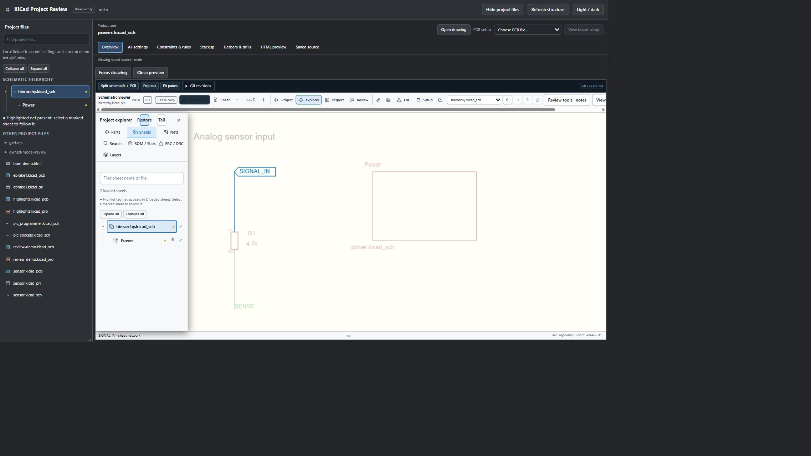

# Sheet hierarchy and net navigation

Open a saved schematic from a repository file page. If a child is opened, the viewer searches its directory and ancestor directories for the saved root, then loads the root's referenced descendants. The project manager and **Explorer → Sheets** use the same loaded graph, labels, nesting and active-sheet selection. Files outside that graph remain under **Other project files**.

Use the branch arrows, Expand all / Collapse all, or search to find a sheet. Search retains matching sheets' ancestors. Back, Forward, Up and Root stay available in the top sheet toolbar. Unavailable referenced files appear explicitly instead of disappearing. The source arrow opens the saved file on its Git host; the parent-location button locates the child sheet symbol.

## Follow a net across sheets

1. Select **Explorer → Nets**, or highlight a net in the drawing with **H**, backtick or tilde.
2. Open **Sheets**. Gold dots and tinted sheet names mark the loaded sheets containing a proven related net. Both the outer project hierarchy and inner explorer update.
3. Click a marked sheet. The viewer opens that sheet, keeps the related net selected and fits its visible geometry. Properties also offers **Matching sheets** navigation.
4. Clear the net highlight to remove its sheet badges. Pinned net selections can mark multiple groups.

This screenshot uses the actual nested browser viewer with synthetic saved drawings and mocked local Git transport. It does not establish installed-extension or private-repository acceptance.

## Connectivity and loading limits

Cross-sheet matching uses exact saved global labels, explicit global power symbols, and exact parent sheet-pin / child hierarchical-label connections. Sheet links retain their saved UUID and resolved child path. Equal local label names alone do not connect sheets. Repeated sheet instances and their descendants, cyclic hierarchical edges, implicit hidden power pins and buses are excluded from hierarchical matching. Reused files share a file view. This is not a complete KiCad netlist or an ERC result.

Only loaded files in the selected project are searched. Explicit power-symbol membership also requires available conductive pin metadata; an unrendered symbol without that metadata may not produce a sheet match. Parent discovery permits 128 candidates, traversal retains at most 128 files, total source remains limited to 96 MiB, and reads run with concurrency four. Incomplete discovery shows a warning; open the known root directly to avoid searching unrelated candidates. API permissions, unavailable references and rate limits can still prevent loading.
