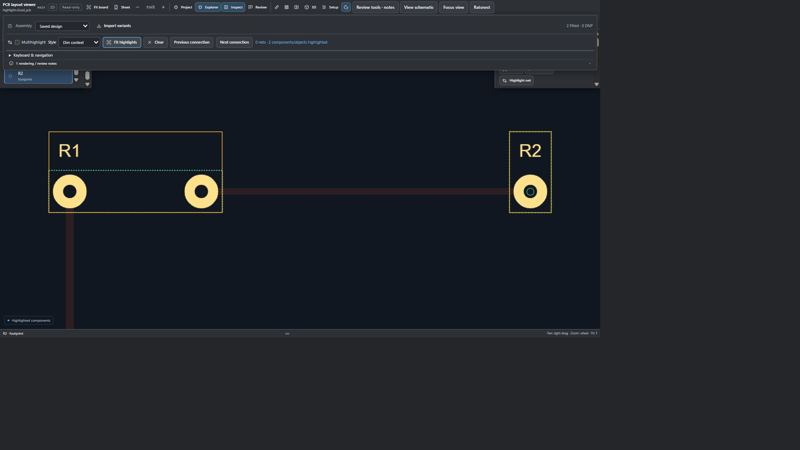

# KiCad Visual Review v0.12.13

## Group highlighting

Use **Ctrl**, **Shift** or **Command-click** to add or remove drawing objects or Parts rows from a highlight group. Alternatively, enable **Multihighlight** in **Review tools** and click items normally. An additive canvas click preserves the camera. **Fit highlights** fits the group on the active drawing; **Clear** or **Esc** clears the group and its paired highlights.

Selecting a sheet in the navigator opens it and highlights its loaded objects and descendant sheets. Selecting a subsheet symbol highlights the symbol and its loaded subtree while keeping the parent view. Groups retain members across loaded sheet files. Saved file views do not expand reused-sheet instances, and missing sheets are not invented. Groups are bounded to 200 objects; truncated sheet groups show a limit notice.

In linked schematic/PCB views, group selections cross-highlight all unambiguously matched saved parts and nets together. Unmatched or ambiguous identities are reported. Each view shows members belonging to its active file; the remaining matched members are retained when navigating sheets. Net classes and search groups also propagate their matched parts/nets. Source designs remain read-only.

The screenshot uses synthetic fixture boards with mocked transport. It is not evidence of installed-browser authentication or a live repository review.

## Downloads

- Chrome / Edge / Brave / Opera / Vivaldi / Chromium: `kicad-visual-review-chrome-edge-brave-opera-vivaldi-chromium-0.12.13.zip`
- Firefox: `kicad-visual-review-firefox-0.12.13.zip` — unsigned development extension.
- Safari: `kicad-visual-review-safari-0.12.13.zip` — macOS conversion and signing required.
- VS Code: `kicad-visual-review-vscode-0.12.13.vsix`

Reload the extension and refresh repository pages after updating.

## Verification

Local release verification passed: 615 JavaScript tests, 64 Python tests with one skip, and package inventory/security audits. Tests cover additive picks, member toggling, sheet descendants, group clearing, saved part/net mapping and malformed group rejection, including VS Code pairing. The local browser showed both component rows selected, two highlighted objects, and a working Fit highlights action. Installed-browser and Safari runtime limitations remain.
