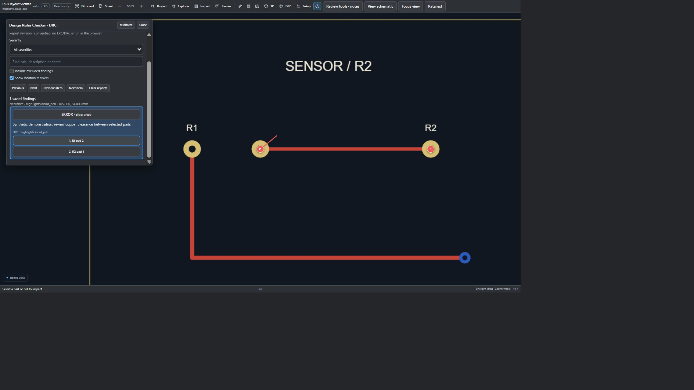

# KiCad Visual Review v0.12.14

## Floating ERC/DRC results in drawing views

The schematic toolbar now has **ERC**, and the layout toolbar has **DRC**. Each opens an independent floating results window in its drawing pane, including split views. The Explorer's ERC/DRC action opens the same window.

Drag the title bar to move the window, resize it with its corner, or use **Minimize**, **Restore** and **Close**. A focused title bar also supports arrow keys (Shift for larger steps) and Esc to close. The window overlays the canvas without reducing its size. Opening other Explorer sections keeps the results window available.

Load a saved KiCad JSON check report from your repository or import a local report. Report-entry controls collapse after loading. Filter by severity, search findings, include excluded items or toggle location markers. Click a finding or an affected item to jump to its position and display an arrow. Previous/Next and Previous item/Next item navigate findings and affected locations. Associated loaded subsheets can be opened automatically; unresolved locations are reported without inventing coordinates.

Closing the window retains its report and visible markers. Clear reports removes those results and markers. ERC/DRC checks are **not executed in the browser**: these are saved native KiCad results, and their correspondence to the viewed revision remains unverified. Run checks in KiCad and export fresh JSON before relying on results.

The screenshot shows the real local viewer with a synthetic DRC fixture and mocked repository transport.

## Downloads

- Chrome / Edge / Brave / Opera / Vivaldi / Chromium: `kicad-visual-review-chrome-edge-brave-opera-vivaldi-chromium-0.12.14.zip`
- Firefox: `kicad-visual-review-firefox-0.12.14.zip` — unsigned development extension.
- Safari: `kicad-visual-review-safari-0.12.14.zip` — macOS conversion and signing required.
- VS Code: `kicad-visual-review-vscode-0.12.14.vsix`

Reload the extension and refresh repository pages after updating.

## Verification

Local verification passed: 619 JavaScript tests, 64 Python tests with one skip, and package inventory/security audits. Tests cover toolbar/window behavior, movement, minimization, closing/reopening, result clicks, active arrows, report clearing, subsheet jumps, unresolved locations and blocked 3D navigation. Local browser verification confirmed loading a saved DRC fixture and jumping to an affected pad. No new installed-browser or Safari runtime acceptance is claimed.
