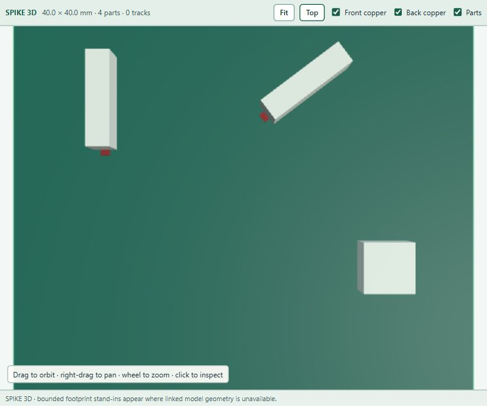

# v0.12.22 — Footprint-bounded 3D stand-ins

Procedural stand-ins no longer use inflated pad-centre dimensions or assume the body is centred on the footprint origin. They use saved fabrication outlines, then courtyard or pad bounds, and follow the footprint's correct scene rotation and back-side placement. Model offsets do not move a stand-in.

Closed body outlines constrain the rectangular stand-in internally, including circular and chamfered shapes. Missing or ambiguous geometry omits the stand-in; guessed default blocks are removed. The selection wireframe also uses the object's actual bounds rather than an enlarged box. Real linked models retain their saved transforms and can legitimately extend beyond the footprint.

Stand-ins remain approximate visual aids with a fixed height, not mechanical clearance models. Open outlines and pad-only footprints use their oriented bounding envelope. Complex or ambiguous closed bodies may have no stand-in.

All browser-named packages and the VS Code VSIX are rebuilt. Firefox is an unsigned development package; Safari requires macOS conversion and signing. Reload the extension and refresh existing viewer pages after updating.

Validation covers off-centre connectors, arbitrary front/back rotations, pad-only geometry, closed circles and concave outlines. Browser visual checks use the retained synthetic `footprint-proxies.kicad_pcb` fixture and production WebGL bundle, without account transport or linked models. Installed KiCad 10.0.6 was available, but native SVG export of this synthetic fixture returned failure without a diagnostic; no native equivalence claim is made.

Pad rotation in the 3D scene now follows the same board-to-scene axis conversion as stand-ins.

699 JavaScript tests passed; 64 Python tests completed with one skip. Package audits passed. Wide dark and narrow light WebGL views were inspected with the synthetic fixture.

