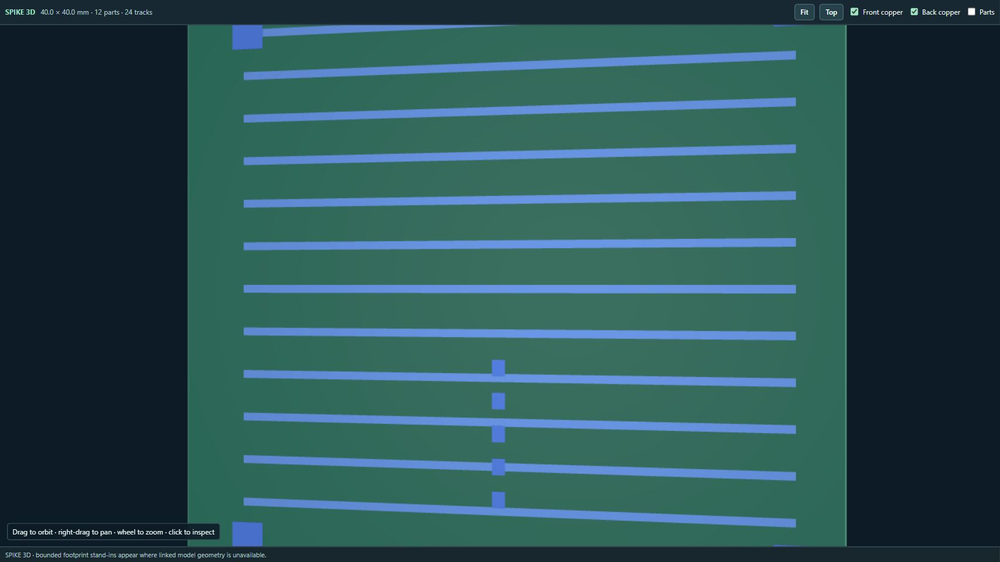

# v0.12.23 — Balanced 3D lighting

The 3D viewer uses neutral ambient fill and equal opposing lights above and below the PCB. Both faces and component side walls remain readable when orbiting. Copper materials use a broader, softer reflection to reduce concentrated glare and preserve layer colour. Linked model geometry and saved transforms are unchanged.

All browser-named packages and the VS Code VSIX are rebuilt. Firefox remains an unsigned development package; Safari requires macOS conversion and signing. Reload the extension and refresh viewer pages after updating.

Validation: 699 JavaScript tests passed; 64 Python tests completed with one skip, and package audits passed. Production WebGL rendering was inspected from the front and underneath using a local synthetic two-sided copper fixture. No live account or native render equivalence is implied.

