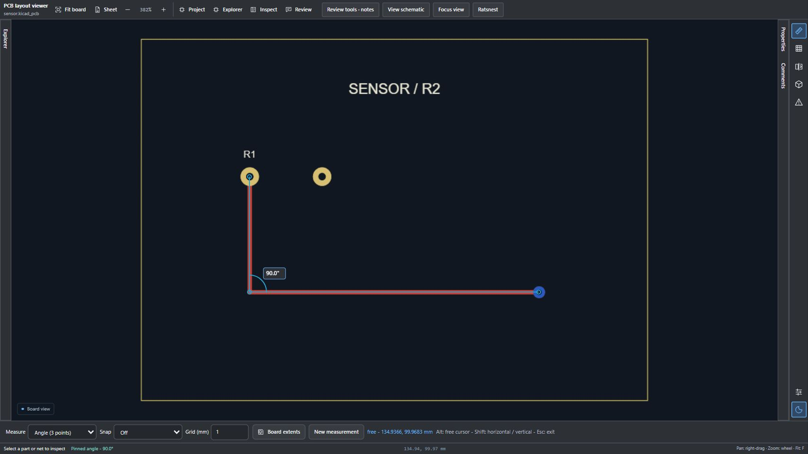

# v0.12.24 — Readable measurement labels and angle ruler

Distance, X/Y offset and board extent labels now have opaque theme-aware backplates and borders. Placement separates overlapping labels where space permits.

Press M or choose Measure, then select **Angle (3 points)**. Click the first arm endpoint, the vertex and the second arm endpoint. A live arc and degree label preview the smaller angle (0–180°); the third click pins it. New measurement restarts it; Escape exits. Geometry/grid snapping and Alt for a free cursor remain available. Degenerate arms are reported rather than assigned an angle. Both schematic and PCB 2D views support the tool.

All browser packages and the VS Code VSIX are rebuilt. Firefox remains unsigned and Safari requires macOS conversion/signing. Reload the extension and refresh viewer pages after updating.

Validation: 701 JavaScript tests passed; 64 Python tests completed with one skip. Package audits passed. Browser inspection confirmed a 90° angle and readable distance/X/Y labels in the wide dark PCB view and a 90° angle in the narrow light schematic view. Synthetic drawings and local mock transport were used; no installed-account or native render equivalence is implied.

