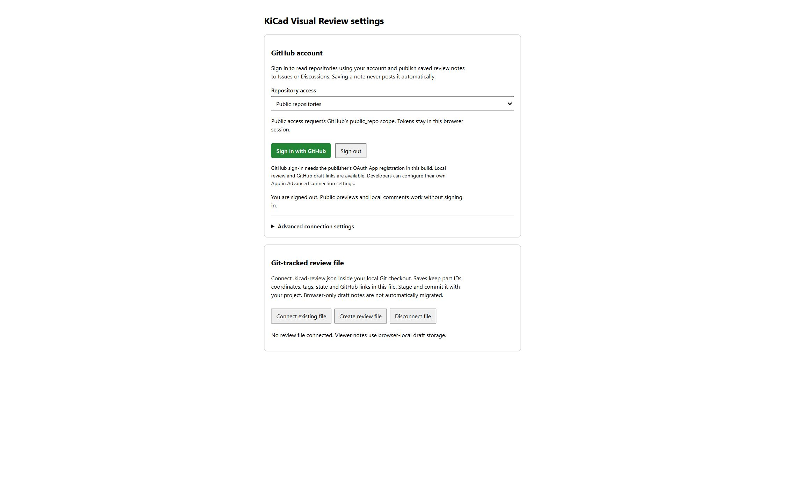
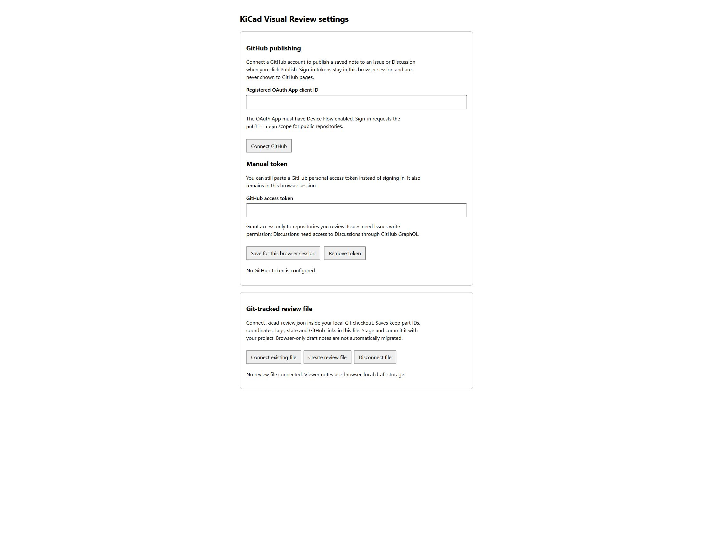
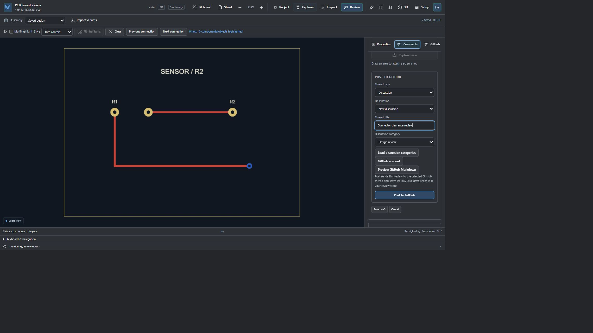
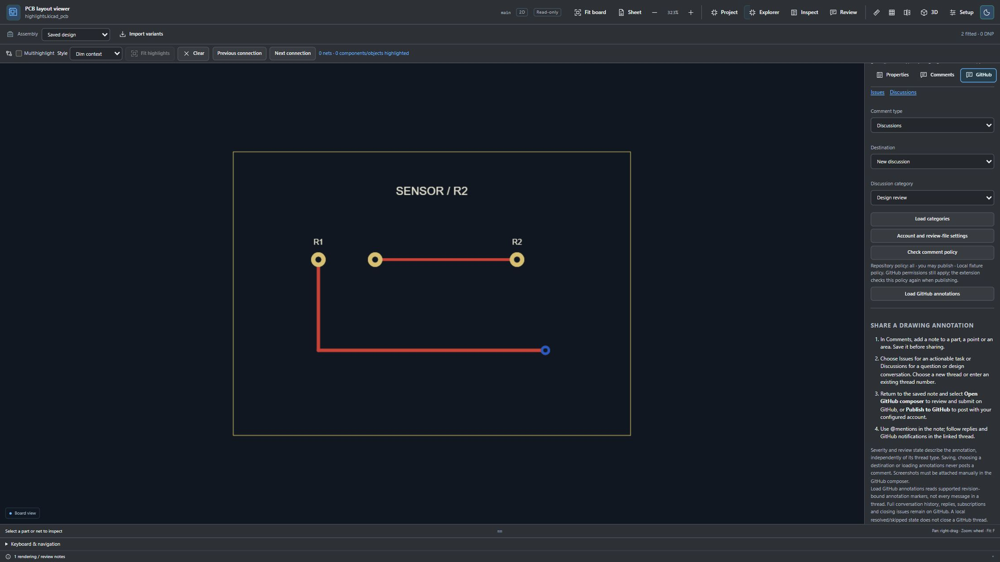
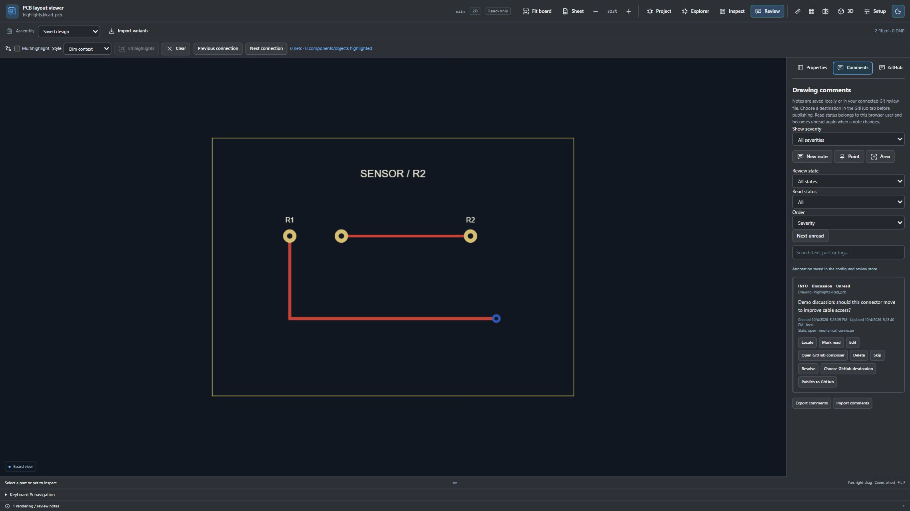

# Using GitHub integration

The browser extension lets you inspect a public KiCad design and attach a local review note to a part, a point, or a selected drawing area. You can keep notes in browser storage or a Git-tracked review file, then explicitly publish a note as an Issue or Discussion. Opening a design, saving a note, choosing a destination, and loading annotations never posts to GitHub by themselves.

The screenshots below show the real viewer UI in a local harness with mocked repository data and policy responses. They are workflow examples; no GitHub issue, discussion, or comment was created for them.

## Open and inspect a drawing

Install and enable a supported browser build as described in [INSTALL.md](../INSTALL.md), grant it access to `github.com`, and open a public repository file ending in `.kicad_sch` or `.kicad_pcb`. The viewer renders the saved file in a read-only drawing canvas. A personal access token with repository access can also authorize file and metadata reads for a private repository. Private pull-request comparison and private-repository annotation readback are not supported. Use **Show source** to return to the file text and **Open full viewer** or **Pop out** when you need more space.

Use **Explorer** to move among loaded schematic sheets, parts, nets, layers, search results, BOM, and saved ERC/DRC reports. Search can filter design objects and project files; selecting a result locates it in the drawing. Select a footprint or symbol to view its saved properties in **Inspect**. For PCBs, highlight nets or net classes, change visible layers, and use the connection controls to step through connected objects. The renderer displays saved data; it does not edit the KiCad source or run native ERC/DRC checks.

For a paired schematic and PCB review, use **Split schematic + PCB** and select the counterpart from the same directory or enter its repository path. To compare revisions, open the Git revisions controls, select branches or commits, and inspect the base/head drawings and **Changes** list. The comparison reports saved-object differences and properties; it does not establish electrical equivalence.

Double-click a sheet symbol to open it. Back, Forward, Up and Root navigate the loaded hierarchy. `E` opens selected-object properties, `F` fits the drawing, and `Home` fits the sheet. Nested `SubSheets/` paths retain their repository location and case.

Use search's wildcard or regular-expression mode when needed. Enable **Multihighlight** to accumulate components, nets or net classes, then use **Fit highlights**, the connection navigation buttons or **Clear**. Layer focus dims unrelated geometry; the live snapped ruler measures saved drawing coordinates.

These shared-view screenshots also use the local preview fixtures described in [image provenance](../images/README.md).

## Connect a GitHub account

Open **Review → GitHub → Account and review-file settings**. Choose public access, or public and private access if needed, then select **Sign in with GitHub**. GitHub supplies a device code to approve on its own website; the extension waits for that approval. Private access requests the broad `repo` scope, which includes read/write access. A fine-grained manual token can restrict access to selected repositories instead.

The publisher must configure a registered GitHub OAuth App client ID with Device Flow enabled before device sign-in can start; this release does not arrive with a ready-to-use OAuth client ID. The screenshot shows that prerequisite, not a successful connection. See [publisher sign-in setup](../GITHUB-SIGNIN.md). Advanced connection settings provide these fallbacks:

- A custom registered OAuth App client ID with Device Flow enabled. Sign-in requests `public_repo` or `repo` according to the access selector.
- A GitHub personal access token with access to the repositories you review. Issue and pull-request posts need Issues write permission. Discussions need permission to use Discussions through GraphQL.

Tokens are encrypted with a temporary background-memory key and excluded from exports, the sidecar and host page scripts. Background restart requires sign-in again; sessions last at most eight hours. **Sign out** purges credentials and cancels pending login. **Reset GitHub connection** also clears the custom public client ID. Uninstall removes local credentials; revoke GitHub authorization separately if needed. See [security boundaries](../../SECURITY.md). Repository permissions and review policy still apply.

This earlier screenshot illustrates the advanced configuration fields before they were collapsed in v0.11.7; it is not a connected-account result. Its fields are intentionally blank. Never copy a real token into a screenshot, issue, or review export.

## Add a local annotation

Open **Review → Comments**. Choose **New note** to anchor to the selected object or current drawing. Choose **Point**, then click the drawing to place a precise anchor; choose **Area**, then drag a rectangle to mark a region. For a note attached to an area, **Capture area** stores a PNG of the visible drawing region. Captures omit viewer controls and overlays. A capture can be downloaded from the saved note; attach it manually in the GitHub composer if the remote thread needs the image.

Enter the note text and optional metadata, then select **Save draft**. Text is limited to 4,000 characters. Choose a severity (Info, Minor, Major, Critical), state (Open, Skipped, Resolved, or Won't fix), comma-separated tags (up to 20, each at most 40 characters), and `@login` mentions (up to 20 valid GitHub-style logins). Mentions are included in the posted text when publishing, but saving a local note does not notify those users.

Created and updated timestamps are generated by the extension in UTC and shown in your local time zone. Edits and state changes update the modification time. Read/unread status is separate from review state: it is stored per browser user, and a changed note becomes unread again. Filter by severity, review state, and read status; search the note text, part, or tag; sort by severity, creation time, or last update. **Next unread** locates the next note matching those filters.

### Keep notes in Git

In Chromium browsers with the extension's file picker support, open extension **Options → Git-tracked review file** and connect or create `.kicad-review.json` in your checkout. The browser asks for read/write file access. The selected file stores notes and confirmed GitHub links; credentials never enter it. Stage and commit the file yourself. Browser-local drafts are not moved into it automatically: export and import them if needed. The browser may ask to renew file permission after restart. See [review comment details](../COMMENTS.md#where-notes-are-stored) for bounds and conflict behavior.

Use **Export comments** to download portable JSON, or **Import comments** to load a JSON export into the current repository/revision/drawing. The viewer checks that imported notes match the current provider, repository, revision, and a loaded drawing. This is the portability path for Firefox and Safari builds where Chromium's local file-sidecar picker is unavailable. Firefox's current package is temporarily installed and has not had installed-browser visual acceptance; see [Firefox setup](../FIREFOX.md). Safari packaging and installed-browser acceptance are still limited; see [Safari setup](../SAFARI.md).

## Post directly from the note editor

The comment form now includes **Thread type**, **Destination**, **Thread title** or **Thread number**, and a category selector for new Discussions. Choose Issue or Discussion here, then click **Post to GitHub** to create the selected thread or add your review to its existing thread number. **Save draft** keeps the note without posting. The separate GitHub tab remains useful for saved notes, policy checks and linked conversations.

**Preview GitHub Markdown** shows the formatted review text and design-context table before transmission. Posted fields include severity, state, source revision/file link, object or area, tags, mentions and times. A successful request records the returned GitHub thread link. Failed publication leaves an editable draft; no automatic retry is made. This screenshot uses mocked repository/category data and does not show a live publication.

Authorized private Issue/Discussion publication is supported when the connected account has write permission and Contents read access for policy verification. Private annotation readback and private PR comparison remain unavailable.

## Choose an Issue or Discussion

Open **Review → GitHub**. Select **Issues** for an actionable task or **Discussions** for a question or design conversation. Then choose a destination:

- **New issue** or **New discussion** creates a thread. For a new discussion, select **Load categories**, then choose a category.
- **Existing issue** or **Existing discussion** adds a comment to that thread; enter its positive thread number.
- On a pull-request file page, the Issues type also offers **This pull request #…** as a destination.

Save the note before sharing. A note remembers whether it is for Issues or Discussions; the selected destination must match that type. Review **Check comment policy** and the displayed permission status before publishing.

The note text, severity, state, tags, mentions, timestamps, repository, revision, file, and any object/location anchors are included in the shared Markdown. The extension adds a hidden `kicad-review:v1` marker so compatible viewers can recognize the annotation on later readback. PNG data is not sent through the API; download and attach it yourself.

## Publish or use the GitHub composer

After saving, return to **Comments** and choose the note's **Publish to GitHub** button to post using the configured account. A confirmed post saves the GitHub thread link to the note. Or choose **Open GitHub composer** to open a prefilled GitHub form; inspect it and submit it yourself. The composer is not submitted automatically.

If GitHub may have accepted a post but the extension did not receive confirmation, the publication is left pending to avoid a duplicate. Inspect GitHub before attempting another post. There is no in-extension reset control for an ambiguous result. A confirmed publication can be retried safely to recover its saved receipt.

This screenshot shows a saved draft and the available actions in the mocked viewer. It does not show a successful remote post. A successful note displays its linked GitHub thread. The note's Resolve, Skip, and other local state controls do not close or update the GitHub thread; replies, subscriptions, and issue closure remain on GitHub.

## Read existing annotations

Choose **Load GitHub annotations** in the GitHub tab to scan public issue and pull-request bodies. The extension matches only valid `kicad-review:v1` annotations for the exact repository, revision, and file. It scans at most 200 recent issues/pull requests and up to 100 comments on a selected thread. Annotation readback uses GitHub's unauthenticated public API; API limits or older threads can make results incomplete. Discussion readback and ordinary unmarked GitHub messages are not supported; the full conversation remains on GitHub. See [the detailed integration notes](../COMMENTS.md#reading-existing-github-annotations).

## Other Git providers and editors

On public GitLab.com repositories, the viewer supports local notes and JSON import/export, but no GitLab account connection, issue/merge-request posting, remote readback, or GitLab-linked sidecar. Use GitLab's own website to create or reply to an issue manually and copy the note text yourself. The browser extension does not open a prefilled GitLab composer.

VS Code notes save through the workspace and can use a workspace `.kicad-review.json` file, but the VS Code viewer does not offer GitHub account setup or direct publishing. The browser extension is required for the GitHub publishing workflow described here.
