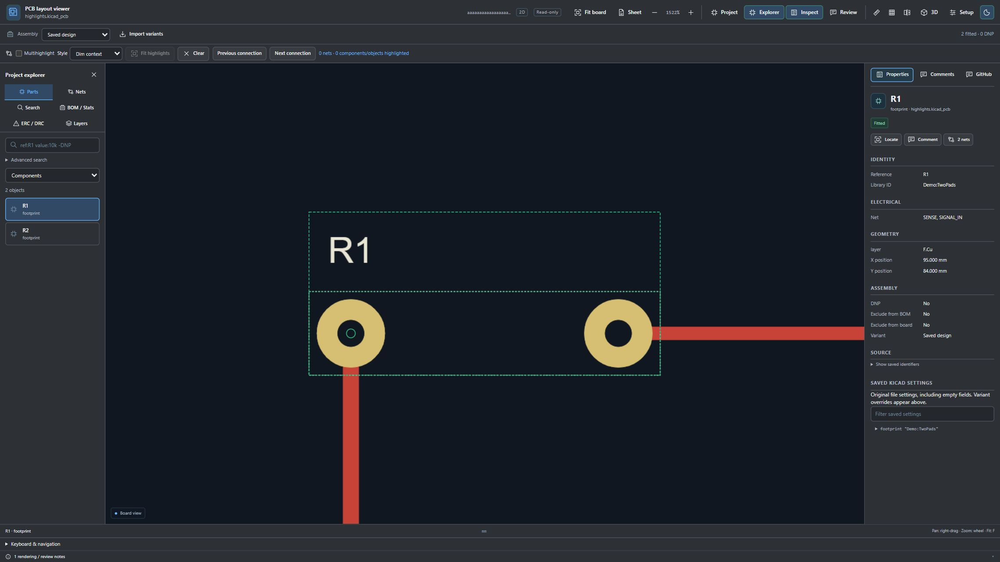
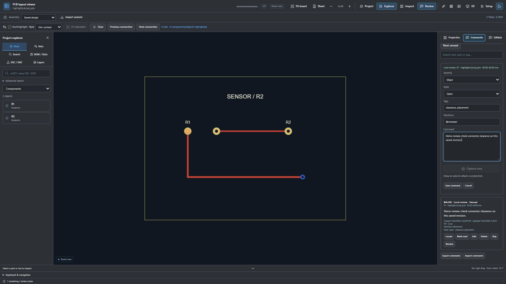
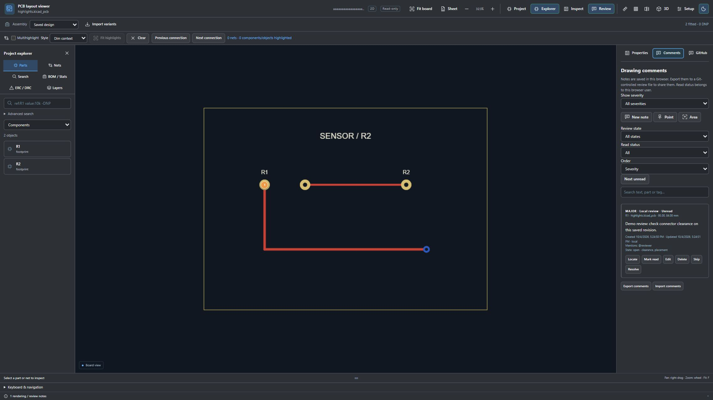

# Using GitLab integration

Starting with v0.12.0, the browser extension supports public and authorized private GitLab projects, explicitly approved self-hosted HTTPS servers, and publishing drawing reviews to issues or discussion threads within existing issues. The design stays read-only.

The screenshots below come from the actual shared viewer in a local harness with fixture files and mocked Git metadata. They are illustrative screenshots from earlier local-review builds; they do not demonstrate live private access, OAuth approval or remote posting. The current release adds GitLab account/publication controls described below. Do not treat the images as proof that a live GitLab issue was created.

## 1. Install and choose your server

Install your browser's package as described in [INSTALL.md](../INSTALL.md), reload it and refresh an existing repository file tab. GitLab.com is built in. For a self-hosted server, open Options → **GitLab accounts and servers**, enter an exact HTTPS origin such as `https://gitlab.example.com`, choose **Grant server access**, and approve the browser permission prompt. Select the server before connecting an account. Instances hosted under a URL subpath such as `https://example.com/gitlab` and merge-request file cards are not supported.

Public viewing needs no login. Private viewing requires an extension credential with access to that project; being signed into the GitLab website alone is insufficient. Enter an expiring token and choose **Connect with token**. `read_api` may suffice for private reads; posting needs `api` and project permissions. Never put tokens into issue text, screenshots or review JSON.

To use OAuth, expand **Sign in with GitLab OAuth**. Follow the selected server's registration link, create a **non-confidential** application, copy the exact **Browser redirect URI** shown in Options, enable `api` scope, and enter its **Public Application ID**. Then choose **Sign in with GitLab** and approve access on GitLab. PKCE and random state protect this flow; no client secret is used. No publisher Application ID is bundled, and the browser redirect URI can differ between installations. If the browser identity API is unavailable, including some Safari builds, use the token connection.

Tokens are encrypted separately for each server with keys kept only in memory. Supported Chrome sessions retain keys through background idle; browser restart, extension reload or key-worker loss requires reconnection. Other browsers also lose sessions on background restart. Sessions expire within eight hours or the provider's shorter limit. Sign-out/reset purge credentials; reset also clears the custom Application ID. Removing a server also removes its preview registration and permission. Local notes remain. Revoke remote access separately in that server's account settings. See [security details and live-browser verification limits](../../SECURITY.md).

## 2. Open and inspect a project

Open a `.kicad_sch`, `.kicad_pcb` or supported project file under the repository **Files** page, including subgroup namespaces. The extension obtains explicit project/ref/file metadata and resolves references to commit SHAs. Missing metadata, unavailable permissions and oversized files are reported rather than guessed. A private 404 can conceal denied access.

Use **Explorer** to select parts, nets, layers, sheets and search results, and **Inspect** to read saved properties. Multihighlight can retain several selections. For schematics, use Back, Forward, Up and Root, or double-click a loaded sheet symbol. `E` opens properties, `F` fits the drawing and `Home` fits the worksheet. Preserve nested file paths when opening paired files.

Use **Split schematic + PCB** for paired drawings and **Git revisions** for branch/commit comparison. Setup, saved stackup, BOM/statistics and supported repository-linked WRL/GLB models use the shared renderer. Missing models are diagnosed; STEP import is unavailable.

## 3. Anchor and prepare your review

Open **Review → Comments**. **New note** anchors to the selected part or drawing. **Point** lets you click a location; **Area** lets you drag a rectangle. **Capture area** captures visible drawing content as a PNG, excluding viewer controls. The image remains in the local/exported note until you download and manually attach it.

Set severity (Info, Minor, Major, Critical), local state (Open, Skipped, Resolved, Won't fix), tags, `@mentions`, and review text. Notes support up to 4,000 characters, twenty tags and twenty account mentions. GitLab usernames with underscores or dots are supported. Local mentions send no notification.

## 4. Publish an Issue or Discussion

The current editor offers **Post to GitLab**:

| Choice | Destination | Required input |
| --- | --- | --- |
| Issue → New issue | Creates a project issue containing the formatted review | Issue title |
| Issue → Existing issue | Adds a note to the issue | Existing issue number |
| Discussion | Creates a discussion thread inside an existing issue | Existing issue number |

GitLab discussions are issue conversation threads, not standalone GitHub-style Discussions. There is no GitHub category selector. **Preview GitLab Markdown** displays the review heading and context table with severity/state, component or net, geometry, variant, repository, revision permalink, identifiers, tags, mentions and UTC times. **Save draft** saves locally without posting. **Post to GitLab**, or **Publish to GitLab** on a saved note, explicitly submits the review with your connected account and records the confirmed remote link.

A failed post preserves the draft. An uncertain outcome blocks automatic retry to prevent duplicates: inspect the GitLab issue before trying again. Confirmed publications recover their saved receipt. Use the linked issue to reply, subscribe and follow notifications. Actual posted mentions notify users according to GitLab's permissions and behavior. Download the screenshot and attach it through GitLab's normal editor; API publication excludes PNG data.

## 5. Read annotations and manage policy

Open the **GitLab** collaboration tab, select an existing issue destination and enter its issue number, then choose **Load GitLab annotations**. The extension scans the description and at most 500 notes for its validated annotation markers. Markers must match the exact server, project, revision and drawing. Ordinary messages are not converted into drawing notes. Complete conversations remain on GitLab. Local review state and remote issue state are separate; resolving or skipping a local note does not close an issue or edit the original post.

Repository owners can add `.kicad-review-policy.json` on the default branch. Use `all`, `collaborators` or an explicit `allowlist` as appropriate; malformed/unverifiable policies block publication. Contributors-only mode fails closed without verifiable account membership or an explicit allowlist because commit emails do not prove authorship. Policy is a check on this extension's publishing workflow, not a replacement for GitLab's access controls or a way to prevent users posting directly on the website. See [policy format and comment details](../COMMENTS.md).

## 6. Share the Git review record

Choose **Export comments** to save `kicad-review-comments.json`, then commit it through normal Git tools if desired. **Import comments** checks provider, HTTPS host, project, revision and drawing; records from another context are rejected. Import/export is bounded to 100 notes and 1 MiB. GitLab uses browser-local storage and exports rather than the connected GitHub `.kicad-review.json` file workflow. Notes do not synchronize between users automatically, and saving an export does not commit or push it.

See [Git host boundaries](../GIT-HOSTS.md), [Firefox](../FIREFOX.md), [Safari](../SAFARI.md), and [release notes](../releases/v0.12.0.md). Browser packages remain development/preview releases; live account approval, installed-browser lifecycle and signed-store distribution require separate acceptance testing.
